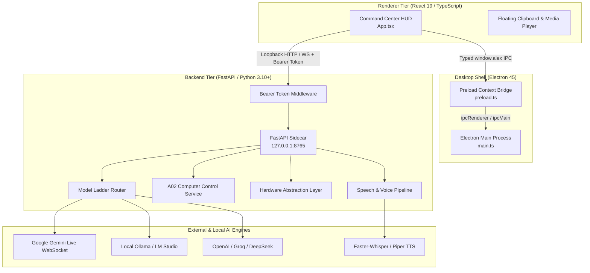
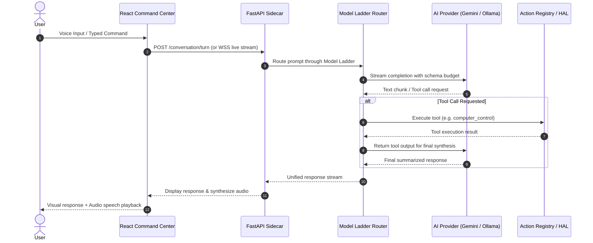
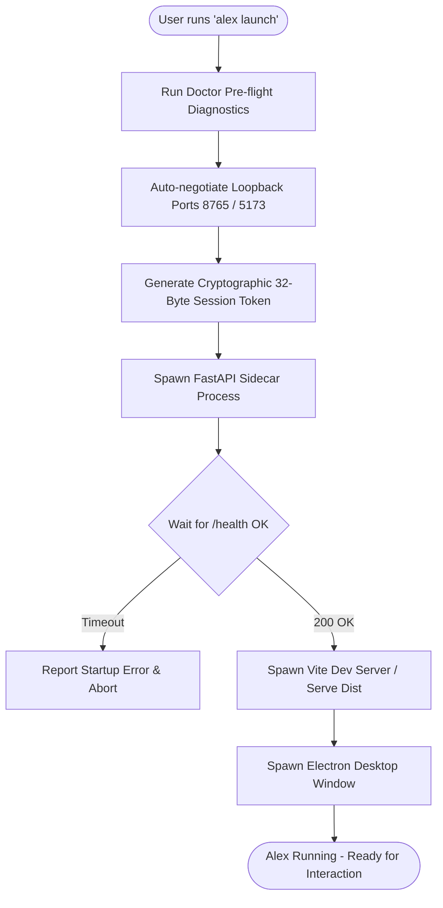

# Alex AI Desktop Assistant

[](docs/development/TESTING.md)
[](backend/)
[](frontend/)
[](frontend/electron/)
[](LICENSE)

**Alex** is a professional, secure, enterprise-grade AI desktop assistant and autonomous command center. Originally evolved from the `Mark-LVI` prototype, Alex re-architects the personal desktop assistant paradigm around a decoupled, crash-resilient **Three-Tier Architecture**: a high-performance **FastAPI (Python 3.10+)** backend sidecar, an interactive **React 19 & TypeScript** holographic command-center HUD, a strictly sandboxed **Electron 45** desktop container, and a **Unified CLI Launcher** for cross-platform orchestration across Windows, macOS, and Linux.

---

## Table of Contents

1. [Project Title & Introduction](#1-project-title--introduction)
2. [Application Overview](#2-application-overview)
3. [Key Features](#3-key-features)
4. [Feature Implementation Status](#4-feature-implementation-status)
5. [Screenshots / Interface Overview](#5-screenshots--interface-overview)
6. [Technology Stack](#6-technology-stack)
7. [System Requirements](#7-system-requirements)
8. [Project Architecture](#8-project-architecture)
9. [Repository Structure](#9-repository-structure)
10. [Application Modules](#10-application-modules)
11. [Complete Feature Documentation](#11-complete-feature-documentation)
12. [AI Assistant Architecture](#12-ai-assistant-architecture)
13. [AI Providers & Model Integrations](#13-ai-providers--model-integrations)
14. [Voice & Audio Capabilities](#14-voice--audio-capabilities)
15. [System Monitoring](#15-system-monitoring)
16. [File & Screen Management](#16-file--screen-management)
17. [UI & Navigation](#17-ui--navigation)
18. [API Documentation](#18-api-documentation)
19. [External Integrations](#19-external-integrations)
20. [Application Workflows](#20-application-workflows)
21. [Security & Permissions](#21-security--permissions)
22. [Environment Variables](#22-environment-variables)
23. [Installation & Setup](#23-installation--setup)
24. [Development Guide](#24-development-guide)
25. [Production Build & Deployment](#25-production-build--deployment)
26. [Testing](#26-testing)
27. [Troubleshooting](#27-troubleshooting)
28. [Known Limitations](#28-known-limitations)
29. [Roadmap / Planned Features](#29-roadmap--planned-features)
30. [Contributing Guidelines](#30-contributing-guidelines)
31. [License](#31-license)

---

## 1. Project Title & Introduction

Alex AI Desktop Assistant is an advanced multimodal artificial intelligence assistant engineered for deep operating system integration, autonomous task execution, and real-time natural language interaction.

By pairing modern cloud intelligence (**Google Gemini Live WebSocket streaming**, OpenAI, Groq, DeepSeek) with private offline engines (**Ollama**, **LM Studio**, **Faster-Whisper**, **Piper Neural TTS**, **OpenWakeWord**), Alex delivers uninterrupted productivity, conversational intelligence, and hands-free computer control without compromising user privacy or workstation stability.

---

## 2. Application Overview

- **Primary Goal:** Provide a responsive, multi-modal autonomous command center that can execute desktop tasks, manage system settings, monitor hardware health, process complex documents, transcribe audio, synthesize speech, and interact naturally via voice and text.
- **Target Audience:** Developers, power users, researchers, and system administrators requiring an intelligent, local-first AI assistant capable of interacting with their workstation environment safely.
- **Operating Modes:**
  1. **Full Desktop Mode:** Electron desktop shell wrapping the React HUD with native system hooks, keyboard shortcuts, screen recording, and tray integration.
  2. **Browser / Web-Only Mode:** Standalone web application served over loopback HTTP (`launch --no-electron`), accessible via any modern browser.
  3. **Headless Backend Mode:** REST and WebSocket sidecar service (`--backend-only`) for programmatic integration, background agents, or remote companion clients.
  4. **Mobile Companion Mode:** Encrypted LAN gateway pairing mobile devices (iOS app and responsive Web Companion) for remote approvals, mobile voice streaming, and telemetry.

---

## 3. Key Features

- **Holographic Command Center HUD:** Futuristic dark cyan continuous workspace featuring a compact Top HUD with minimal live hardware telemetry, dynamic responsive avatar positioning, independent floating workspace windows, and glassmorphic control drawers.
- **Independent Floating HUD Workspace:** Dedicated floating workspace window (`HUDWorkspaceWindow`) supporting in-canvas YouTube playback, music player with audio visualizer, PDF viewer, multi-format document viewer, image viewer, and browser workspace.
- **Dynamic Avatar Positioning:** Adaptive avatar engine that remains centred during idle standby and transitions smoothly to the extreme bottom-right corner when content is opened.
- **Voice-Controlled Workspace Navigation:** Hands-free voice commands to open, play, pause, resume, minimize, restore, and close active workspace windows.
- **Full-Duplex Gemini Live Voice:** Low-latency bidirectional voice interaction with natural speech interruption, multiple vocal personas, and live transcription.
- **A02 Computer Control (Failsafe Hardened):** Coordinate-validated mouse and keyboard automation featuring multi-monitor boundary enforcement, emergency corner abort triggers, rate-limited injection, and human-in-the-loop confirmation modals.
- **Multi-Engine Model Ladder:** Dynamic intelligent routing between Gemini Live, Ollama, LM Studio, OpenAI, Groq, and DeepSeek, with automatic token schema budgeting and reasoning token stripping.
- **Hardware Abstraction Layer (HAL):** Native platform adapters for Windows (Win32), macOS (AppleScript / Quartz), and Linux (X11 / EWMH / Wayland passive).
- **Embedded HUD Media Player & YouTube Player:** Direct embedded YouTube streaming and `yt-dlp` stream extraction with glowing playback controls, timecode tracking, and audio level warning.
- **OpenCV Vision & Hardware Camera:** Real-time webcam frame acquisition (`opencv-python 5.0+`), optical scene inspection, and visual reasoning.
- **Document & File Workspace:** Multi-format file parsing (`.pdf`, `.docx`, `.xlsx`, `.pptx`, `.txt`, `.csv`, `.json`, `.py`, `.md`) with automated token estimation and summarization.
- **OS Native Scheduled Reminders:** Cross-platform persistent reminder scheduling via macOS `launchd`, Linux `cron`, and Windows `Task Scheduler`.
- **Background Topic Monitor:** Periodic headless DuckDuckGo news extraction and keyword alert generation.
- **Floating Clipboard Intelligence:** Global copy listener with quick-action modal for instantaneous text translation, code explanation, and bug fixing.
- **Desktop Environment Management:** Wallpapers manager, desktop file hygiene organizer, and system settings control (volume, brightness, power state).
- **Enterprise Security Boundary:** Three-tier trust isolation, loopback-only binding (`127.0.0.1`), per-session 32-byte cryptographically secure Bearer tokens, and OS keyring storage (zero plaintext secrets).

---

## 4. Feature Implementation Status

| Feature / Subsystem | Implementation Status | Core Source Files | Primary Tests |
| :--- | :--- | :--- | :--- |
| **Electron Desktop Shell** | **Fully Implemented** | `frontend/electron/main.ts`, `preload.ts` | `electron-security.test.ts`, `screenCapture.test.ts` |
| **Unified Continuous HUD Workspace** | **Fully Implemented** | `frontend/src/App.tsx`, `index.css` | `App.test.tsx` (17 tests) |
| **Minimal System Monitor** | **Fully Implemented** | `frontend/src/components/SystemMonitor.tsx` | `App.test.tsx`, `HUDWorkspace.test.tsx` |
| **Independent Floating Workspace** | **Fully Implemented** | `frontend/src/components/workspace/HUDWorkspaceWindow.tsx` | `HUDWorkspaceWindow.test.tsx` (10 tests) |
| **Dynamic Avatar Positioning** | **Fully Implemented** | `frontend/src/components/HudAvatar.tsx`, `useAvatarPosition.ts` | `HudAvatar.test.tsx` (11 tests) |
| **Universal Content Viewers** | **Fully Implemented** | `frontend/src/components/workspace/` | `HUDWorkspace.test.tsx` (5 tests) |
| **Voice-Controlled HUD Workspace** | **Fully Implemented** | `frontend/src/utils/workspaceCommands.ts` | `VoiceControlledWorkspace.test.tsx` (8 tests) |
| **Unified CLI Launcher** | **Fully Implemented** | `launcher/cli.py`, `bin/alex.js` | `test_launcher.py` |
| **FastAPI Backend Sidecar** | **Fully Implemented** | `backend/app/main.py`, `api/routes.py` | `test_api.py`, `test_sidecar.py` |
| **Gemini Live Multimodal Voice** | **Fully Implemented** | `services/live_voice_service.py` | `test_live_voice_service.py` |
| **Model Ladder & Schema Budget** | **Fully Implemented** | `services/model_ladder_service.py`, `providers/` | `test_model_ladder_service.py`, `test_schema_budget.py` |
| **Local LLMs (Ollama / LM Studio)** | **Fully Implemented** | `providers/ollama_provider.py`, `lm_studio_provider.py` | `test_ollama_provider.py`, `test_lm_studio_provider.py` |
| **Cloud Providers (Groq / DeepSeek)**| **Fully Implemented** | `providers/groq_provider.py`, `deepseek_provider.py` | `test_cloud_providers.py` |
| **A02 Computer Control Engine** | **Fully Implemented** | `services/computer_control_service.py` | `test_computer_control_service.py` |
| **Hardware Abstraction Layer (HAL)** | **Fully Implemented** | `services/adapters/win32_window_adapter.py`, etc. | `test_win32_adapter.py`, `test_macos_adapter.py`, `test_linux_adapter.py` |
| **GPU Telemetry (NVML)** | **Fully Implemented** | `services/adapters/nvml_adapter.py` | `test_nvml_adapter.py` |
| **Speech-to-Text (Faster-Whisper)** | **Fully Implemented** | `services/speech_service.py` | `test_speech_service.py` |
| **Text-to-Speech (Piper & System)** | **Fully Implemented** | `services/tts_service.py`, `system_tts_adapter.py` | `test_tts_service.py` |
| **ElevenLabs Multilingual Streaming** | **Fully Implemented** | `services/elevenlabs_service.py` | `test_elevenlabs_service.py` |
| **Local Wake-Word ("Hey Alex")** | **Fully Implemented** | `services/wake_word_service.py` | `test_wake_word_service.py` |
| **Document Deep Parser** | **Fully Implemented** | `services/document_parser_service.py` | `test_document_parser.py` |
| **Embedded HUD Media Player** | **Fully Implemented** | `services/media_service.py`, `VideoPlayer.tsx` | `test_media_service.py`, `VideoPlayer.test.tsx` |
| **OpenCV Vision Service** | **Fully Implemented** | `services/vision_service.py` | `test_vision_service.py` |
| **YouTube Transcript Extraction** | **Fully Implemented** | `services/youtube_transcript_service.py` | `test_youtube_transcript_service.py` |
| **OS Scheduled Reminders** | **Fully Implemented** | `services/os_scheduler_adapter.py`, `reminder_service.py` | `test_os_scheduler_adapter.py` |
| **Topic Monitor (DuckDuckGo)** | **Fully Implemented** | `services/topic_monitor_service.py` | `test_topic_monitor_service.py` |
| **Floating Clipboard Intelligence** | **Fully Implemented** | `FloatingClipboardPanel.tsx` | `FloatingClipboardPanel.test.tsx` |
| **Desktop Hygiene & Wallpaper** | **Fully Implemented** | `services/desktop_environment_service.py` | `test_desktop_environment_service.py` |
| **WhatsApp / Telegram Messaging** | **Fully Implemented** | `services/messaging_service.py` | `test_messaging_service.py` |
| **Mobile Gateway & Web Companion** | **Fully Implemented** | `api/routes.py`, `frontend/mobile/` | `test_mobile_action_approvals.py`, `test_mobile_upload.py` |
| **iOS Companion Client** | **Implemented (SwiftUI)**| `frontend/mobile/ios/` | Architecture Verified |
| **Browser Control & Web Search** | **Fully Implemented** | `services/browser_control_service.py`, `web_search_service.py` | `test_browser_control_service.py`, `test_web_search_service.py` |
| **Dev Agent & Code Helper** | **Fully Implemented** | `services/dev_agent_service.py`, `code_helper_service.py` | `test_dev_agent_service.py`, `test_code_helper_service.py` |
| **Proactive Suggestions Engine** | **Fully Implemented** | `services/proactive_service.py` | `test_proactive.py` |
| **Flight Finder & Game Updater** | **Fully Implemented** | `services/flight_finder_service.py`, `game_updater_service.py` | `test_flight_finder.py`, `test_game_updater.py` |

---

## 5. Screenshots / Interface Overview

```text
┌────────────────────────────────────────────────────────────────────────────────────────────────────────┐
│ [+] ALEX CORE  [Setup] [Controls]   SYSTEM MONITOR: CPU 24% | RAM 42% | NET ● | AI ●   12:45:00 | NOV 13│
├────────────────────────────────────────────────────────────────────────────────────────────────────────┤
│                                         MAIN HUD WORKSPACE                                             │
│                                                                                                        │
│         ┌─────────────────── FLOATING WORKSPACE WINDOW ────────────────────┐                           │
│         │ [▶] YouTube Player / Music / PDF / Document / Browser     [_][□][✕]│                          │
│         ├──────────────────────────────────────────────────────────────────┤                           │
│         │                                                                  │                           │
│         │              Embedded Media / Document / Web Content             │                           │
│         │                                                                  │                           │
│         │  ◄◄   [ ▶ / ❚❚ ]   ►►   ━━━━━━━●────────────   [🔊 80%]   [ ⛶ ]  │                           │
│         └──────────────────────────────────────────────────────────────────┘                           │
│                                                                                                        │
│                                                                                 ┌─────────┐            │
│                                                                                 │ DYNAMIC │            │
│                                                                                 │ AVATAR  │            │
│                                                                                 │ (CORNER)│            │
│                                                                                 └─────────┘            │
├────────────────────────────────────────────────────────────────────────────────────────────────────────┤
│ ALEX DESKTOP ASSISTANT v0.1.0  •  LOCAL LOOPBACK 127.0.0.1:8765  •  HUD WORKSPACE: ACTIVE             │
└────────────────────────────────────────────────────────────────────────────────────────────────────────┘
```

The redesigned ALEX interface is structured as a unified, continuous command-center workspace:
- **Top HUD:** Compact horizontal header with ALEX branding, drawer controls, minimal live system telemetry (CPU %, RAM %, Network, Backend, AI Engine, and Voice status indicators), and UTC clock.
- **Main HUD Workspace:** One continuous holographic workspace eliminating restrictive three-partition sidebars.
- **Independent Floating HUD Window (`HUDWorkspaceWindow`):** Centered floating workspace window supporting media playback, documents, PDFs, images, and browser pages with minimize, restore, and close controls.
- **Dynamic Avatar Positioning:** The holographic avatar remains horizontally and vertically centered during normal mode, and automatically moves to the extreme bottom-right corner when content is active, scaling down proportionally while preserving full animations.

---

## 6. Technology Stack

### Frontend & Desktop
- **Framework:** React 19 (`^19.1.0`), React DOM 19
- **Language:** TypeScript 5.8 (`^5.8.3`)
- **Desktop Shell:** Electron 45 (`^45.1.0`)
- **Build Tool:** Vite 6 (`^6.3.5`)
- **Styling:** Tailwind CSS 4 (`^4.1.11`) with custom glassmorphism and command-center variables
- **Testing:** Vitest 5 (`^5.0.5`), `@testing-library/react` (`^16.3.0`), jsdom (`^26.1.0`) — **183 tests across 25 suites**
- **Packaging:** Electron Builder (`^26.0.12`)

### Backend Sidecar
- **Web Framework:** FastAPI (`0.115+`), Uvicorn (`0.34+`), Starlette
- **Data Validation:** Pydantic v2 (`2.10+`), Pydantic-Settings (`2.7+`)
- **Operating System Security:** Keyring (`25+`) (Windows Credential Vault, macOS Keychain, Linux Secret Service)
- **AI Integrations:**
  - Google GenAI SDK (`google-genai 1.30+`)
  - OpenAI-compatible REST SDK (`httpx 0.28+`)
  - Faster-Whisper (`1.0+`) & CTranslate2 (`4.0+`)
  - Piper Neural TTS (`1.2+`)
  - OpenWakeWord (`0.6+`)
- **Vision & Hardware Camera:** OpenCV (`opencv-python 5.0+`) for real-time camera capture & device probing
- **Automation & OS Control:** PyAutoGUI (`0.9.54+`), PyPerclip, Pillow, psutil (`5.9+`)
- **Media & Document Processing:** yt-dlp, pypdf (`4.0+`), python-docx (`1.1+`), openpyxl (`3.1+`), python-pptx (`0.6+`)
- **Cryptography & Mobile:** cryptography (`42.0+`), qrcode (`7.4+`)
- **Test Framework:** pytest (`8.3+`), pytest-asyncio — **518 passing tests across 34 suites**

---

## 7. System Requirements

### Hardware Requirements
- **Processor:** 64-bit multi-core CPU (Intel Core i5/i7/i9 8th gen+, AMD Ryzen 3000+, or Apple Silicon M1-M4).
- **RAM:** Minimum 8 GB RAM (16 GB recommended for running local models like Ollama or Whisper).
- **Disk Space:** 3 GB free disk space (additional space required if downloading local LLM weights or Whisper models).
- **Display:** Recommended minimum resolution 1920x1080 at 100% display scaling.
- **Audio:** Microphone input (16kHz PCM compatible) and stereo speakers/headphones.

### Software Prerequisites
- **Operating System:**
  - **Windows:** Windows 10 or 11 (64-bit, Build 19045+)
  - **macOS:** macOS 14 Sonoma or macOS 15 Sequoia (Apple Silicon & Intel)
  - **Linux:** Ubuntu 22.04 LTS or 24.04 LTS (X11 session recommended for computer control)
- **Runtimes:**
  - **Python:** 3.10, 3.11, 3.12, 3.13, or 3.14 (64-bit)
  - **Node.js:** Node.js 18.0.0+ (LTS 20 or 22 recommended) with `npm`

---

## 8. Project Architecture

Alex employs an authenticated, three-tier decoupled architecture:



### Communication Protocols
- **Renderer to Electron:** Strongly-typed IPC bridge via `window.alex` (defined in `preload.ts`). `contextIsolation` is enabled and `nodeIntegration` is disabled.
- **Renderer to Backend Sidecar:** Direct loopback HTTP/REST and WebSockets over `http://127.0.0.1:8765`. Every request must present an `Authorization: Bearer <token>` matching the launcher's ephemeral 32-byte secret.
- **Backend to Operating System:** Formal Hardware Abstraction Layer (HAL) dispatching to Win32 API, macOS AppleScript/Quartz, or Linux X11/EWMH.

---

## 9. Repository Structure

```text
ALEX-AI-main/
├── bin/                          # Unified executable entry points
│   └── alex.js                   # Node.js CLI forwarding wrapper
├── alex                          # Unix shell launcher script
├── alex.cmd                      # Windows batch launcher script
├── package.json                  # Root npm workspace configuration
├── .env.example                  # Comprehensive environment template
├── AGENTS.md                     # AI agent operational guidelines
├── CONTRIBUTING.md               # Developer contributing guidelines
├── LICENSE                       # Project license (CC BY-NC 4.0)
│
├── launcher/                     # Unified CLI Process Orchestrator
│   ├── __main__.py               # CLI execution entry
│   ├── cli.py                    # Command dispatch (launch, stop, status, doctor)
│   ├── backend_manager.py        # FastAPI sidecar process supervisor
│   ├── frontend_manager.py       # Vite dev server process supervisor
│   ├── electron_manager.py       # Electron desktop shell supervisor
│   ├── doctor.py                 # Pre-flight environment diagnostics
│   ├── environment.py            # Port auto-negotiation and token generation
│   └── shutdown_manager.py       # Safe tree termination
│
├── backend/                      # Python FastAPI Backend Sidecar
│   ├── requirements.txt          # Python dependencies manifest
│   ├── app/
│   │   ├── main.py               # Application factory & action registry
│   │   ├── api/
│   │   │   └── routes.py         # REST & WebSocket API endpoints
│   │   ├── core/
│   │   │   ├── config.py         # Runtime configuration settings
│   │   │   ├── security.py       # Loopback token authentication middleware
│   │   │   ├── storage.py        # SQLite / JSON document persistence
│   │   │   └── lazyimport.py     # Cold-start dependency deferral
│   │   ├── providers/            # AI Model Provider Integrations
│   │   │   ├── base.py           # Provider protocol definitions
│   │   │   ├── registry.py       # Dynamic provider registry
│   │   │   ├── schema_budget.py  # Context window & schema optimizer
│   │   │   ├── reasoning_filter.py # Thinking token stripper
│   │   │   ├── ollama_provider.py
│   │   │   ├── lm_studio_provider.py
│   │   │   ├── openai_provider.py
│   │   │   ├── groq_provider.py
│   │   │   └── deepseek_provider.py
│   │   ├── actions/              # Autonomous Action Framework
│   │   │   └── builtins/         # Builtin actions (files, computer, web, etc.)
│   │   └── services/             # Core Business Logic Services
│   │       ├── computer_control_service.py # A02 mouse/keyboard automation
│   │       ├── live_voice_service.py       # Gemini Live WebSocket bridge
│   │       ├── model_ladder_service.py     # Multi-provider routing
│   │       ├── speech_service.py           # Faster-Whisper STT
│   │       ├── tts_service.py              # Piper Neural TTS
│   │       ├── elevenlabs_service.py       # ElevenLabs streaming TTS
│   │       ├── wake_word_service.py        # OpenWakeWord listener
│   │       ├── media_service.py            # yt-dlp media extraction
│   │       ├── vision_service.py           # OpenCV frame capture
│   │       ├── document_parser_service.py  # PDF, Word, Excel, PPTX parser
│   │       ├── os_scheduler_adapter.py     # launchd / cron / Task Scheduler
│   │       ├── topic_monitor_service.py    # DuckDuckGo background news
│   │       ├── desktop_environment_service.py # Wallpapers & file hygiene
│   │       ├── messaging_service.py        # WhatsApp & Telegram
│   │       └── adapters/                   # Hardware Abstraction Layer (HAL)
│   └── tests/                    # Backend Pytest Suite (518 tests across 34 suites)
│
├── frontend/                     # React 19 + Electron Desktop Shell
│   ├── package.json              # Frontend npm dependencies
│   ├── vite.config.ts            # Vite 6 configuration
│   ├── electron/                 # Electron Runtime
│   │   ├── main.ts               # Electron main process & IPC handlers
│   │   ├── preload.ts            # Secure context bridge (`window.alex`)
│   │   └── screenCapture.ts      # Desktop display capture utility
│   ├── src/
│   │   ├── main.tsx              # React application root
│   │   ├── App.tsx               # Main Command Center HUD
│   │   ├── index.css             # Unified futuristic design system
│   │   ├── components/           # UI Components (Avatar, Media, SystemMonitor, Clipboard)
│   │   │   └── workspace/        # Floating HUD Workspace (HUDWorkspaceWindow, Media, PDF, Docs, Browser)
│   │   ├── pages/                # Functional pages (Settings, Reminders, etc.)
│   │   └── hooks/                # React state & audio hooks
│   └── mobile/                   # Mobile Companion Gateway
│       ├── web/                  # Mobile Web Companion HTML5 client
│       └── ios/                  # Native iOS SwiftUI companion app
│
└── docs/                         # Comprehensive Technical Documentation
    ├── architecture/             # System blueprints and HAL specifications
    ├── configuration/            # Environment variable standards
    ├── development/              # Setup, dev, and packaging guides
    ├── platforms/                # Windows, macOS, Ubuntu, iOS platform guides
    ├── release/                  # Release governance & quality scorecards
    └── security/                 # Threat models and security specifications
```

---

## 10. Application Modules

### 1. Unified Launcher (`launcher/`)
Manages process lifecycle, pre-flight environment verification (`alex doctor`), port auto-negotiation (`ALEX_BACKEND_PORT`, `ALEX_FRONTEND_PORT`), session token generation, and clean process tree termination on SIGINT/SIGTERM.

### 2. FastAPI Backend Sidecar (`backend/app/`)
Provides high-speed local APIs bound strictly to `127.0.0.1`. Houses all AI providers, speech engines, computer control routines, and hardware abstraction adapters.

### 3. React Command Center HUD (`frontend/src/`)
A responsive single-page application built on React 19. Renders hardware telemetry, holographic avatar animation, audio visualizer waveform, activity log feed, drag-and-drop file upload, and modal interfaces.

### 4. Electron Desktop Shell (`frontend/electron/`)
Wraps the web frontend with strict security settings (`contextIsolation: true`, `nodeIntegration: false`, `sandbox: true`). Provides system tray integration, global keyboard shortcuts, and screen capture.

### 5. Mobile Companion Gateway (`frontend/mobile/`)
Enables cross-device mobile management over local Wi-Fi. Features QR-code cryptographic pairing, biometric approval requests for high-risk actions, voice streaming, and camera uploads.

---

## 11. Complete Feature Documentation

### A02 Computer Control Engine
Autonomous mouse and keyboard automation designed with physical safety guarantees:
- **Coordinate Bounding:** Validates every coordinate against physical display geometry prior to execution.
- **Failsafe Corner Trigger:** Aborts automation immediately if the mouse moves to any display corner.
- **Human Confirmation Gate:** Irreversible operations (system shutdown, restart, file deletion) pause execution and trigger a user confirmation dialog.

### Document Parsing & Workspace Engine
Extracts plain text and metadata from user-provided files:
- **Supported Formats:** `.pdf`, `.docx`, `.xlsx`, `.pptx`, `.txt`, `.csv`, `.json`, `.py`, `.md`.
- **Token Budgeting:** Calculates token counts and optimizes context windows to prevent LLM context overflow.

### Media Player & YouTube Transcript Service
- **Embedded HUD Video Player:** Streams media directly inside the center HUD canvas using `yt-dlp` format extraction.
- **Transcript Extraction:** Fetches full YouTube video transcripts without requiring video playback for instant AI summarization.

### OS Native Reminders & Background Topic Monitor
- **Scheduled Reminders:** Persists reminders directly into native operating system daemons (`launchd` on macOS, `cron` on Linux, `Task Scheduler` on Windows).
- **Topic Monitor:** Queries DuckDuckGo news feeds periodically in the background, maintaining keyword state and reporting breaking headlines.

### Desktop Hygiene & Wallpaper Manager
- Automatically organizes desktop clutter into categorized subdirectories (`Documents/`, `Images/`, `Archives/`).
- Changes operating system desktop wallpapers programmatically across Windows, macOS, and Linux.

---

## 12. AI Assistant Architecture

The AI assistant system follows an asynchronous, event-driven pattern designed for resilience:



---

## 13. AI Providers & Model Integrations

Alex supports cloud and local model execution:

| Provider | Type | Protocol | Default Model | Key Strengths |
| :--- | :--- | :--- | :--- | :--- |
| **Google Gemini Live** | Cloud | WebSocket / REST | `gemini-3.1-flash-live-preview` | Low-latency voice, multimodal reasoning, tool calling |
| **Ollama** | Local | HTTP (OpenAI-compatible) | `llama3.2` | 100% offline, privacy-preserving, zero cost |
| **LM Studio** | Local | HTTP (`/v1/chat/completions`) | `local-model` | Multi-architecture local GGUF execution |
| **OpenAI** | Cloud | HTTP REST | `gpt-4o-mini` | High tool calling accuracy, broad benchmark coverage |
| **Groq** | Cloud | HTTP REST | `llama-3.3-70b-versatile` | Ultra-fast inference (500+ tokens/sec) |
| **DeepSeek** | Cloud | HTTP REST | `deepseek-chat` | Advanced reasoning with automated thinking token filter |

### Schema Budgeting & Reasoning Filter
- **Schema Budgeting (`schema_budget.py`):** Automatically compacts tool definitions to fit within smaller local model context limits.
- **Reasoning Filter (`reasoning_filter.py`):** Strips `<think>...</think>` internal monologue blocks from DeepSeek-R1 responses before presenting text to the user or speech synthesizer.

---

## 14. Voice & Audio Capabilities

- **Microphone Acquisition:** Captures 16kHz 16-bit mono PCM via Web Audio API (frontend) or PyAudio/sounddevice (backend).
- **Speech-to-Text (STT):**
  - **Cloud:** Real-time native Gemini Live voice transcription.
  - **Local:** Faster-Whisper executing on CPU or CUDA (`tiny`, `base`, `small`, `medium`, `large-v3`).
- **Text-to-Speech (TTS):**
  - **Neural Offline:** Piper Neural TTS generating expressive offline audio.
  - **Cloud Streaming:** ElevenLabs multilingual streaming TTS.
  - **System Fallback:** Native OS speech synthesis (`SAPI5` on Windows, `say` on macOS, `espeak-ng` on Linux).
- **Wake Word Detection:** OpenWakeWord continuously monitoring for `"Hey Alex"` or `"Hey Jarvis"`.
- **Audio Feedback Chime:** Dual-tone sine wave chime synthesized via Web Audio API on state transitions.

---

## 15. System Monitoring

The HUD features a redesigned **Minimal System Monitor** embedded directly into the Top HUD:
- **Clean Horizontal Display:** Compact metrics presentation without oversized cards or unnecessary glow.
- **Hardware Telemetry:** Real-time CPU utilization % and RAM utilization % tracked dynamically via `system_metrics_service.py`.
- **Minimal Status Indicators:** Cyan status badges for `NETWORK` (Online/Offline), `BACKEND` (Connected/Disconnected), `AI ENGINE` (Ready/Degraded), and `VOICE` (Active/Idle).
- **Streamlined Architecture:** Completely removed legacy collapse/expand toggles, handlers, and animations for a permanent, unobtrusive system readout.

---

## 16. File & Screen Management

- **File Drag-and-Drop:** Native HTML5 dropzone with visual feedback, attached file chip display, and delete action.
- **Screen Capture:** Electron desktop capturer taking full-display snapshots saved to temporary workspace directories for multimodal visual reasoning.
- **File Workspace:** Sandboxed workspace directory (`data/workspace/`) for writing, editing, and downloading files.

---

## 17. UI & Navigation

The React 19 interface provides intuitive command-center navigation:
- **Top HUD:** Compact horizontal arrangement combining ALEX branding, Drawer toggles, the Minimal System Monitor, active activity information, and the live UTC Clock.
- **Continuous Main HUD Workspace:** A single cohesive holographic workspace replacing the previous three-partition sidebar structure.
- **Independent Floating HUD Window (`HUDWorkspaceWindow`):** Reusable floating workspace window for multimedia and document presentation:
  - **YouTube Player:** Direct embedded playback, title display, and search selection.
  - **Music Player:** Audio playback with track metadata, artwork, and real-time audio visualizer waveform.
  - **PDF Viewer:** In-canvas document rendering with page scrolling, zoom controls, and page jumps.
  - **Document Viewer:** Formatted presentation of text, markdown, source code, and JSON documents.
  - **Image Viewer:** Visual previews with pan, zoom, fit-to-screen, and aspect ratio preservation.
  - **Browser Workspace:** Embedded sandboxed web browser with URL bar and navigation controls.
  - **Window Controls:** Minimize (to compact status pill), Maximize/Restore, and Close with automatic window reuse.
- **Dynamic Avatar Positioning Engine:**
  - **Normal Mode:** Avatar centered horizontally and vertically at standard size with complete animated holographic rings.
  - **Active Workspace Mode:** Smoothly animates and transitions the avatar to the extreme bottom-right corner of the HUD, scaling down proportionally without clipping controls or content.
  - **Automatic Restoration:** Returns smoothly to center stage whenever the active workspace window is closed.
- **Voice-Controlled Workspace Actions:** Hands-free commands to open media, pause/resume video, view PDFs/images, minimize, restore, and close active workspace windows.
- **Setup Drawer:** Quick access to Desktop Shortcuts, Audio Devices, Reminders, Actions, Computer Control, Assistant Customization, Conversation History, and Web Search.
- **Controls Drawer:** Toggles for Fullscreen, Microphone, Animated Face / Hologram, and Push-to-Talk.

---

## 18. API Documentation

The FastAPI backend exposes the following endpoints (all require `Authorization: Bearer <token>`):

| Method | Endpoint | Description |
| :--- | :--- | :--- |
| `GET` | `/health` | Health check & sidecar status |
| `GET` | `/system/metrics` | Real-time CPU, RAM, disk, and GPU telemetry |
| `GET` | `/system/capabilities`| Platform capabilities & permission report |
| `GET` | `/system/briefing` | Daily overview briefing (reminders, system status) |
| `POST`| `/conversation/turn` | Submit multi-turn text/attachment prompt |
| `WS` | `/conversation/live` | Bidirectional Gemini Live multimodal WebSocket |
| `GET` | `/actions` | List all available registered actions |
| `POST`| `/actions/{id}/execute`| Execute a specific action with parameters |
| `GET` | `/actions/history` | Retrieve historical action execution logs |
| `GET` | `/reminders` | List all scheduled reminders |
| `POST`| `/reminders` | Create a new scheduled reminder |
| `DELETE`| `/reminders/{id}` | Delete an existing reminder |
| `POST`| `/web/search` | Execute grounded web search |
| `GET` | `/settings` | Retrieve active application settings |
| `PUT` | `/settings/api-key` | Securely store an API key in OS Keyring |
| `GET` | `/memory` | List persistent user memories |
| `POST`| `/speech/transcribe` | Transcribe audio file via Whisper |
| `POST`| `/speech/synthesize` | Synthesize speech via Piper TTS |
| `GET` | `/media/status` | Current media player status |
| `POST`| `/media/resolve` | Resolve YouTube / audio URL with yt-dlp |
| `GET` | `/window/list` | List open desktop windows |
| `POST`| `/window/focus` | Bring specific window to focus |
| `GET` | `/mobile/status` | Mobile gateway connection status |
| `GET` | `/mobile/pair/init` | Generate QR code for mobile pairing |
| `POST`| `/mobile/pair` | Authenticate mobile pairing attempt |
| `POST`| `/shutdown` | Cleanly terminate backend sidecar |

---

## 19. External Integrations

- **Google Gemini API:** Gemini Live WebSocket streaming and multimodal inference.
- **OpenAI API:** GPT-4o-mini completion and function calling.
- **Groq Cloud API:** High-speed Llama-3 inference.
- **DeepSeek Cloud API:** DeepSeek-V3 and DeepSeek-R1 reasoning models.
- **ElevenLabs API:** Neural voice synthesis with multilingual accents.
- **DuckDuckGo News / Search:** Grounded search and automated news polling without API keys.
- **WhatsApp Web / Telegram API:** Automated message dispatching.

---

## 20. Application Workflows

### Complete Application Startup Workflow



---

## 21. Security & Permissions

- **Three-Tier Sandboxing:** The React renderer runs with `contextIsolation: true` and `nodeIntegration: false`. No Node.js APIs or shell commands are accessible from web code.
- **Loopback Enforcement:** The backend sidecar binds strictly to `127.0.0.1`. Remote network access is rejected at the socket level.
- **Bearer Token Authentication:** Every HTTP request and WebSocket connection must present an ephemeral 32-byte cryptographic token generated per session.
- **OS Keyring Secret Storage:** API keys and credentials are stored in operating system vaults (Windows Credential Manager, macOS Keychain, Linux Secret Service). No plaintext secrets are saved to disk.
- **Prompt Injection Defanging:** Input sanitizers strip indirect prompt injections before passing user input to local shell commands or file systems.

---

## 22. Environment Variables

All settings support `.env` overrides:

| Variable | Description | Required | Default |
| :--- | :--- | :---: | :--- |
| `ALEX_BACKEND_HOST` | Loopback bind address | No | `127.0.0.1` |
| `ALEX_BACKEND_PORT` | Port for FastAPI sidecar | No | `8765` (auto-reassigned if busy) |
| `ALEX_FRONTEND_PORT`| Port for Vite dev server | No | `5173` (auto-reassigned if busy) |
| `ALEX_FRONTEND_URL` | Frontend URL loaded by Electron | No | `http://127.0.0.1:5173/` |
| `ALEX_LOG_LEVEL` | Logging verbosity (`DEBUG`, `INFO`, `WARNING`, `ERROR`) | No | `INFO` |
| `ALEX_DATA_DIR` | Custom application data path | No | OS Standard (`%APPDATA%\Alex` or `~/.alex`) |
| `ALEX_PYTHON` | Python executable override | No | Auto-discovered (`backend/.venv` > `PATH`) |
| `ALEX_API_TOKEN` | Ephemeral authentication token | No | Cryptographically generated per launch |
| `GEMINI_API_KEY` | Google Gemini API key fallback | No | Retrieved from OS Keyring |
| `OLLAMA_URL` | Ollama local server endpoint | No | `http://127.0.0.1:11434` |
| `OLLAMA_MODEL` | Default Ollama model name | No | `llama3.2` |
| `LM_STUDIO_URL` | LM Studio local server endpoint | No | `http://127.0.0.1:1234` |
| `LM_STUDIO_MODEL` | Default LM Studio model name | No | `local-model` |
| `WHISPER_MODEL` | Whisper model size (`tiny`, `base`, `small`, `medium`)| No | `base` |
| `WHISPER_DEVICE` | Whisper compute device (`cpu`, `cuda`) | No | `cpu` |
| `TTS_ENGINE` | Speech synthesis engine (`piper`, `system`, `cloud`) | No | `piper` |
| `WAKE_WORD_ENABLED` | Enable local wake word listener | No | `false` |

---

## 23. Installation & Setup

### Step 1: Clone Repository
```bash
git clone https://github.com/your-org/alex-ai.git
cd alex-ai
```

### Step 2: Setup Backend Virtual Environment
```bash
cd backend
python -m venv .venv

# Activate Virtual Environment:
# On Windows (cmd):
.venv\Scripts\activate.bat
# On Windows (PowerShell):
.venv\Scripts\Activate.ps1
# On macOS / Linux:
source .venv/bin/activate

pip install -r requirements.txt
cd ..
```

### Step 3: Setup Frontend Dependencies
```bash
cd frontend
npm install
cd ..
```

---

## 24. Development Guide

Alex provides a Unified CLI to run and manage all development processes:

```bash
# 1. Run Pre-flight Health & Dependency Checks
python -m launcher.cli doctor
# Or using npm:
npm run doctor

# 2. Launch Full Desktop Stack (Backend + Frontend + Electron)
python -m launcher.cli launch
# Or using npm:
npm run launch

# 3. Launch in Browser-Only Mode (No Electron Desktop Window)
python -m launcher.cli launch --no-electron

# 4. Check Running Processes & Status
python -m launcher.cli status

# 5. Stop All Running Services Cleanly
python -m launcher.cli stop
```

---

## 25. Production Build & Deployment

### Packaging Standalone Binaries

Alex compiles into standalone platform installers that require no external runtimes:

```bash
cd frontend

# 1. Compile Backend Executable with PyInstaller
npm run build:backend

# 2. Package Desktop Application with Electron Builder
npm run dist
```

### Distribution Artifacts
- **Windows:** NSIS Installer (`release/Alex-Setup-0.1.0.exe`) and portable executable.
- **macOS:** Apple Disk Image (`release/Alex-0.1.0.dmg`) and zip archive.
- **Linux:** AppImage (`release/Alex-0.1.0.AppImage`) and native Debian package (`.deb`).

---

## 26. Testing

The repository maintains an automated test suite across backend and frontend:

```bash
# Run Complete Test Suite (Frontend + Backend)
npm test

# Run Backend Pytest Suite Only (518 tests)
cd backend
pytest tests/ -v

# Run Frontend Vitest Suite Only (183 tests)
cd frontend
npm test
```

### Test Coverage Baseline
- **Backend Tests:** **518 passed**, 1 skipped, 0 failed across 34 test suites.
- **Frontend Tests:** **183 passed**, 0 failed across 25 test suites.
- **Total:** **701 passing tests** with 100% deterministic execution.

---

## 27. Troubleshooting

| Symptom | Cause | Solution |
| :--- | :--- | :--- |
| `alex doctor` reports missing Python modules | Active venv is not selected | Run `source backend/.venv/bin/activate` or set `ALEX_PYTHON` |
| `Port 8765 busy` during launch | Previous instance did not exit | Run `python -m launcher.cli stop` or launcher auto-negotiates next port |
| Computer control fails on Ubuntu Wayland | Wayland blocks synthetic input | Log into an X11 ("Ubuntu on Xorg") session |
| Computer control fails on macOS | Accessibility permissions missing | Enable Alex in `System Settings > Privacy & Security > Accessibility` |
| Screen capture shows black screen on macOS | Screen recording permission missing| Enable Alex in `System Settings > Privacy & Security > Screen Recording` |
| Gemini Live reports authentication error | Missing or invalid API key | Enter valid Gemini key in Settings Drawer or run `python -m keyring set Alex gemini-api-key` |

---

## 28. Known Limitations

- **Ubuntu Wayland Input:** Wayland security prohibits programmatic input synthesis across distinct application windows. Under Wayland, Alex automatically alerts the user and recommends logging into an X11 session.
- **Physical Audio Endpoints:** Audio playback and microphone capture require an active hardware sound device or virtual audio loopback driver on headless CI machines.
- **iOS Sandbox Isolation:** The iOS companion app cannot drive third-party iOS apps due to Apple sandbox constraints; it serves strictly as a companion client to your desktop workstation.

---

## 29. Roadmap / Planned Features

- [ ] **Multi-Agent Collaboration:** Delegated task execution across specialized sub-agents.
- [ ] **Local Model Fine-Tuning:** In-memory LoRA adaptations for personal user terminology.
- [ ] **Cross-Device Clipboard Sync:** Encrypted peer-to-peer clipboard synchronization between paired devices.
- [ ] **Visual Workflow Builder:** Drag-and-drop workflow automation canvas for multi-step desktop tasks.

---

## 30. Contributing Guidelines

We welcome contributions! Please review our [Contributing Guidelines](CONTRIBUTING.md) and [Operational Guidelines](AGENTS.md) before submitting pull requests:
1. Fork the repository and create a descriptive branch: `git checkout -b feature/my-new-feature`.
2. Ensure all changes include tests and pass existing suites (`npm test`).
3. Commit your changes using conventional commit messages: `git commit -m 'feat: add support for XYZ'`.
4. Open a pull request against the `main` branch.

---

## 31. License

Alex AI Desktop Assistant is licensed under the **Creative Commons Attribution-NonCommercial 4.0 International License (CC BY-NC 4.0)**. 

Portions derived from `Mark-LVI / MARK 56` (Copyright © 2026 FatihMakes). See [LICENSE](LICENSE) and [CONTRIBUTING.md](CONTRIBUTING.md) for full terms.
