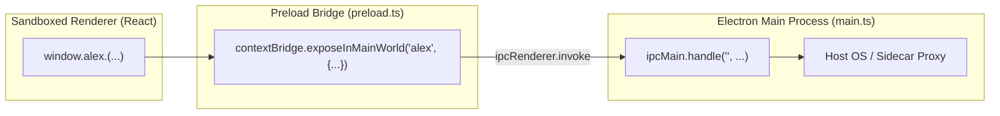

# Electron IPC Reference & Preload Bridge Specifications

**Document Version:** 1.0  
**Inspection Date:** 2026-11-03  
**Status:** `ACTIVE_API_SPECIFICATION`  
**Security Context:** `contextIsolation: true`, `nodeIntegration: false`  

---

## 1. IPC Architecture & Security Bridge

The React 18 renderer runs in a fully sandboxed Chromium process with zero access to Node.js APIs. All communication with the Electron main process and host operating system occurs via the typed `window.alex` bridge exposed by `frontend/electron/preload.ts`:



---

## 2. Typed `window.alex` API Specifications

```typescript
export interface AlexDesktopApi {
  // ── System & Platform Telemetry ──────────────────────────────────────────
  getPlatformCapabilities(): Promise<PlatformCapabilityReport>;
  getSystemMetrics(): Promise<SystemMetrics>;

  // ── Native Window Management ─────────────────────────────────────────────
  minimizeWindow(): Promise<void>;
  maximizeWindow(): Promise<void>;
  closeWindow(): Promise<void>;
  setAlwaysOnTop(alwaysOnTop: boolean): Promise<boolean>;

  // ── Desktop Notifications ────────────────────────────────────────────────
  showNotification(title: string, body: string): Promise<boolean>;

  // ── Display & Screen Capture ─────────────────────────────────────────────
  captureScreen(sourceId?: string): Promise<string>; // Returns base64 PNG data URL
  listDisplaySources(): Promise<Array<{ id: string; name: string }>>;

  // ── Backend Sidecar Proxy (Bearer Authenticated) ─────────────────────────
  proxyBackend(
    endpoint: string,
    method?: string,
    body?: unknown
  ): Promise<unknown>;

  // ── Live Voice WebSocket Metadata ────────────────────────────────────────
  getLiveVoiceWsUrl(): Promise<string>; // Returns ws://127.0.0.1:8765/api/v1/live-voice?token=...
}
```

---

## 3. Channel Mapping & IPC Invariants

| Invocation Method | IPC Channel | Parameters | Return Type | Security Enforcement |
| :--- | :--- | :--- | :--- | :--- |
| `getPlatformCapabilities()` | `alex:get-capabilities` | None | `PlatformCapabilityReport` | Read-only; queries system without side effects. |
| `getSystemMetrics()` | `alex:get-metrics` | None | `SystemMetrics` | Queries psutil CPU/RAM telemetry via loopback. |
| `showNotification(title, body)`| `alex:show-notification` | `title: string, body: string` | `boolean` | Sanitizes string lengths; dispatches native OS notification. |
| `captureScreen(sourceId)` | `alex:capture-screen` | `sourceId?: string` | `string` (Base64) | Requires active user session; uses `desktopCapturer`. |
| `proxyBackend(path, method, body)`| `alex:proxy-backend` | `path: string, method, body` | `unknown` | Auto-injects dynamic session bearer token; validates loopback host. |
| `getLiveVoiceWsUrl()` | `alex:get-ws-url` | None | `string` | Constructs authenticated loopback WebSocket URL with session token. |

