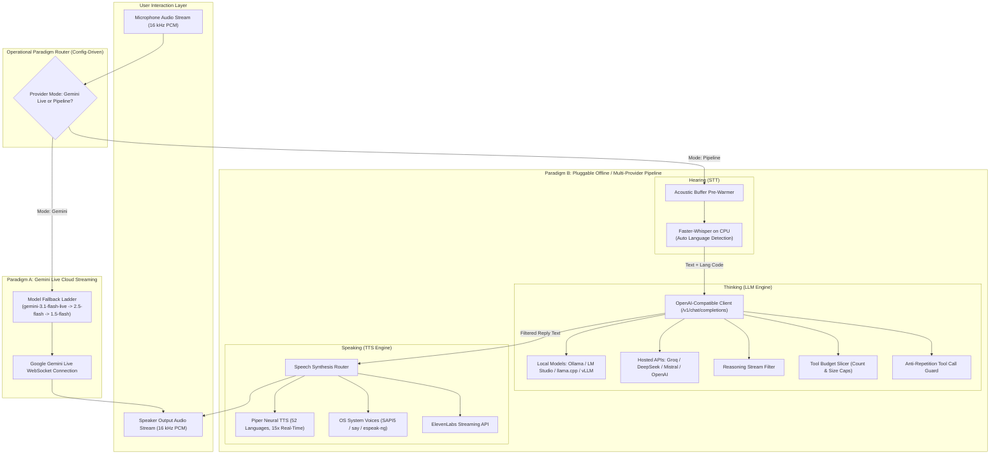

# AI Provider & Speech Pipeline Architecture

**Document Version:** 1.0  
**Inspection Date:** 2026-11-03  
**Status:** `ACTIVE_ARCHITECTURE_SPECIFICATION`  

---

## 1. Architectural Overview & Design Motivation

Alex is designed to provide seamless multimodal interaction across two operational paradigms:
1. **Cloud Streaming (Primary):** Google Gemini Live WebSocket API (`models/gemini-3.1-flash-live-preview`), delivering ultra-low-latency, full-duplex conversational voice with native audio tokens.
2. **Offline & Multi-Provider Pipeline (Secondary / Resilient):** A modular, pluggable pipeline that decouples **Hearing (STT)**, **Thinking (LLM)**, and **Speaking (TTS)**. This ensures that the assistant continues to operate when cloud quotas are exhausted, when offline, or when strict enterprise privacy mandates that microphone audio must not leave the building.

---

## 2. Pluggable Pipeline Components

### 2.1 Hearing: Speech-to-Text (STT) Architecture
- **Engine:** `faster-whisper` (CTranslate2 implementation of Whisper running on CPU).
- **Acoustic Pre-Warming:** At startup, a 100ms silent audio frame is passed to the recognizer. This compiles the execution kernels during application boot, reducing first-word transcription latency from **8.92 seconds down to 1.16 seconds**.
- **Per-Sentence Language Detection:** Whisper outputs both the transcribed text and the detected ISO language code (e.g., `en`, `tr`, `de`, `fr`, `ru`). This language tag is passed directly down to the TTS engine so the voice automatically matches the language spoken by the user.

### 2.2 Thinking: LLM & Tool Budgeting Architecture
- **Unified Protocol:** All external and local engines connect through the standardized OpenAI-compatible HTTP schema (`POST /v1/chat/completions`).
- **Loopback Normalization:** Local addresses (such as `localhost:11434`) are explicitly normalized to IPv4 loopback `127.0.0.1:11434` to prevent Windows IPv6 dual-stack resolution timeouts.
- **`<think>` Reasoning Stream Filter (Private Reasoning Data Policy):** Reasoning models (such as DeepSeek-R1 and Qwen-3) emit internal chain-of-thought enclosed in `<think>...</think>` tags. The streaming parser intercepts chunks across token boundaries (e.g. `"<thi"` and `"nk>"`) and strips reasoning blocks completely in real time. Under strict privacy policy: raw internal reasoning is **never exposed in the React HUD**, **never sent to TTS or audio output**, and **never included in primary conversation history**. Storing raw chain-of-thought (e.g. `thought_log`) is prohibited; only operational audit metadata (provider, model, latency, token usage, fallback reason, tool invocation, tool outcome, error category) is retained.
- **Dual Tool Budgeting Engine:**
  - A cloud model (Gemini) easily accepts all 45 tools (~56,000 characters).
  - An 8B local model (such as Llama 3.1 8B or Qwen 2.5 7B) suffers from tool hallucination or invalid JSON when overloaded.
  - The budget engine enforces two simultaneous caps for local models:
    1. **Count Budget:** Limits active declarations to the top 8 to 14 core tools.
    2. **Size Budget:** Truncates tool descriptions to their `brief` field, reducing tool character footprint from ~18,000 characters to ~9,000 characters.
- **Anti-Repetition Loop Guard:** If a local model calls the same tool repeatedly with identical parameters, the loop guard caps execution at 2 attempts, returns the existing cached result, and instructs the model to synthesize a response.

### 2.3 Speaking: Speech Synthesis (TTS) Architecture
- **Piper Neural TTS (Primary Local):**
  - Synthesizes neural audio at **15x faster than real-time on ordinary CPU** (0.34s compute for 5.15s of speech).
  - 176 pre-trained voices across 52 languages.
  - Dynamically selects the voice corresponding to the language code emitted by Whisper.
- **OS System Voices (Zero-Install Fallback):**
  - Windows: SAPI5 (`comtypes` / `win32com`).
  - macOS: `say` command with system voice selection.
  - Linux: `espeak-ng`.
  - Audits voice existence before speaking: If a system voice lacks the required phonetic alphabet, it falls back gracefully rather than emitting silent audio.
- **ElevenLabs (Cloud Streaming):**
  - WebSocket streaming endpoint for ultra-realistic studio quality when internet connectivity is available.

---

## 3. Sidecar Request Offloading

The assistant frequently performs background "side calls" that do not involve live conversation:
- Summarizing an attached PDF.
- Analyzing visual elements in a captured screenshot.
- Validating Python code syntax.
- Extracting entities from web search results.

In Gemini, these side calls consume the **Text Quota**, which on free tiers depletes far faster than the Live audio quota. Alex implements **Sidecar Request Offloading**:
- Background side calls can be routed to a local model (Ollama) or a cheap cloud API (Groq), preserving the primary Gemini quota for real-time voice streaming.
- If `sidecar_first = True`, Alex queries the local model first and falls back to Gemini only if the local model fails.

