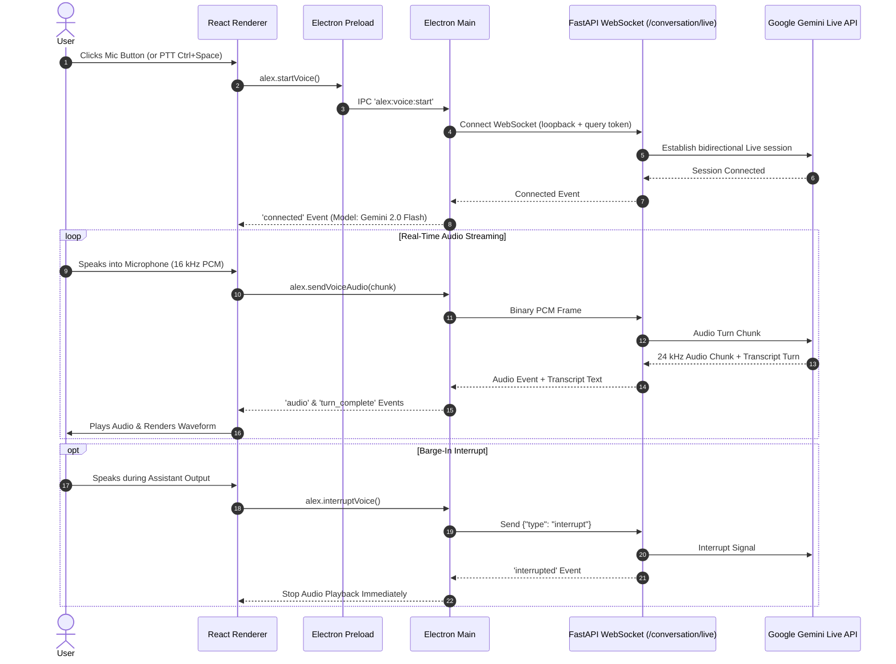
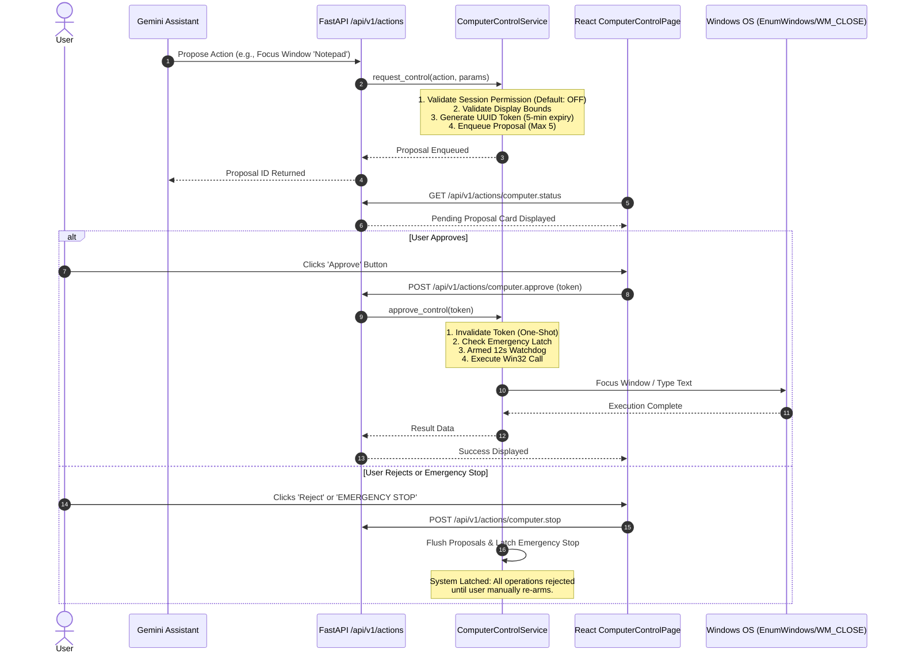

# Alex Desktop Assistant – System Architecture

**Document Version:** 2.0 (Unified HUD & Workspace Architecture)  
**Last Updated:** 2026-11-13  
**Project:** Alex Desktop Assistant  
**Authoritative References:** [`../../README.md`](../../README.md), [`./SYSTEM_FLOW.md`](./SYSTEM_FLOW.md), [`../security/SECURITY.md`](../security/SECURITY.md), [`../release/PROJECT_TASK_REGISTER.md`](../release/PROJECT_TASK_REGISTER.md)

---

## 1. System Topology & Architectural Invariants

Alex employs a three-tier decoupled runtime architecture consisting of an unprivileged React 19 renderer, a privileged Electron desktop shell broker, and an authenticated Python / FastAPI loopback sidecar.

```mermaid
flowchart TD
    subgraph Renderer["React 19 Presentation Tier (Unprivileged)"]
        TopHUD["Top HUD (Branding & Minimal System Monitor)"]
        MainHUD["Continuous Holographic Workspace"]
        Workspace["Floating HUD Workspace (Media/PDF/Docs/Browser)"]
        DynamicAvatar["Dynamic Avatar (Center/Bottom-Right Adaptive)"]
        AudioVis["Web Audio Waveform Visualizer"]
        Drawers["Settings / Memory / Reminders / Actions Pages"]
        BridgeClient["alexApi (window.alex contextBridge facade)"]
    end

    subgraph DesktopShell["Electron Broker Tier (Privileged)"]
        Preload["preload.ts (contextIsolation, allowlisted IPC)"]
        Main["main.ts (Window Manager & IPC Handlers)"]
        NavHardening["Origin & Path Security Guards (isAllowedDevOrigin)"]
        ScreenCap["Native Screen Chooser (desktopCapturer)"]
        TokenGen["Ephemeral Session Bearer Token Generator"]
    end

    subgraph BackendSidecar["Python / FastAPI Backend Tier (Privileged)"]
        FastAPIApp["main.py (Loopback API & Token Middleware)"]
        RouteRegistry["api/routes.py (Versioned /api/v1 Endpoints)"]
        ActionEngine["actions/ (Typed Action Registry & Executor)"]
        
        subgraph Services["Domain Service Layer"]
            CapSvc["PlatformCapabilityService"]
            BriefSvc["BriefingService"]
            CtrlSvc["ComputerControlService (Frozen)"]
            FileSvc["FileWorkspaceService (10-Entry Undo)"]
            VoiceSvc["LiveVoiceService (WebSocket Loopback)"]
            ConvSvc["ConversationService (Model Ladder)"]
            MemSvc["MemoryService (Relevance Search)"]
            RemSvc["ReminderService (Delivery Ack)"]
            MetricSvc["SystemMetricsService & Monitor"]
            VisionSvc["VisionService (OpenCV Frame Capture)"]
            SearchSvc["WebSearchService (Gemini Grounding)"]
            SetSvc["SettingsService"]
        end
        
        subgraph Persistence["Storage & External System Primitives"]
            DocStore["JsonDocumentStore (Atomic Disk Writes)"]
            Keyring["OS Credential Store (keyring)"]
            Win32API["Win32 EnumWindows & WM_CLOSE"]
            OpenCV["OpenCV Camera Driver (cv2)"]
        end
    end

    subgraph ExternalServices["External Cloud & Model Integrations"]
        GeminiLive["Google Gemini Live API (WebSocket)"]
        GeminiREST["Google Gemini 2.5/1.5 Flash (REST)"]
    end

    %% Wiring
    MainHUD --> TopHUD
    MainHUD --> Workspace
    MainHUD --> DynamicAvatar
    MainHUD --> BridgeClient
    BridgeClient --> Preload
    Preload -->|Typed Electron IPC| Main
    Main --> ScreenCap
    Main --> NavHardening
    Main -->|HTTP / WebSocket + Bearer Token| FastAPIApp
    FastAPIApp --> RouteRegistry
    RouteRegistry --> ActionEngine
    RouteRegistry --> Services
    SetSvc --> Keyring
    FileSvc --> DocStore
    MemSvc --> DocStore
    RemSvc --> DocStore
    CtrlSvc --> Win32API
    VisionSvc --> OpenCV
    VoiceSvc -->|16kHz PCM| GeminiLive
    ConvSvc -->|REST Multi-Turn| GeminiREST
    SearchSvc -->|Search Grounding| GeminiREST
```

---

## 2. Core Architectural Invariants

Alex enforces five strict structural security invariants:

1. **Zero Direct Privilege in Renderer:** The React renderer executes with `contextIsolation: true` and `nodeIntegration: false`. It cannot access Node.js primitives (`process`, `require`, `fs`, `child_process`), cannot bind network ports, and cannot make arbitrary shell calls.
2. **Strict Origin & URL Validation:** Electron `webContents` navigation and new window requests are strictly gated by `isAllowedDevOrigin(testUrl, expectedUrl)` in development and canonical path checks (`isAllowedProdFile(testUrl)`) in production. Arbitrary URLs cannot load inside the desktop frame.
3. **Loopback Binding & Ephemeral Cryptographic Auth:** The Python sidecar binds strictly to `127.0.0.1`. Every application run generates a random 32-byte base64url bearer token. All HTTP routes and WebSocket connections require an `Authorization: Bearer <token>` header, compared via constant-time HMAC comparison.
4. **Human-in-the-Loop Gating:** AI models cannot autonomously execute side-effecting operations. High-risk actions (file modification, computer control, external network calls) require explicit, one-shot user confirmation in the renderer.
5. **Private Scoped Filesystem:** File operations are restricted to `data_dir/workspace`. Path traversal (`../`), absolute host paths, and symlink/hardlink escapes are rejected at the service layer.

---

## 3. Communication Pipelines & Data Flows

### A. Sequential Startup & Health Verification
Orchestrated by the unified launcher (`alex launch`):
1. **Port Allocation:** Launcher queries default ports (`8765`, `5173`); allocates available loopback ports if conflicts exist.
2. **Backend Sidecar Boot:** Launcher executes Python FastAPI with `ALEX_API_TOKEN` and `--port`.
3. **Backend Health Check:** Launcher polls `http://127.0.0.1:<port>/api/v1/health` with bearer token until HTTP 200 is confirmed (20s timeout).
4. **Frontend Dev Server Boot:** Launcher boots Vite dev server on configured port.
5. **Frontend Readiness Check:** Launcher polls frontend URL until HTTP 200 is received.
6. **Electron Desktop Launch:** Launcher boots Electron with `ALEX_BACKEND_PORT`, `ALEX_API_TOKEN`, and `ALEX_ELECTRON_DEV_URL`. Electron attaches to the running processes without duplicating child processes.

### B. Gemini Live Real-Time Voice Pipeline

### C. Computer Control Safety & Proposal Pipeline (Milestone A02)

---

## 4. Subsystem Components & Responsibilities

### 1. Presentation Tier (`frontend/src/`)
- `App.tsx`: Master Command Center HUD orchestrating the Top HUD, continuous holographic workspace, dynamic avatar, and floating workspace window.
- `components/SystemMonitor.tsx`: Minimal, non-collapsible horizontal telemetry bar with CPU %, RAM %, and live cyan status indicators (Network, Backend, AI Engine, Voice).
- `components/HudAvatar.tsx` & `hooks/useAvatarPosition.ts`: Dynamic adaptive avatar that centers during normal mode and animates smoothly to extreme bottom-right during active content.
- `components/workspace/HUDWorkspaceWindow.tsx`: Independent floating content window with title bar, minimize/restore/close controls, and content containers.
- `components/workspace/`: Universal content viewers for embedded YouTube playback, music player with waveform audio visualizer, PDF viewer, multi-format document viewer, image viewer, and browser workspace.
- `utils/workspaceCommands.ts`: Voice and intent parser for workspace navigation and window lifecycle controls.
- `pages/ConversationPage.tsx`: Bounded conversation log displaying user and assistant turns, audio visualizer, attachment previews, and input bar.
- `pages/MemoryPage.tsx`: Categorized CRUD drawer with optimistic state updates.
- `pages/SettingsPage.tsx`: Configuration interface for names, accent colors, Gemini voices, HUD style, and API key input.
- `pages/AudioDevicesPage.tsx`: Web Audio API device enumerator, test tone generator, and push-to-talk settings.
- `pages/ComputerControlPage.tsx`: Permission toggle, proposal queue review, and latched emergency stop controls.
- `services/alexApi.ts`: Type-safe abstraction layer bridging React hooks to Electron preload handlers.

### 2. Electron Broker Tier (`frontend/electron/`)
- `main.ts`: Application lifecycle manager, BrowserWindow factory, child process sidecar supervisor, native screen capture dialog broker, desktop notification dispatcher, and IPC router.
- `preload.ts`: `contextBridge.exposeInMainWorld("alex", ...)` implementation providing strictly typed, allowlisted async methods.

### 3. Backend Engine (`backend/app/`)
- `core/storage.py` (`JsonDocumentStore`): Thread-safe, atomic document persistence using temporary write files and atomic replaces.
- `core/security.py` (`ApiTokenMiddleware`): Loopback token validation enforcing constant-time comparisons.
- `services/platform_capability_service.py`: Transparent inspection and honest reporting of operating system capabilities, optional dependency presence, and platform limitations.
- `services/briefing_service.py`: Aggregates hardware metrics, pending/due reminders, and user identity facts into a structured greeting.
- `services/file_workspace_service.py`: Scoped filesystem manager with path canonicalization, traversal blocking, symlink/hardlink refusal, and persistent 10-entry undo journal.
- `services/computer_control_service.py`: Frozen A02 service implementing proposal queues, single-operation approvals, watchdog timers, coordinate clamping, and Win32 window management.
- `services/live_voice_service.py`: Bidirectional 16 kHz / 24 kHz WebSocket loopback pipeline interfacing with Google Gemini Live.
- `services/memory_service.py`: Local categorized document memory with score-ranked keyword relevance search.
- `services/reminder_service.py`: ISO datetime parsing, due calculation, and delivery acknowledgment tracking.
- `services/system_metrics_service.py`: Collects CPU, RAM, network, uptime, and process telemetry with streak tracking.
- `services/vision_service.py`: Hardware camera frame capture and device index probing via OpenCV (`cv2`) for real-time visual reasoning and environment inspection.

---

## 5. Security & Isolation Specification

### Threat Model & Countermeasure Matrix

| Threat Category | Potential Attack Vector | Alex Architectural Defense |
|---|---|---|
| **Remote Access / LAN Exfiltration** | Unauthorized HTTP request from local network. | Backend strictly binds to `127.0.0.1`; requests without valid per-run bearer token rejected with HTTP 401. |
| **Cross-Site Scripting (XSS)** | Injected malicious script in chat or web search. | Strict Content Security Policy (`script-src 'self'`), `nodeIntegration: false`, `contextIsolation: true`. |
| **Filesystem Escape** | Model generating path traversal (`../../Windows/System32`). | `FileWorkspaceService` verifies all paths resolve strictly inside `data_dir/workspace`; symlinks rejected. |
| **Unbounded Autonomous Input** | Model issuing runaway keyboard or mouse commands. | AI can only issue proposals; proposals expire in 5 minutes; execution requires human click; 12s watchdog aborts. |
| **Process Tree Destruction** | Polite close killing Alex's own process tree. | `ComputerControlService` resolves Alex process ancestry and explicitly refuses to terminate self or parent PIDs. |
| **Plaintext Credential Leakage** | API keys saved in plaintext files or logged. | Keys stored in OS credential store (`keyring`); API never echoes key in responses; launcher masks tokens (`****`). |

