# Cross-Platform Architecture: Hardware & OS Abstraction Layer (HAL)

**Document Version:** 1.0  
**Inspection Date:** 2026-11-03  
**Status:** `ACTIVE_ARCHITECTURE_SPECIFICATION`  
**Target Operating Systems:** Windows 10/11, Ubuntu Linux (X11 & Wayland), macOS (Apple Silicon & Intel), iOS (Companion)  

---

## 1. Architectural Motivation & Problem Statement

In both `Mark-LVI` and the initial `Alex` codebase, several system operations were implemented using platform-specific APIs tightly coupled to Windows:
- Window management relied directly on `ctypes.windll.user32` (`EnumWindows`, `GetWindowTextW`, `SetForegroundWindow`, `WM_CLOSE`).
- Audio endpoint querying and volume adjustments called Windows `pycaw` / CoreAudio COM interfaces.
- Input synthesis assumed an unrestricted Win32 desktop station, failing immediately or silently under Linux Wayland and macOS without Accessibility grants.

To achieve genuine cross-platform support without sacrificing reliability or stability, Alex introduces a formal **Hardware Abstraction Layer (HAL)**. The HAL defines clean, platform-neutral abstract interfaces in Python, implemented by swappable operating system adapters.

```mermaid
graph TD
    subgraph "Core Business Logic & Action Handlers"
        CTRL["Computer Control Service"]
        AUDIO["Audio Device Service"]
        WIN_SVC["Window Management Service"]
        CAP_SVC["Platform Capability Service"]
    end

    subgraph "Hardware Abstraction Layer (HAL) Interfaces"
        I_INPUT["InputControlAdapter (Interface)"]
        I_AUDIO["AudioEndpointAdapter (Interface)"]
        I_WIN["WindowManagementAdapter (Interface)"]
        I_PERM["PlatformPermissionAdapter (Interface)"]
    end

    CTRL --> I_INPUT
    AUDIO --> I_AUDIO
    WIN_SVC --> I_WIN
    CAP_SVC --> I_PERM

    subgraph "Windows Adapter (Win32 / COM)"
        W_IN["PyAutoGUI Win32 Hook"]
        W_AU["pycaw / Windows CoreAudio"]
        W_WN["ctypes user32 EnumWindows / WM_CLOSE"]
        W_PR["Active Directory GPO / AppLocker Check"]
        I_INPUT -.-> W_IN
        I_AUDIO -.-> W_AU
        I_WIN -.-> W_WN
        I_PERM -.-> W_PR
    end

    subgraph "macOS Adapter (AppleScript / Quartz / CoreAudio)"
        M_IN["PyAutoGUI macOS Quartz Event Tap"]
        M_AU["CoreAudio HAL / osascript volume"]
        M_WN["AppleScript / Quartz Window Server"]
        M_PR["macOS TCC Permission Probe (TCC.db)"]
        I_INPUT -.-> M_IN
        I_AUDIO -.-> M_AU
        I_WIN -.-> M_WN
        I_PERM -.-> M_PR
    end

    subgraph "Ubuntu / Linux Adapter (X11 / Wayland / ALSA / PipeWire)"
        L_IN["X11 xdotool / libxdo (X11 only)"]
        L_AU["PulseAudio / PipeWire pactl"]
        L_WN["EWMH / wmctrl (X11 only)"]
        L_PR["XDG_SESSION_TYPE Wayland Detector"]
        I_INPUT -.-> L_IN
        I_AUDIO -.-> L_AU
        I_WIN -.-> L_WN
        I_PERM -.-> L_PR
    end
```



---

## 2. HAL Interface Specifications

### 2.1 Window Management Adapter (`WindowManagementAdapter`)
```python
class WindowInfo(BaseModel):
    id: str               # HWND (Windows), Window ID (X11), Window ID (macOS)
    title: str            # Window title text
    process_name: str     # Associated executable (e.g., spotify.exe, Spotify)
    pid: int              # Process ID
    is_active: bool       # Whether window currently has foreground focus
    rect: tuple[int, int, int, int] # (x, y, width, height)

class WindowManagementAdapter(ABC):
    @abstractmethod
    def list_windows(self) -> list[WindowInfo]:
        """Enumerate all visible top-level application windows."""

    @abstractmethod
    def focus_window(self, window_id: str) -> bool:
        """Bring target window to the foreground without duplicating process."""

    @abstractmethod
    def close_window_gracefully(self, window_id: str) -> bool:
        """Request graceful closure (WM_CLOSE / SIGTERM) to preserve unsaved work."""

    @abstractmethod
    def minimize_all(self) -> bool:
        """Show desktop by minimizing all open windows."""
```

#### OS-Specific Implementations:
1. **Windows (`Win32WindowAdapter`):**
   - Calls `user32.EnumWindows`, `GetWindowTextW`, `IsWindowVisible`.
   - Uses `AttachThreadInput` + `SetForegroundWindow` to bypass Windows foreground lock.
   - Sends `WM_CLOSE` (via `PostMessageW`) to prompt unsaved work dialogs.
2. **macOS (`MacOSWindowAdapter`):**
   - Queries running applications via `NSWorkspace` / `CGWindowListCopyWindowInfo`.
   - Raises window using AppleScript: `tell application id "..." to activate`.
   - Graceful closure via AppleScript `tell application "..." to quit`.
3. **Linux (`LinuxWindowAdapter`):**
   - Under X11: Calls `wmctrl -l` and `wmctrl -ia <id>` or `xdotool windowactivate <id>`.
   - Under Wayland: Reports `can_focus_windows = False` to the model; logs diagnostic notice.

---

### 2.2 Input Control Adapter (`InputControlAdapter`)
```python
class InputControlAdapter(ABC):
    @abstractmethod
    def get_cursor_position(self) -> tuple[int, int]: ...
    @abstractmethod
    def move_to(self, x: int, y: int, duration: float = 0.0) -> None: ...
    @abstractmethod
    def click(self, x: int, y: int, button: Literal["left", "right", "middle"]) -> None: ...
    @abstractmethod
    def drag_to(self, start_x: int, start_y: int, end_x: int, end_y: int) -> None: ...
    @abstractmethod
    def write_text(self, text: str, interval: float = 0.0) -> None: ...
    @abstractmethod
    def send_hotkey(self, *keys: str) -> None: ...
```

#### Failsafe Invariant Enforcement:
Regardless of platform, all input adapters must enforce the **A02 Safety Invariants**:
- Coordinate bounds checks against `screen_size()`.
- Emergency abort corner detection (cursor moved to screen origin raises `FailsafeTriggeredException`).
- Event injection rate limiting (minimum pause between events $\ge$ 0.05s).

---

### 2.3 Audio Endpoint & Volume Adapter (`AudioEndpointAdapter`)
```python
class AudioEndpoint(BaseModel):
    id: str
    name: str
    kind: Literal["input", "output"]
    is_default: bool
    volume: float  # 0.0 to 1.0

class AudioEndpointAdapter(ABC):
    @abstractmethod
    def list_endpoints(self, kind: Literal["input", "output"]) -> list[AudioEndpoint]: ...
    @abstractmethod
    def get_volume(self, endpoint_id: str) -> float: ...
    @abstractmethod
    def set_volume(self, endpoint_id: str, volume: float) -> bool: ...
```

#### OS-Specific Implementations:
1. **Windows:** Uses `pycaw` (Python Core Audio Windows Library) via `IMMDeviceEnumerator` and `IAudioEndpointVolume`. Handles `NotPresent` device filtering.
2. **macOS:** Queries CoreAudio via `osascript` (`set volume output volume ...`) or native CoreAudio C bindings.
3. **Linux:** Interacts with PulseAudio / PipeWire via `pactl get-sink-volume` and `pactl set-sink-volume`.

---

### 2.4 Platform Permission & Security Detector (`PlatformPermissionAdapter`)
```python
class PlatformCapabilities(BaseModel):
    os_name: Literal["Windows", "macOS", "Linux", "iOS"]
    desktop_environment: str # "GNOME", "KDE", "Aqua", "Explorer"
    session_type: str        # "x11", "wayland", "win32", "mobile"
    can_control_input: bool
    can_capture_screen: bool
    can_focus_windows: bool
    app_locker_restricted: bool
    notes: list[str]
```

#### Detection Logic & Model Injection:
- On Linux: Checks `XDG_SESSION_TYPE`, `WAYLAND_DISPLAY`, and `DISPLAY`. If Wayland is active, sets `can_control_input = False`, `can_capture_screen = False`, and `can_focus_windows = False`.
- On macOS: Checks for accessibility permissions. If ungranted, notes that user must enable `System Settings > Privacy & Security > Accessibility`.
- On Windows: Probes child process instantiation to detect enterprise AppLocker / Software Restriction Policies (SRP).
- **Prompt Injection:** These capabilities are translated directly into LLM system prompt facts via `_describe_limits()` so the assistant answers honestly: *"I cannot move the mouse in this session because Wayland does not allow synthetic input"* instead of hallucinating successful clicks.

---

## 3. Platform Comparison Matrix Across System Primitives

| System Primitive | Windows 10/11 | Ubuntu Linux (X11) | Ubuntu Linux (Wayland) | macOS (Apple Silicon/Intel) | iOS Companion |
| :--- | :--- | :--- | :--- | :--- | :--- |
| **Window Enumeration** | `EnumWindows` (Win32) | `wmctrl -l` | Blocked by compositor | `CGWindowListCopyWindowInfo` | Not applicable |
| **Window Raising** | `SetForegroundWindow` | `wmctrl -ia` | Blocked by compositor | AppleScript `activate` | Not applicable |
| **Polite App Quit** | `WM_CLOSE` | `SIGTERM` / `wmctrl -c` | `SIGTERM` to PID | AppleScript `quit` | Not applicable |
| **Mouse / Keyboard** | PyAutoGUI Win32 | X11 `xdotool` | Blocked by Wayland | Quartz (Requires TCC grant) | Not permitted |
| **Screen Capture** | `mss` / Win32 GDI | `mss` / X11 Root | PipeWire Portal chooser | Screen Recording TCC grant | In-app camera only |
| **Audio Volume** | `pycaw` CoreAudio | `pactl` (Pulse/PipeWire)| `pactl` (Pulse/PipeWire) | `osascript` / CoreAudio | System volume buttons |
| **Credential Storage** | Windows Credential Mgr| Secret Service (Keyring)| Secret Service (Keyring)| Apple Keychain (Keyring) | iOS Secure Enclave |
| **OS Schedulers** | `schtasks.exe` | `systemd --user` timer | `systemd --user` timer | `launchd` LaunchAgent | EventKit / APNs |
| **Desktop Shell** | Electron (Win32) | Electron (X11/Wayland) | Electron (Wayland native) | Electron (macOS App) | SwiftUI Mobile App |

