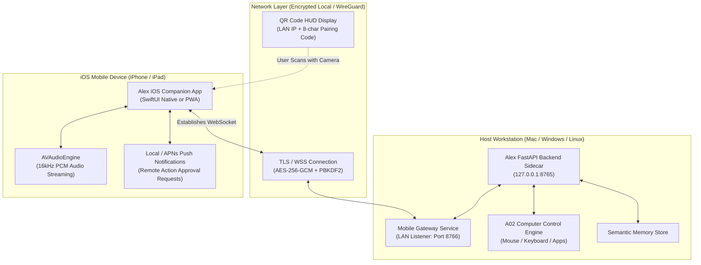
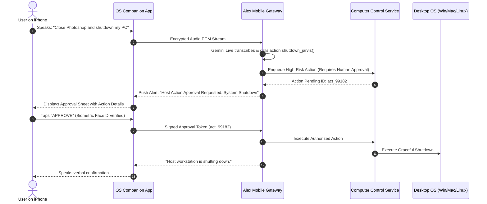

# iOS Architecture & Mobile Companion Strategy

**Document Version:** 1.0  
**Inspection Date:** 2026-11-03  
**Status:** `MOBILE_ARCHITECTURE_SPECIFICATION`  
**Target Devices:** iPhone (iOS 16+), iPad (iPadOS 16+)  

---

## 1. Executive Summary & Strategy Overview

Achieving iOS support for Alex AI Desktop Assistant requires navigating the strict security boundaries of Apple's **App Sandbox** and iOS system lifecycle restrictions.

On desktop platforms (Windows, macOS, Ubuntu), Alex runs a local Python runtime, manages background processes, captures screen canvases, and controls mouse/keyboard pointers. **None of these capabilities can be reproduced natively on an iOS device**:
- iOS does not permit running an arbitrary Python sidecar process tree.
- iOS does not permit an application to synthetically control other iOS applications or move a system mouse cursor.
- iOS severely restricts background socket execution and audio capture when the application is backgrounded.

Therefore, the authoritative architecture for iOS is the **Alex Mobile Companion Client**:
A native Swift/SwiftUI mobile app (or responsive PWA) that connects to the user's desktop Alex instance over local Wi-Fi or secure TLS tunnel, delivering full mobile voice conversation, memory access, live system telemetry, and remote action approval.



---

## 2. Pairing & Security Protocol

To ensure that only authorized devices can connect to the host assistant over the local network, Alex adopts the hardened pairing protocol established in Mark-LVI (`dashboard/server.py`), elevated with modern cryptography:

1. **Host QR Code Generation:**
   - The desktop HUD displays a dynamic pairing QR code containing:
     ```json
     {
       "host": "192.168.1.108",
       "port": 8766,
       "code": "A9K2-X8P4",
       "fingerprint": "SHA256:7b2e...9a"
     }
     ```
2. **Key Derivation (PBKDF2):**
   - Both host and mobile client derive an AES-256 encryption key from the pairing code:
     $$\text{Key} = \text{PBKDF2}(\text{code}, \text{salt}=\text{fingerprint}, \text{iterations}=200,000, \text{hash}=\text{SHA-256})$$
3. **Session Handshake & Rate Limiting:**
   - Mobile sends a handshake request; failed attempts trigger a 5-minute lockout after 5 incorrect tries.
   - Once paired, the server issues a scoped session JWT valid for 24 hours.
4. **Command Encryption:**
   - All bidirectional WebSocket frames carry AES-256-GCM encrypted payloads with a dynamic 12-byte initialization vector (IV) per frame.

---

## 3. Mobile Capabilities & Workflow Mapping

| Capability | Desktop Workstation | iOS Mobile Companion Client |
| :--- | :--- | :--- |
| **Assistant Voice Conversation** | Full-duplex Web Audio stream | Native `AVAudioEngine` 16kHz PCM streaming over WSS |
| **Assistant Text Chat** | React markdown chat | Native SwiftUI chat bubble interface |
| **Memory & Facts Browsing** | HUD Memory Drawer | Searchable mobile memory list with delete swipe |
| **Host System Telemetry** | Live gauges (CPU, RAM, GPU) | Real-time hardware telemetry widget |
| **Computer Control Approval** | On-screen modal prompt | Push Notification $\rightarrow$ One-tap "Approve / Reject" |
| **Local Device Input Synthesis** | PyAutoGUI Win32/X11/Quartz | **NOT PERMITTED** (Apple iOS Sandbox restriction) |
| **Remote Host Input Synthesis** | Executes directly on host | **Triggers execution on host** upon mobile approval |
| **Local File Operations** | Reads/writes host filesystem | Accesses files shared via companion upload API |
| **Document Analysis** | Local PDF/DOCX parsing | Mobile uploads document $\rightarrow$ Host parses $\rightarrow$ Returns answer |

---

## 4. Mobile Remote Action Approval Sequence

One of the most powerful workflows enabled by the iOS Companion is **Remote Desktop Automation Authorization**:



---

## 5. Technical Stack for iOS Companion

### Option A: Native iOS Application (Swift & SwiftUI) — Recommended
- **UI Framework:** SwiftUI with SF Symbols and holographic glassmorphism.
- **Audio Engine:** `AVAudioEngine` for low-latency 16kHz int16 PCM capture and playback.
- **Networking:** Native `URLSessionWebSocketTask` with TLS pinning.
- **Security:** `CryptoKit` (AES-256-GCM, PBKDF2), FaceID authentication via `LocalAuthentication`.

### Option B: Progressive Web App (PWA) / Capacitor
- **UI Framework:** Shared React 18 / Tailwind CSS codebase bundled via Capacitor.
- **Audio Engine:** Web Audio API (`AudioWorklet`).
- **Networking:** Standard browser WebSocket with SubtleCrypto.
- **Advantage:** Zero App Store review requirements; runs directly via Mobile Safari.

---

## 6. Honest Limitations & Compliance Declarations

1. **No Background Mic Surveillance:** When the iOS app is in the background or device is locked, Apple restricts continuous microphone streaming unless configured with specific background audio modes. Alex will NOT perform 24/7 background audio monitoring on iOS.
2. **No iOS Synthetic Touch:** Alex cannot click on other iPhone apps, type into third-party mobile text fields, or modify iOS system settings. All computer control actions apply strictly to the paired **host workstation**.
3. **LAN / Tunnel Prerequisite:** The companion client requires that the host desktop is running and reachable over the local Wi-Fi network or a private VPN (e.g. Tailscale).

