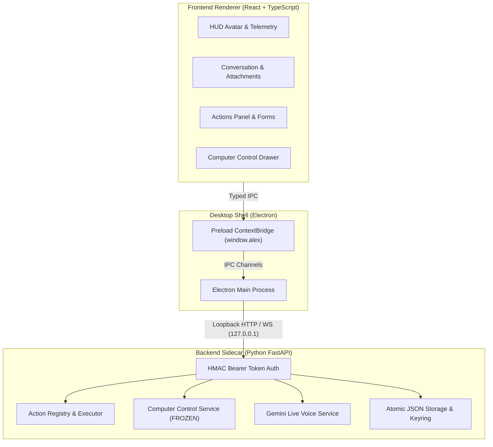
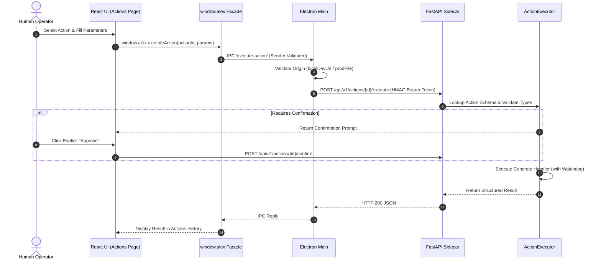
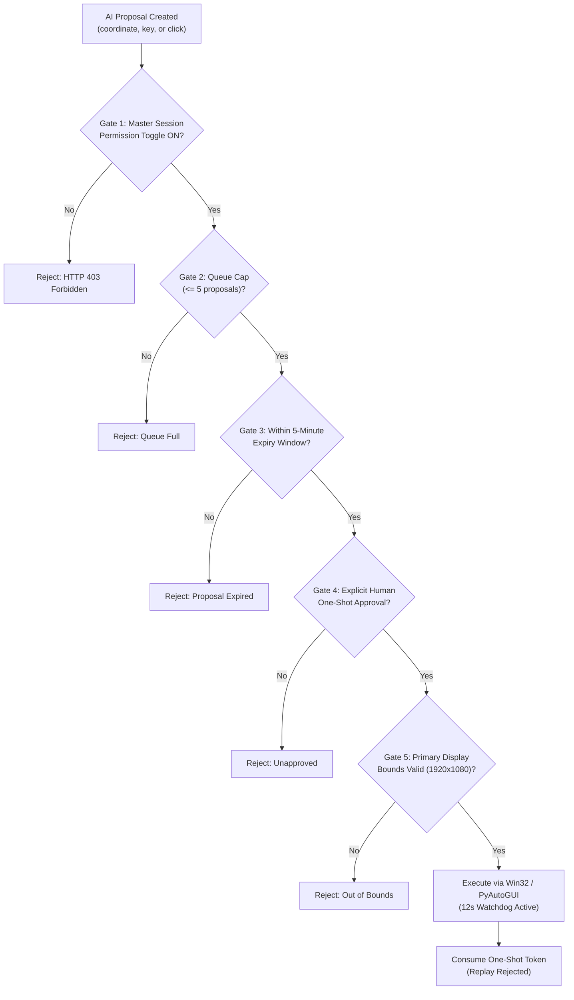
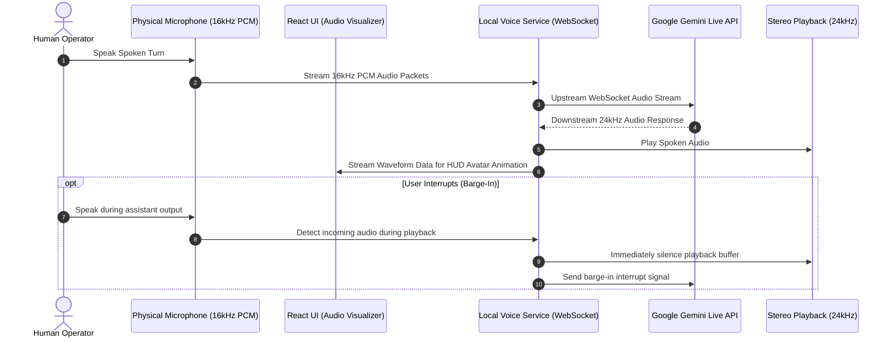

# Alex Desktop Assistant — System Execution & Data Flow

**Document Version:** 1.0  
**Last Updated:** 2026-11-03  
**Status:** Authoritative Architecture Reference  
**Cross-References:** [`ARCHITECTURE.md`](./ARCHITECTURE.md), [`../security/SECURITY.md`](../security/SECURITY.md), [`../api/API_REFERENCE.md`](../api/API_REFERENCE.md)

---

## 1. Overview

This document specifies the end-to-end runtime lifecycle, process execution flow, data pathways, and safety gating mechanisms of the Alex AI Desktop Assistant.



---

## 2. Unified Startup Orchestration Flow

The Unified Application Launcher (`alex launch` / `python -m launcher.cli launch`) enforces a health-gated sequential startup sequence to eliminate startup race conditions between tiers:

```mermaid
sequenceDiagram
    autonumber
    actor User as User / Shell
    participant Launcher as Unified Launcher CLI
    participant Backend as Python FastAPI Sidecar
    participant Frontend as Vite Dev Server
    participant Electron as Electron Desktop Shell

    User->>Launcher: alex launch
    Launcher->>Launcher: 1. Validate dependencies (Python 3.11+, Node 20+, npm)
    Launcher->>Launcher: 2. Check loopback ports (8765, 5173); reassign if occupied
    Launcher->>Backend: 3. Spawn Backend with per-run random bearer token
    loop Health Polling (up to 20s)
        Launcher->>Backend: GET http://127.0.0.1:8765/api/v1/health
        Backend-->>Launcher: HTTP 200 {status: "ok"}
    end
    Launcher->>Frontend: 4. Spawn Vite Dev Server (http://127.0.0.1:5173)
    loop Web Polling (up to 30s)
        Launcher->>Frontend: HTTP GET http://127.0.0.1:5173
        Frontend-->>Launcher: HTTP 200 OK
    end
    Launcher->>Electron: 5. Spawn Electron Window with ALEX_API_TOKEN & Ports
    Electron->>Preload: Inject window.alex contextBridge
    Launcher->>Launcher: 6. Persist PIDs, ports, and tokens to %APPDATA%/Alex/runtime.json
    Launcher-->>User: Startup Complete (Monitoring active child processes)
```

### Port Conflict Resilience
If default ports (`8765` or `5173`) are occupied, the launcher automatically scans for the next available ephemeral port, updates process arguments dynamically, and passes the resolved ports to Electron without failing startup.

### Process State Persistence
Process PIDs, assigned ports, and bearer token masks are stored in `runtime.json` under the platform user data directory (`%APPDATA%/Alex/runtime.json` on Windows, `~/.alex/runtime.json` on macOS/Linux). On launch, stale PIDs from previous crashed sessions are detected and purged.

---

## 3. Coordinated Graceful Shutdown Flow

When `alex stop`, window close, or `Ctrl+C` is received, the supervisor executes coordinated teardown:

1. **SIGTERM to Electron Shell:** Electron closes all BrowserWindow instances, flushes window state, and exits.
2. **SIGTERM to Frontend Server:** Vite development server terminates.
3. **Graceful Backend Shutdown:** FastAPI receives `SIGTERM`, triggers `@app.on_event("shutdown")`, commits in-flight atomic file writes, closes active WebSockets, and exits.
4. **Port Release Verification:** Launcher verifies loopback ports are freed within 10 seconds.
5. **Runtime State Cleanup:** `runtime.json` is safely unlinked or marked inactive.

---

## 4. Action Execution Flow

Privileged actions in Alex are strictly typed, allowlisted, and decoupled from arbitrary shell execution:



### Action Dispatch Constraints:
- **Max 4 Executions Per Turn:** Prevents model runaway loops during multi-action tasks.
- **Pydantic Type Enforcement:** Parameters must validate against JSON schemas before dispatch.
- **Execution Watchdog:** Unresponsive handlers are cancelled after timeout (default 12 seconds).

---

## 5. Milestone A02 Computer Control Safety Gating (FROZEN)

The Computer Control subsystem ([`backend/app/services/computer_control_service.py`](../../backend/app/services/computer_control_service.py)) enforces 5 non-negotiable safety gates:



### Latched Emergency Stop
Pressing the Emergency Stop button in the UI:
1. Immediately flushes all queued and pending proposals.
2. Forcibly aborts any active action at the next safe boundary.
3. Sets a **latched emergency state** that rejects all subsequent actions until explicitly re-armed by manual user action.

---

## 6. Gemini Live AI Voice Streaming Flow


