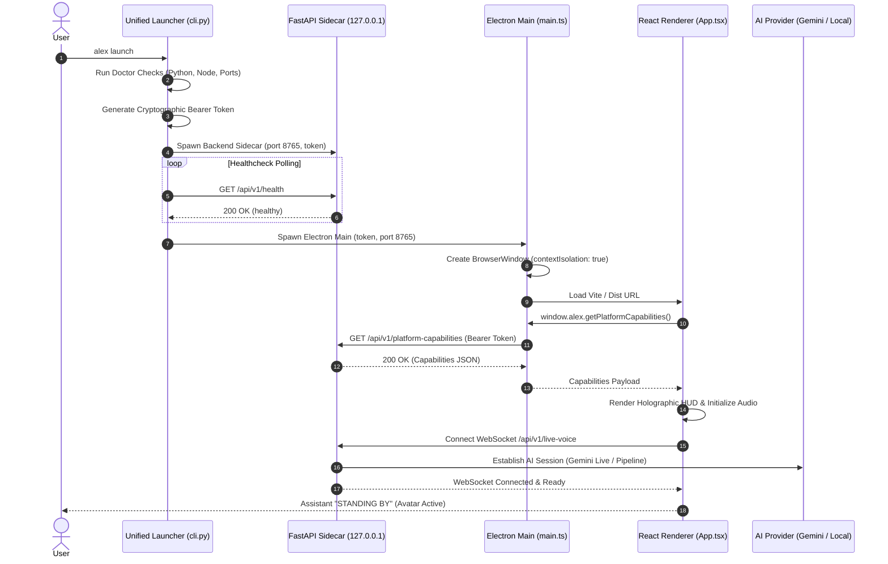
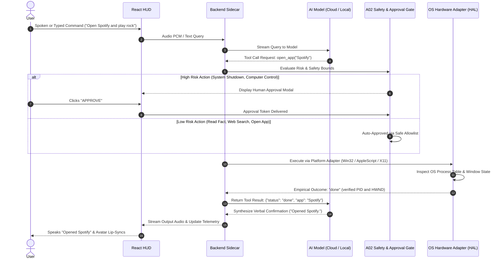

# Target Architecture: Alex AI Desktop Assistant

**Document Version:** 1.0  
**Inspection Date:** 2026-11-03  
**Status:** `TARGET_ARCHITECTURE_SPECIFICATION`  
**Target Scope:** Windows 10/11, Ubuntu Linux (X11 & Wayland), macOS (Apple Silicon & Intel), iOS (Companion Client)  

---

## 1. Architectural Blueprint & System Topology

The target architecture for Alex AI Desktop Assistant preserves the decoupled three-tier security model while integrating the full functional breadth of Mark-LVI and expanding to multi-platform and mobile companion support.

```mermaid
graph TD
    subgraph "Client Layer (Desktop & Mobile)"
        D_UI["React 18 / TypeScript Desktop HUD<br>(Electron Chromium Shell - Sandboxed)"]
        M_UI["iOS / Mobile Companion Client<br>(SwiftUI Native / Responsive PWA)"]
    end

    subgraph "Desktop Shell Layer (Electron)"
        E_MAIN["Electron Main Process<br>(main.ts - Node.js Container)"]
        E_PRE["Preload Bridge (preload.ts)<br>contextBridge.exposeInMainWorld('alex')"]
        D_UI <-->|Typed IPC| E_PRE
        E_PRE <-->|IPC Handlers| E_MAIN
    end

    subgraph "Process Supervisor (Unified Launcher)"
        CLI["Alex CLI Launcher (launcher/cli.py)<br>• Environment & Doctor Checks<br>• Port Collision Resolution<br>• Process Lifecycle Management"]
    end

    subgraph "Backend Service Sidecar (FastAPI - 127.0.0.1:8765)"
        AUTH["Bearer Token Authenticator<br>(32-byte dynamic session token)"]
        ROUTER["FastAPI Router (/api/v1/*)"]
        
        subgraph "AI & Speech Engine"
            LIVE_BR["Gemini Live WebSocket Bridge"]
            MOD_LAD["Model Fallback Ladder (9 Rungs)"]
            PROV_PIP["Provider Pipeline (STT -> LLM -> TTS)"]
            LOCAL_LLM["OpenAI-Compatible Client<br>(Ollama / LM Studio / vLLM / Groq)"]
            STT_WHIS["Faster-Whisper STT (Local CPU)"]
            TTS_PIPE["Piper Neural TTS (52 Languages)"]
            WAKE_ENG["OpenWakeWord Engine ('Hey Alex')"]
        end

        subgraph "Action & Automation Engine"
            ACT_LOAD["Dynamic Action & Plugin Loader"]
            ACT_EXEC["Action Executor & Outcome Verifier"]
            CTRL_SVC["A02 Computer Control Service<br>(Failsafes, Bounds, Emergency Abort)"]
            DOC_PROC["Document Processor<br>(PDF, DOCX, XLSX, PPTX)"]
            DEV_AGENT["Dev Agent & Code Helper"]
            MEDIA_SVC["Media & YouTube Streamer"]
        end

        subgraph "Hardware & OS Abstraction Layer (HAL)"
            WIN_ADAPT["Windows Adapter (Win32, pycaw, Credential Mgr)"]
            MAC_ADAPT["macOS Adapter (AppleScript, CoreAudio, Keychain)"]
            LNX_ADAPT["Linux Adapter (EWMH, ALSA/PipeWire, Secret Service)"]
            TCC_DETECT["OS Permission & Wayland Detector"]
        end

        subgraph "State, Memory & Storage"
            DOC_STORE["Atomic JsonDocumentStore / SQLite"]
            MEM_SVC["Semantic Memory & Fact Recall"]
            KEYRING["OS Keyring (Windows / Mac / Linux)"]
        end

        subgraph "Remote Mobile Gateway"
            DASH_SVC["LAN Pairing Server (QR Code)<br>PBKDF2 200k rounds + AES-256-GCM"]
        end
    end

    CLI -->|Spawns & Monitors| E_MAIN
    CLI -->|Spawns & Monitors| AUTH
    E_MAIN <-->|Loopback HTTP/WS + Bearer Token| AUTH
    AUTH --> ROUTER
    M_UI <-->|Encrypted LAN WebSocket / TLS| DASH_SVC
    DASH_SVC --> ROUTER

    ROUTER --> LIVE_BR
    ROUTER --> PROV_PIP
    ROUTER --> ACT_EXEC
    ROUTER --> CTRL_SVC
    ROUTER --> MEM_SVC

    PROV_PIP --> LOCAL_LLM
    PROV_PIP --> STT_WHIS
    PROV_PIP --> TTS_PIPE
    PROV_PIP --> MOD_LAD

    ACT_EXEC --> ACT_LOAD
    ACT_EXEC --> DOC_PROC
    ACT_EXEC --> DEV_AGENT
    ACT_EXEC --> MEDIA_SVC

    CTRL_SVC --> WIN_ADAPT
    CTRL_SVC --> MAC_ADAPT
    CTRL_SVC --> LNX_ADAPT
    CTRL_SVC --> TCC_DETECT

    MEM_SVC --> DOC_STORE
    AUTH --> KEYRING
```

---

## 2. Layer Responsibilities & Trust Boundaries

### 2.1 Client Layer (Desktop HUD & Mobile Companion)
- **Desktop HUD (React 18 + TypeScript):**
  - Runs in Chromium renderer with zero Node.js integration.
  - Software/WebGL 3D holographic avatar with real-time lip-sync derived from audio formant levels and text phonemes.
  - Live audio visualizer, interactive controls drawers (Controls, Setup, Engine & Providers, Audio Devices, Memory, Reminders).
  - Communicates strictly via `window.alex` typed IPC methods.
- **Mobile Companion Client (iOS SwiftUI / Responsive PWA):**
  - Connects to the host workstation over local Wi-Fi or secure TLS tunnel.
  - Authenticates via QR code pairing (PBKDF2-derived key, AES-256-GCM encryption).
  - Provides full-duplex voice interaction, text conversation, memory browsing, live telemetry display, and one-tap approval for pending desktop computer control actions.

### 2.2 Desktop Shell Layer (Electron)
- **Container Security:** Enforces `contextIsolation: true`, `nodeIntegration: false`, `sandbox: true`, and `webSecurity: true`.
- **Preload Bridge:** Exposes allowlisted IPC invoke channels:
  - System metrics and platform capabilities.
  - Loopback proxy routing to FastAPI sidecar with automatic bearer token injection.
  - Native display capture via `desktopCapturer`.
  - Native OS notifications.
  - Window control (minimize, maximize, close, pin on top).

### 2.3 Process Supervisor (Unified CLI Launcher)
- **Pre-Flight Diagnostics (`alex doctor`):** Audits Python runtimes, Node.js runtimes, package dependencies, and loopback port availability.
- **Port Conflict Negotiation:** Auto-reassigns ports if default loopback ports (8765, 5173) are occupied.
- **Process Supervision:** Tracks process tree PIDs via statefile; guarantees clean shutdown on `Ctrl+C` or `alex stop` without orphaned zombie processes.

### 2.4 Backend Service Sidecar (FastAPI / Uvicorn)
- **Security & Network:** Binds strictly to loopback `127.0.0.1`. Every request validates the dynamic 32-byte session token generated at launch.
- **Multi-Provider AI & Speech Pipeline:**
  - **Cloud Primary:** Google Gemini Live WebSocket API (`gemini-3.1-flash-live-preview`).
  - **Failover Ladder:** 9-rung model fallback absorbing 429 quota exhaustion.
  - **Offline Local Pipeline:** Faster-Whisper (STT on CPU) $\rightarrow$ OpenAI-Compatible Client (Ollama, LM Studio, Groq, DeepSeek) $\rightarrow$ Piper Neural TTS (52 languages, 15x real-time on CPU) $\rightarrow$ OS System Voices.
  - **Wake Word:** Local ONNX openWakeWord engine listening for "Hey Alex" / "Hey Jarvis".
- **Action & Automation Engine:**
  - Dynamic discovery loader scanning builtins and user plugins.
  - Standardized five-word outcome contract (`done`, `unverified`, `failed`, `ask`, `started`).
  - Strict human approval gating for high-risk actions.
  - Document parsing (PDF, Word, Excel, PowerPoint) and autonomous dev agent.
- **Hardware Abstraction Layer (HAL):**
  - Decouples OS-specific APIs behind clean interfaces for Windows (Win32), macOS (Quartz/AppleScript), and Linux (X11/EWMH).
  - Active detection of Wayland restrictions and macOS TCC permissions.

---

## 3. End-to-End System Startup Flow

---

## 4. End-to-End Action Execution Flow & Safety Gate

---

## 5. Architectural Quality Attributes

| Quality Attribute | Architectural Design Rationale |
| :--- | :--- |
| **Security** | Sandboxed Chromium renderer; typed preload bridge; dynamic 32-byte loopback bearer token; OS keyring secret storage; human approval gates for irreversible actions. |
| **Reliability** | Decoupled processes prevent renderer or action crashes from killing the backend; 9-rung model fallback ladder absorbs cloud quota depletion. |
| **Maintainability** | TypeScript contracts in frontend (`types/api.ts`); Pydantic v2 validation in backend (`schemas/`); modular service architecture with clean dependency injection. |
| **Performance** | Sub-4-second cold startup; lazy loading for heavy packages (`cv2`, `playwright`, `faster-whisper`); 15x real-time neural speech synthesis on CPU. |
| **Portability** | Clean Hardware Abstraction Layer (HAL) isolating OS-specific ctypes into swappable adapters; full platform support across Windows, macOS, Ubuntu Linux, and iOS companion. |
| **Offline Privacy** | Fully self-contained local pipeline (Faster-Whisper STT $\rightarrow$ Ollama LLM $\rightarrow$ Piper TTS) guaranteeing zero network data leakage when requested by user. |

