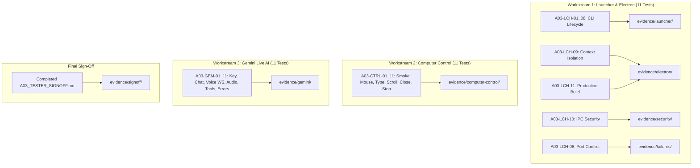

# Milestone A03 – External QA Handoff Readiness Report

**Document Version:** 1.0  
**Audit Date:** 2026-11-02  
**Project:** Alex Desktop Assistant  
**Milestone:** A03 – External Workstation Runtime Acceptance & Handoff Sign-Off  
**Audit Roles:** Senior QA Release Manager, Technical Project Coordinator, and Lead Systems Auditor  
**Authoritative References:**  
- [`A03_EXTERNAL_TESTER_HANDOFF.md`](./A03_EXTERNAL_TESTER_HANDOFF.md)  
- [`A03_TEST_EXECUTION_CHECKLIST.md`](./A03_TEST_EXECUTION_CHECKLIST.md)  
- [`A03_TESTER_SIGNOFF.md`](./A03_TESTER_SIGNOFF.md)  
- [`A03_EVIDENCE_TEMPLATE.md`](./A03_EVIDENCE_TEMPLATE.md)  
- [`A03_MILESTONE_ACCEPTANCE_REPORT.md`](../A03_MILESTONE_ACCEPTANCE_REPORT.md)  
- [`PROJECT_TASK_REGISTER.md`](../PROJECT_TASK_REGISTER.md)  
- [`ACCEPTANCE_EVIDENCE_INDEX.md`](../ACCEPTANCE_EVIDENCE_INDEX.md)  

---

## 1. Executive Summary & Governance Attestation

Following the completion and verification of the Milestone A03 external testing documentation suite, this report delivers the formal release coordination assessment. It confirms that the project repository is in a **controlled, audited, and strictly frozen state**, fully prepared for independent external QA execution.

### Governance Status Attestation:
* **Implementation Freeze Preserved:** No application source code has been altered. Milestone A02 Computer Control (`backend/app/services/computer_control_service.py`, `backend/app/actions/builtins/computer_control.py`, `frontend/src/pages/ComputerControlPage.tsx`) and the Unified Launcher (`launcher/`) remain completely frozen.
* **Baseline Preservation:** The reference project `Mark-LVI-main` remains untouched and strictly read-only.
* **No Premature Acceptance:** No workstream has been marked `ACCEPTED` based on automated unit tests, documentation completion, or handoff packaging alone.
* **Workstation Isolation:** The development host remains restricted by Active Directory Software Restriction Policy (AppLocker), blocking interactive terminal spawning of `powershell.exe`. No policy bypass was attempted.

---

## 2. Phase 1 – Read-Only Handoff Package Audit Results

A systematic, line-by-line inspection of all A03 handoff documents was performed against the 8 required criteria:

| Audit Criterion | Verification Scope | Audit Outcome | Observations / Evidence |
|---|---|---|---|
| **1. 33 Test IDs Present** | Execution checklist contains all 33 test IDs across 3 workstreams. | **VERIFIED** | `A03-LCH-01`..`11` (11 tests), `A03-CTRL-01`..`11` (11 tests), `A03-GEM-01`..`11` (11 tests). |
| **2. Test Protocol Completeness** | Each test ID specifies objective, exact command, expected result, evidence path, and PASS/FAIL/BLOCKED criteria. | **VERIFIED** | All 33 test cases feature structured sections with explicit expected outcomes, evidence files, and checkboxes. |
| **3. Evidence Directories Exist** | Physical directories exist on disk under `Alex/docs/external-acceptance/evidence/`. | **VERIFIED** | `launcher/`, `electron/`, `computer-control/`, `gemini/`, `security/`, `failures/`, `signoff/` all exist with `.gitkeep` markers. |
| **4. Standardized Templates** | Evidence templates enforce metadata, timestamps, tester identity, and sanitization flags. | **VERIFIED** | Templates A, B, C, and D enforce standard headers, masked tokens (`****`), and redaction rules. |
| **5. Separate Workstream Sign-Offs** | Sign-off certificate provides independent decision blocks for each workstream. | **VERIFIED** | Workstream 1, 2, and 3 have dedicated scorecard summaries, subtotal tallies, and independent verdict checkboxes. |
| **6. Consistent Prerequisites** | Operating system, runtime, hardware, and peripheral prerequisites align across all docs. | **VERIFIED** | Windows 10/11, Python 3.12, Node.js >= 18.20, 1080p display, physical mic/speakers, and Gemini key match across all files. |
| **7. Command Accuracy** | Documented commands match actual CLI and test entry points. | **VERIFIED** | `launcher.cli` arguments (`doctor -v`, `launch`, `status --json`, `restart`, `stop -f`) and Tkinter test flag (`$env:ALEX_ENABLE_DESKTOP_SMOKE = "1"`) verified against source. |
| **8. Security & Compliance** | Zero instructions encourage policy bypass, mock simulation for hardware, or credential leaks. | **VERIFIED** | Redaction standard mandates masking keys to `****`; guidelines prohibit AppLocker bypass or simulated hardware claims. |

---

## 3. Test Coverage & Evidence Mapping Summary

The 33 acceptance test protocols map deterministically to designated evidence files under `Alex/docs/external-acceptance/evidence/`:

### Complete Test-to-Evidence Matrix

| Test ID | Protocol Name | Workstream | Required Evidence File Path | Artifact Format |
|---|---|---|---|---|
| `A03-LCH-01` | Dependency & Environment Doctor | Launcher | `evidence/launcher/doctor_stdout.txt` | Terminal Log |
| `A03-LCH-02` | Full-Stack Sequential Launch | Launcher | `evidence/launcher/launch_stdout.txt` `evidence/electron/window_boot.png` | Terminal Log + Screenshot |
| `A03-LCH-03` | Status Command & PID Tracking | Launcher | `evidence/launcher/status_stdout.txt` | Terminal Log |
| `A03-LCH-04` | Bearer Token Redaction in JSON | Launcher | `evidence/launcher/status_json.txt` | Masked JSON State Dump |
| `A03-LCH-05` | Headless Launch Mode | Launcher | `evidence/launcher/headless_launch.txt` | Terminal Log |
| `A03-LCH-06` | Graceful Multi-Process Stop | Launcher | `evidence/launcher/stop_stdout.txt` | Terminal Log |
| `A03-LCH-07` | Full Session Restart | Launcher | `evidence/launcher/restart_stdout.txt` | Terminal Log |
| `A03-LCH-08` | Port Collision Auto-Reassignment | Launcher | `evidence/failures/port_conflict_stdout.txt` | Terminal Log |
| `A03-LCH-09` | Electron Context Isolation | Electron | `evidence/electron/devtools_context_isolation.png`| DevTools Screenshot |
| `A03-LCH-10` | IPC Sender & Origin Security Suite | Security | `evidence/security/electron_security_stdout.txt` | Vitest Test Output |
| `A03-LCH-11` | Production Packaging Verification | Packaging | `evidence/electron/packaging_stdout.txt` | Node Packaging Log |
| `A03-CTRL-01`| Guarded Tkinter Interaction Smoke | Control | `evidence/computer-control/smoke_stdout.txt` | Python Smoke Output |
| `A03-CTRL-02`| Physical Mouse Move & Click | Control | `evidence/computer-control/mouse_click_approval.png` | HUD Screenshot |
| `A03-CTRL-03`| Double-Click & Right-Click | Control | `evidence/computer-control/right_click_context.png` | Windows Screenshot |
| `A03-CTRL-04`| Drag Interpolation & Emergency Stop| Control | `evidence/computer-control/drag_emergency_stop.png` | HUD Screenshot |
| `A03-CTRL-05`| Text Typing (ASCII & Unicode Smart)| Control | `evidence/computer-control/typing_notepad.png` | Notepad Screenshot |
| `A03-CTRL-06`| Viewport Downward Scrolling | Control | `evidence/computer-control/scroll_advance.png` | Viewport Screenshot |
| `A03-CTRL-07`| In-Memory Screenshot Preview | Control | `evidence/computer-control/screenshot_preview.png` | HUD Screenshot |
| `A03-CTRL-08`| Win32 Window Enumeration & Focus | Control | `evidence/computer-control/focus_notepad.png` | Desktop Screenshot |
| `A03-CTRL-09`| Polite Close via `WM_CLOSE` | Control | `evidence/computer-control/close_smoke_stdout.txt`| Python Smoke Output |
| `A03-CTRL-10`| Proposal Expiry & Replay Gate | Control | `evidence/computer-control/proposal_expiry_log.txt` | Terminal / API Log |
| `A03-CTRL-11`| Emergency Stop Latch & Watchdog | Control | `evidence/computer-control/emergency_latch.png` | HUD Screenshot |
| `A03-GEM-01` | Keyring Credential Save via UI | Gemini | `evidence/gemini/credential_saved.png` | Settings Screenshot |
| `A03-GEM-02` | Live Gemini REST Chat Turn | Gemini | `evidence/gemini/rest_turn_chat.png` | Chat Screenshot |
| `A03-GEM-03` | Live WebSocket Handshake | Gemini | `evidence/gemini/websocket_connected.png` | Chat / Log Screenshot |
| `A03-GEM-04` | 16 kHz Microphone PCM Streaming | Gemini | `evidence/gemini/mic_streaming.png` | Waveform Screenshot |
| `A03-GEM-05` | 24 kHz Audio Playback & Hologram | Gemini | `evidence/gemini/assistant_speaking.png` | Hologram Screenshot |
| `A03-GEM-06` | Physical Barge-In Interruption | Gemini | `evidence/gemini/barge_in_interrupted.png` | Waveform Screenshot |
| `A03-GEM-07` | Push-to-Talk (Ctrl+Space) Gating | Gemini | `evidence/gemini/ptt_gated_turn.png` | Chat Screenshot |
| `A03-GEM-08` | Dynamic Live Tool Call (`metrics`) | Gemini | `evidence/gemini/live_tool_metrics.png` | Chat / Log Screenshot |
| `A03-GEM-09` | Voice Action Proposal Creation | Gemini | `evidence/gemini/voice_proposal_enqueued.png` | Controls Screenshot |
| `A03-GEM-10` | Human Approval & Result Return | Gemini | `evidence/gemini/voice_proposal_approved.png` | Controls Screenshot |
| `A03-GEM-11` | Invalid Key & Disconnect Handling | Gemini | `evidence/gemini/invalid_key_banner.png` | Error Banner Screenshot |
| Sign-Off | Completed Sign-Off Certificate | QA Lead | `evidence/signoff/completed_A03_TESTER_SIGNOFF.md` | Signed Markdown Document |

---

## 4. Workstation Prerequisites for External Tester

The external test engineer must verify that the test workstation satisfies all requirements prior to executing the test suite:

1. **Host OS:** Microsoft Windows 10 (64-bit, 21H2+) or Windows 11 (64-bit, 22H2/23H2/24H2).
2. **Execution Permissions:** Standard user execution (Administrator/UAC elevation NOT required); no Active Directory Group Policy (AppLocker / SRP) restricting PowerShell or Node/Python child process spawning.
3. **Python Runtime:** Python 3.12 (64-bit) with `venv` installed at `backend/.venv`.
4. **Node.js Runtime:** Node.js >= 18.20.0 (LTS) and npm >= 9.0 installed.
5. **Physical Display:** Minimum resolution 1280x720 (1920x1080 recommended) at 100% DPI scaling.
6. **Physical Audio:** Physical microphone (16 kHz capture) and physical speakers / headphones (24 kHz playback) connected and configured as default OS audio devices.
7. **Cloud Credentials:** Valid Google Gemini API Key with active access to `gemini-2.5-flash` and Gemini Live (`models/gemini-3.1-flash-live-preview` / `models/gemini-2.5-flash-native-audio-preview-12-2025`).
8. **Network Access:** Unrestricted HTTPS egress to `generativelanguage.googleapis.com`.

---

## 5. Known Execution Blockers on Development Machine

The development host runner exhibits the following environmental constraints, preventing local runtime acceptance:

* **Active Directory Software Restriction Policy (SRP / AppLocker):**  
  Interactive command execution (`run_command`) halts with `Command failed to run: This program is blocked by group policy.` Any attempt to invoke `powershell.exe` subshells is blocked by domain policy.
* **Lack of Physical Display Surface:**  
  The development runner operates in a headless/virtualized subshell without an interactive Windows desktop session, preventing PyAutoGUI from querying screen geometry or dispatching coordinate clicks.
* **Absence of Audio Hardware:**  
  The runner has no physical microphone or audio output devices, preventing Web Audio API capture of 16 kHz PCM frames or acoustic verification of 24 kHz playback and barge-in interruption.

---

## 6. Outstanding Tester Responsibilities

Upon receiving this handoff package, the external tester is responsible for:

1. Setting up the clean virtual environment and npm packages without modifying application code.
2. Executing all 33 test protocols in [`A03_TEST_EXECUTION_CHECKLIST.md`](./A03_TEST_EXECUTION_CHECKLIST.md).
3. Capturing real, un-simulated console logs, terminal outputs, and full-window screenshots.
4. Sanitizing all sensitive tokens and API keys to `****` in accordance with [`A03_EVIDENCE_TEMPLATE.md`](./A03_EVIDENCE_TEMPLATE.md).
5. Depositing all artifacts into their designated subdirectories under [`Alex/docs/external-acceptance/evidence/`](./evidence/).
6. Completing the environment attestation and scorecard in [`A03_TESTER_SIGNOFF.md`](./A03_TESTER_SIGNOFF.md).
7. Signing the formal certificate and submitting the completed package for final release review.

---

## 7. Explicit Current Acceptance Status by Workstream

In strict accordance with project governance, current authoritative acceptance statuses are formally recorded as follows:

| Workstream | Subsystems | Current Authoritative Status | Status Rationale |
|---|---|---|---|
| **Workstream 1** | Unified Launcher CLI & Electron Desktop Shell | **`BLOCKED_BY_ENVIRONMENT`** | Automated tests pass (22 launcher, 8 security); physical runtime launch blocked by host AppLocker policy. |
| **Workstream 2** | A02 Computer Control Physical Verification | **`NOT ACCEPTED`** *(Implementation FROZEN)* | Automated tests pass (32 service unit tests); physical mouse/keyboard/scroll verification blocked by runner environment. |
| **Workstream 3** | Gemini Live AI Voice & Function Calling | **`BLOCKED_BY_ENVIRONMENT`** | WebSocket framing and fake-turn tests pass; physical microphone/speaker routing and live production credentials unavailable on runner. |

---

## 8. Final Handoff Recommendation

### Verdict: `READY_FOR_EXTERNAL_TESTING`

**Justification:**  
1. All 33 test cases are fully specified with objectives, exact commands, expected results, evidence paths, and evaluation criteria.
2. All 7 physical evidence directories exist on disk.
3. Standardized evidence recording templates and redaction guidelines are published.
4. Workstation hardware and software prerequisites are consistent and verified against actual entry points.
5. Implementation freezes across Computer Control, Unified Launcher, and `Mark-LVI-main` remain strictly intact.
6. The project is in an auditable, controlled state and ready for execution by an independent QA engineer.

---

*Milestone A03 External QA Handoff Coordination complete. All documentation artifacts are verified and persisted. Standing by for external test execution and evidence submission.*

