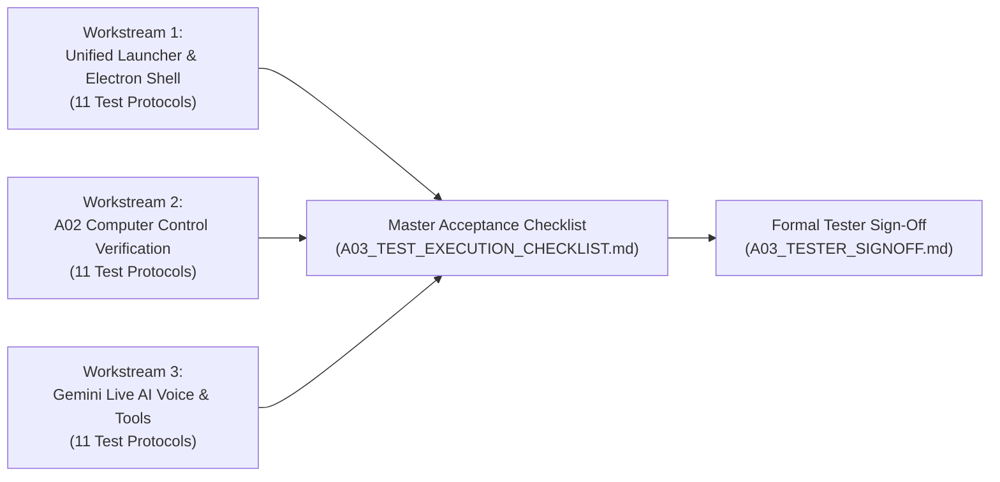

# Milestone A03 – External Workstation Tester Handoff Manual

**Document Version:** 1.0  
**Handoff Date:** 2026-11-01  
**Project:** Alex Desktop Assistant  
**Milestone:** A03 – External Workstation Runtime Acceptance & Handoff Sign-Off  
**Target Roles:** External QA Engineer, Independent Test Auditor, Lead Systems Verifier  
**Authoritative References:**  
- [`Alex/docs/A03_MILESTONE_ACCEPTANCE_REPORT.md`](../A03_MILESTONE_ACCEPTANCE_REPORT.md)  
- [`Alex/docs/PROJECT_TASK_REGISTER.md`](../PROJECT_TASK_REGISTER.md)  
- [`Alex/docs/A02_COMPLETION_AUDIT.md`](../A02_COMPLETION_AUDIT.md)  
- [`Alex/docs/UNIFIED_STARTUP_RUNTIME_ACCEPTANCE.md`](../UNIFIED_STARTUP_RUNTIME_ACCEPTANCE.md)  
- [`Alex/docs/external-acceptance/A03_TEST_EXECUTION_CHECKLIST.md`](./A03_TEST_EXECUTION_CHECKLIST.md)  
- [`Alex/docs/external-acceptance/A03_TESTER_SIGNOFF.md`](./A03_TESTER_SIGNOFF.md)  
- [`Alex/docs/external-acceptance/A03_EVIDENCE_TEMPLATE.md`](./A03_EVIDENCE_TEMPLATE.md)  

---

## 1. Context & Operational Background

On **2026-11-01**, formal physical runtime acceptance for Milestone A03 was initiated on the development runner host. During the invocation of interactive command subshells, the operating system security subsystem rejected execution with:

```text
Command failed to run: This program is blocked by group policy. For more information, contact your system administrator.
```

The development host is an enterprise-managed machine enforcing Active Directory Software Restriction Policies (SRP / AppLocker) that prohibit interactive terminal spawning of `powershell.exe` in automated agent sessions. Furthermore, automated CI/runner environments lack physical audio peripherals (microphones, speakers), physical display surfaces, and live cloud production secrets.

### Implementation Baseline & Freeze Status
* **Automated Quality Audit:** **PASSED**. 113 backend Pytest tests, 33 frontend Vitest tests, and packaging verifications pass with 0 failures. TypeScript and Vite production builds succeed with 0 errors.
* **Milestone A02 (Computer Control):** Strictly **FROZEN**. All 22 ported capabilities, emergency stop latches, proposal expiry rules, and Win32 process protection guards are complete in source code.
* **Unified Launcher CLI & Electron Desktop Shell:** Strictly **FROZEN**. Origin-based navigation guards, scoped `localDevUrl`, masked bearer tokens, and sequential multi-process startup are stabilized.
* **Authoritative Acceptance Status:** **`BLOCKED_BY_ENVIRONMENT`** (Launcher / Electron) and **`NOT ACCEPTED`** (A02 Computer Control).

This handoff package provides everything an authorized external tester requires to execute the physical acceptance suite on an unrestricted Windows 10/11 workstation and deliver an auditable, legally binding sign-off.

> [!IMPORTANT]
> **Delivery Notice:** Preparing this handoff package does **not** constitute runtime acceptance. Runtime acceptance requires physical execution, log capture, and formal sign-off by an authorized human tester.

---

## 2. Workstation Hardware & Software Specifications

To execute the test protocols without environmental interference, the target test machine must meet the following mandatory specifications:

| Resource Category | Minimum Specification | Recommended Specification | Verification Purpose |
|---|---|---|---|
| **Operating System** | Microsoft Windows 10 (64-bit, 21H2+) | Microsoft Windows 11 (64-bit, 22H2 / 23H2 / 24H2) | Target execution OS; Win32 window APIs (`EnumWindows`, `SetForegroundWindow`, `WM_CLOSE`). |
| **Execution Policy** | Standard user execution (no Administrator/UAC elevation required) | No Active Directory AppLocker / SRP blocking PowerShell or Python child processes | Required for `alex launch`, `python -m launcher.cli`, and subshell execution. |
| **Python Runtime** | Python 3.12 (64-bit) | Python 3.12.7+ (64-bit) with `venv` and `pip` | Backend FastAPI sidecar, dependencies (`google-genai`, `pyperclip`, `psutil`). |
| **Node.js Runtime** | Node.js v18.20.0 (LTS) | Node.js v20.x or v22.x with npm >= 9.0 | Frontend Vite server, Electron desktop shell (`electron@45.1.0`). |
| **Physical Display** | 1280x720 physical monitor (100% scaling) | 1920x1080 physical monitor (100% scaling) | Screen capture coordinates, display boundary validation, Tkinter smoke window. |
| **Audio Hardware** | Physical USB / 3.5mm microphone + headphones | Studio or headset mic (16 kHz PCM) + stereo speakers | Live bidirectional audio streaming, barge-in echo verification, test tones. |
| **Cloud Credentials** | Google Gemini API Key | Dedicated test key with access to `gemini-2.5-flash` and Gemini Live (`models/gemini-3.1-flash-live-preview` / `models/gemini-2.5-flash-native-audio-preview-12-2025`) | Live multi-turn REST chat and WebSocket voice streaming. |
| **Network Egress** | Unrestricted HTTPS egress to `generativelanguage.googleapis.com` | Low-latency broadband internet connection | Real-time audio packet transport and Google search grounding. |

---

## 3. Workstation Onboarding & Setup Guide

Execute the following setup commands sequentially from a fresh terminal on the unrestricted workstation:

### Step 1: Clone Repository & Verify Tree
```powershell
# Navigate to preferred development directory
cd C:\Workspace

# Clone repository
git clone <repository-url> Alex
cd Alex

# Confirm tree structure
dir
# Expected directories: backend/, frontend/, launcher/, docs/
```

### Step 2: Initialize Python Virtual Environment
```powershell
# Create dedicated virtual environment in backend/.venv
cd backend
python -m venv .venv

# Activate virtual environment
.\.venv\Scripts\Activate.ps1

# Upgrade pip and install exact locked dependencies
python -m pip install --upgrade pip
pip install -r requirements.txt

# Verify key dependencies
python -c "import fastapi, google.genai, pyperclip, psutil; print('Backend dependencies: OK')"
cd ..
```

### Step 3: Install Frontend Dependencies & Build Electron Bundle
```powershell
cd frontend

# Install exact npm lockfile packages
npm ci

# Compile TypeScript and verify build
npm run build

# Verify build output
dir dist
dir dist-electron
cd ..
```

### Step 4: Configure Secrets & Environment Files
Create the backend configuration file from the template:
```powershell
copy backend\.env.example backend\.env
```
Open `backend\.env` in an editor and configure your active Google Gemini API key:
```ini
ALEX_DATA_DIR=
ALEX_LOG_LEVEL=INFO
GEMINI_API_KEY=AIzaSyYourActualKeyHere1234567890
```

> [!NOTE]
> **Credential Storage Architecture:**
> Alex supports two complementary credential ingestion pathways:
> 1. **OS Credential Locker (`keyring`):** Recommended for interactive runtime. Configured via the Settings UI (tested in `A03-GEM-01`), storing the secret securely in Windows Credential Manager under Service `Alex` and Account `gemini-api-key`.
> 2. **Environment File (`backend/.env`):** Loaded on startup via `SettingsService.get_api_key_for_service()`. Useful for automated test scripts and headless mode without interactive GUI input.

> [!WARNING]
> Never commit `backend/.env` or any file containing plaintext API keys to source control.

---

## 4. Tester Rules of Engagement

All external testers must strictly adhere to the following governance rules during acceptance testing:

1. **No Code Modifications:** Do not modify any application source code in `backend/app/`, `frontend/src/`, `frontend/electron/`, or `launcher/`. If a test fails, document the defect in the evidence log—do not refactor code to make the test pass.
2. **Preserve Computer Control Freeze:** The A02 Computer Control subsystem is strictly frozen. No service logic or confirmation gates may be altered.
3. **No Mock Substitution:** Headless mocks and simulated unit runs do not constitute runtime proof. Physical window rendering, mouse movements, and audio playback must be observed.
4. **Mandatory Redaction:** Never record real Gemini API keys, raw bearer tokens, or personal directory paths in logs, screenshots, or transcripts. Always sanitize to `****`.
5. **Deterministic Evidence Recording:** Every test case must produce a verifiable artifact committed under `Alex/docs/external-acceptance/evidence/`.

---

## 5. Acceptance Workstream Overview

Testing is structured into three discrete workstreams:



### Workstream 1: Unified Launcher & Electron Desktop Runtime
- Validates system health checks via `alex doctor`.
- Validates full-stack startup sequencing (`alex launch`), process PID state tracking, dynamic port conflict reassignment (8765 -> 8766), graceful multi-process termination (`alex stop`), and token masking (`****`).
- Validates Electron BrowserWindow initialization (1180x800), context isolation (`nodeIntegration: false`), and origin-based navigation guards.

### Workstream 2: A02 Computer Control Physical Desktop Verification
- Validates physical mouse movement, coordinate clicking, double-click, right-click, and drag interpolation.
- Validates ASCII text typing and Unicode clipboard smart typing.
- Validates viewport downward scrolling, in-memory screenshot capture, visible window enumeration via Win32 `EnumWindows`, title focus, and polite application termination (`WM_CLOSE`).
- Validates safety controls: session permission toggle (default OFF), 5-minute proposal TTL, one-shot approval tokens, duplicate approval rejection, latched emergency stop, and 12-second watchdog timers.

### Workstream 3: Gemini Live AI Voice & Function Calling Integration
- Validates real-time 16 kHz microphone PCM audio capture and streaming over loopback WebSocket to Gemini Live.
- Validates 24 kHz audio return and physical speaker playback with synchronized holographic waveform animations.
- Validates instant barge-in interruption (speaking while the assistant responds immediately stops audio playback).
- Validates dynamic model function calling (assistant invoking `system.get_metrics`, `memory.recall`) and proposal generation requiring human approval in the Controls drawer.

---

## 6. Execution Protocol & Deliverables Index

External testers must utilize the following companion documents:

1. **Test Execution Checklist:** [`Alex/docs/external-acceptance/A03_TEST_EXECUTION_CHECKLIST.md`](./A03_TEST_EXECUTION_CHECKLIST.md)  
   *Step-by-step test commands, execution sequences, expected outputs, and pass/fail criteria.*
2. **Tester Sign-Off Certificate:** [`Alex/docs/external-acceptance/A03_TESTER_SIGNOFF.md`](./A03_TESTER_SIGNOFF.md)  
   *Workstation attestation forms, workstream decision scorecards, and formal signature certificates.*
3. **Evidence Recording Templates:** [`Alex/docs/external-acceptance/A03_EVIDENCE_TEMPLATE.md`](./A03_EVIDENCE_TEMPLATE.md)  
   *Standardized templates for console outputs, state dumps, and screenshot metadata.*
4. **Designated Evidence Repository:**
   - Launcher Outputs: [`Alex/docs/external-acceptance/evidence/launcher/`](./evidence/launcher/)
   - Electron Screenshots & DevTools: [`Alex/docs/external-acceptance/evidence/electron/`](./evidence/electron/)
   - Computer Control Smoke Logs: [`Alex/docs/external-acceptance/evidence/computer-control/`](./evidence/computer-control/)
   - Gemini Live Audio & Transcripts: [`Alex/docs/external-acceptance/evidence/gemini/`](./evidence/gemini/)
   - Security Validation Outputs: [`Alex/docs/external-acceptance/evidence/security/`](./evidence/security/)
   - Failure & Recovery Scenarios: [`Alex/docs/external-acceptance/evidence/failures/`](./evidence/failures/)
   - Completed Sign-Offs: [`Alex/docs/external-acceptance/evidence/signoff/`](./evidence/signoff/)

