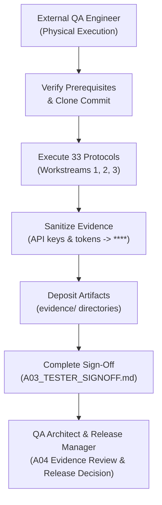

# Milestone A04 – External QA Execution Plan

**Document Version:** 1.0  
**Execution Milestone:** A04 – External QA Execution, Evidence Review & Release Authorization  
**Project:** Alex Desktop Assistant  
**Date:** 2026-11-02  
**Target Roles:** External QA Engineer, Lead Systems Verifier, Security Reviewer, Release Manager  
**Authoritative References:**  
- [`Alex/docs/external-acceptance/A03_EXTERNAL_TESTER_HANDOFF.md`](./A03_EXTERNAL_TESTER_HANDOFF.md)  
- [`Alex/docs/external-acceptance/A03_TEST_EXECUTION_CHECKLIST.md`](./A03_TEST_EXECUTION_CHECKLIST.md)  
- [`Alex/docs/external-acceptance/A03_TESTER_SIGNOFF.md`](./A03_TESTER_SIGNOFF.md)  
- [`Alex/docs/external-acceptance/A03_EVIDENCE_TEMPLATE.md`](./A03_EVIDENCE_TEMPLATE.md)  
- [`Alex/docs/external-acceptance/A03_EXTERNAL_HANDOFF_READINESS.md`](./A03_EXTERNAL_HANDOFF_READINESS.md)  
- [`Alex/docs/PROJECT_TASK_REGISTER.md`](../PROJECT_TASK_REGISTER.md)  

---

## 1. Executive Scope & Objectives

Milestone **A04** governs the transition from handoff readiness (`READY_FOR_EXTERNAL_TESTING`) to formal physical runtime testing on an unrestricted Windows 10/11 workstation, evidence collection, authenticity audit, and release authorization.

### Primary Objectives:
1. **Maintain Implementation Freezes:** Execute acceptance testing against the frozen Alex codebase without modifying application source code.
2. **Empirical Evidence Generation:** Coordinate execution of all 33 test protocols in [`A03_TEST_EXECUTION_CHECKLIST.md`](./A03_TEST_EXECUTION_CHECKLIST.md) on physical hardware.
3. **Evidence Authenticity & Sanitization:** Ensure all terminal logs, DevTools screenshots, Tkinter smoke outputs, and audio recordings are genuine, un-simulated, and sanitized of credentials (`****`).
4. **Independent Workstream Evaluation:** Independently evaluate Workstream 1 (Launcher & Electron), Workstream 2 (A02 Computer Control), and Workstream 3 (Gemini Live).
5. **Release Authorization Gate:** Formally determine project release readiness based on auditable evidence.

> [!IMPORTANT]
> **Governance Notice:** This execution plan coordinates external testing. It does **not** assume or assert that external testing has already occurred. Local development host execution remains strictly blocked by Active Directory Group Policy (AppLocker), and local policy bypass is prohibited.

---

## 2. Baseline Git Commit & Repository Snapshot Identification

To ensure auditable repeatability, the external testing process must be tied to an exact, immutable code baseline:

| Attribute | Recorded Baseline Details |
|---|---|
| **Repository Path** | `d:\Workspace\Jibi\Alex` |
| **Package Version** | `0.1.0` (defined in `backend/pyproject.toml` and `frontend/package.json`) |
| **Baseline Snapshot Identifier** | `SNAPSHOT_v0.1.0-20261102` |
| **Repository Status on Runner** | Clean filesystem release snapshot (runner host environment lacks local `.git` metadata) |
| **External Tester Git SHA** | `<TARGET_COMMIT_SHA>` *(External tester must record the exact 40-character Git commit SHA upon cloning from origin)* |
| **Working Tree Status** | **CLEAN / FROZEN** (Zero uncommitted changes in `backend/app/`, `frontend/src/`, `frontend/electron/`, `launcher/`) |
| **Baseline Preservation Rule** | Strict implementation freeze; no code modifications permitted to make tests pass |

---

## 3. Tester Roles & Responsibilities

The external QA engagement requires strict adherence to designated responsibilities:



### Mandatory Tester Rules of Engagement:
1. **Zero Code Modifications:** Do not edit application files in `backend/app/`, `frontend/src/`, `frontend/electron/`, or `launcher/`. If an anomaly occurs, log a defect—do not refactor code.
2. **Preserve Computer Control Freeze:** The A02 Computer Control implementation is frozen. Test actions must be executed exactly as specified.
3. **No Mocks or Simulations:** Headless runs or mocked responses do not constitute physical runtime proof. Genuine mouse cursor movements, visible window focus, and audible speaker playback must be observed.
4. **Mandatory Secret Sanitization:** Plaintext Gemini API keys, bearer tokens, and private host paths must be redacted to `****`.
5. **Independent Scoring:** Score each test case independently as `PASS`, `FAIL`, or `BLOCKED`.

---

## 4. Workstation Hardware & Software Prerequisites

The external test workstation must satisfy these verified prerequisites before starting execution:

| Requirement Dimension | Minimum Specification | Recommended Specification | Purpose & Justification |
|---|---|---|---|
| **Operating System** | Windows 10 64-bit (21H2+) | Windows 11 64-bit (22H2 / 23H2 / 24H2) | Primary deployment platform; Win32 window APIs (`EnumWindows`, `SetForegroundWindow`, `WM_CLOSE`). |
| **Execution Policy** | Standard user account | Standard user account (no UAC / Administrator elevation required) | Subshell command execution without Active Directory AppLocker or SRP blocking PowerShell. |
| **Python Runtime** | Python 3.12 (64-bit) | Python 3.12.7+ (64-bit) | Backend FastAPI sidecar, dependencies (`google-genai`, `pyautogui`, `psutil`). |
| **Node.js Runtime** | Node.js v18.20.0 (LTS) | Node.js v20.x or v22.x with npm >= 9.0 | Frontend Vite build and Electron desktop shell (`electron@45.1.0`). |
| **Physical Display** | 1280x720 physical monitor (100% DPI) | 1920x1080 physical monitor (100% DPI) | Screen geometry, coordinate clicks, Tkinter smoke window validation. |
| **Audio Hardware** | Physical USB/3.5mm microphone + headphones | Headset/studio mic (16 kHz PCM) + stereo speakers | Live bidirectional streaming, audio visualizer sync, barge-in echo verification. |
| **Cloud Credentials** | Google Gemini API Key | Valid key with access to `gemini-2.5-flash` and Gemini Live | Multi-turn REST chat and real-time Live WebSocket streaming. |
| **Network Egress** | HTTPS port 443 open to Google APIs | Low-latency broadband internet connection | Real-time audio packet transport (`generativelanguage.googleapis.com`). |

---

## 5. 33-Test Execution Protocol Overview

Execution is organized into three sequential workstreams as defined in [`A03_TEST_EXECUTION_CHECKLIST.md`](./A03_TEST_EXECUTION_CHECKLIST.md):

### Workstream 1: Unified Launcher & Electron Desktop Shell (11 Tests)
- `A03-LCH-01`: Environment & Dependency Doctor (`python -m launcher.cli doctor --verbose`)
- `A03-LCH-02`: Full-Stack Sequential Launch (`python -m launcher.cli launch`)
- `A03-LCH-03`: Process Status & PID Verification (`python -m launcher.cli status`)
- `A03-LCH-04`: Bearer Token Redaction in JSON Status (`python -m launcher.cli status --json`)
- `A03-LCH-05`: Headless Launch Mode (`python -m launcher.cli launch --no-electron`)
- `A03-LCH-06`: Graceful Multi-Process Stop (`python -m launcher.cli stop`)
- `A03-LCH-07`: Full Session Restart (`python -m launcher.cli restart`)
- `A03-LCH-08`: Port Conflict Dynamic Reassignment (Simulate occupied port 8765 -> verify 8766)
- `A03-LCH-09`: Electron Context Isolation & Preload Facade (DevTools Console inspection)
- `A03-LCH-10`: IPC Sender & Origin Security Suite (`npm test -- electron-security.test.ts`)
- `A03-LCH-11`: Production Build Packaging & Asset Loading (`npm run build && npm run test:packaging`)

### Workstream 2: A02 Computer Control Physical Desktop Verification (11 Tests)
- `A03-CTRL-01`: Guarded Windows Interaction Smoke Run (`tests/manual_computer_control_smoke.py`)
- `A03-CTRL-02`: Physical Mouse Movement & Coordinate Click (Move to 500,300 with human approval)
- `A03-CTRL-03`: Double-Click & Right-Click Execution (Word selection and Windows context menu)
- `A03-CTRL-04`: Drag Interpolation & Emergency Stop Checkpoint (Drag abort mid-trajectory)
- `A03-CTRL-05`: Text Typing (ASCII text typing and Unicode clipboard smart typing in Notepad)
- `A03-CTRL-06`: Viewport Downward Scrolling (Vertical scroll advance on active window)
- `A03-CTRL-07`: In-Memory Screenshot Preview (Thumbnail render in drawer without disk leaks)
- `A03-CTRL-08`: Win32 Visible Window Enumeration & Title Focus (Calculator/Notepad HWND focus)
- `A03-CTRL-09`: Polite Application Close via `WM_CLOSE` (`tests/manual_computer_control_close_smoke.py`)
- `A03-CTRL-10`: Proposal Expiry & Replay Protection (5-minute TTL expiry and token replay rejection)
- `A03-CTRL-11`: Emergency Stop Latching & Watchdog Cancellation (Latched stop and re-arm)

### Workstream 3: Gemini Live AI Voice & Function Calling Integration (11 Tests)
- `A03-GEM-01`: OS Credential Store Key Save via UI (Windows Credential Locker `keyring`)
- `A03-GEM-02`: Live Gemini REST Multi-Turn Chat (Speed of light query via `gemini-2.5-flash`)
- `A03-GEM-03`: Gemini Live WebSocket Handshake (`models/gemini-3.1-flash-live-preview`)
- `A03-GEM-04`: 16 kHz Microphone PCM Streaming (Web Audio API capture and HUD waveform)
- `A03-GEM-05`: 24 kHz Audio Playback & Holographic Waveform (Audible playback and hologram sync)
- `A03-GEM-06`: Physical Barge-In Interruption (Spoken interruption silences speech within 250ms)
- `A03-GEM-07`: Push-to-Talk (PTT) Gating (`Ctrl+Space` push-to-talk audio gating)
- `A03-GEM-08`: Dynamic Tool Calling over Live Voice (Assistant calls `system.get_metrics`)
- `A03-GEM-09`: Voice-Initiated Computer Control Proposal (Assistant enqueues proposal card)
- `A03-GEM-10`: Human Proposal Approval & Voice Result Return (Click Approve and model acknowledgment)
- `A03-GEM-11`: Invalid Credential & Disconnect Error Handling (Polite UI banner on invalid key)

---

## 6. Evidence Collection & Redaction Requirements

All test artifacts must be committed to the standardized directory structure:

```
Alex/docs/external-acceptance/evidence/
├── launcher/          # Logs from A03-LCH-01 through A03-LCH-07
├── electron/          # DevTools context isolation & packaging logs (A03-LCH-09, A03-LCH-11)
├── computer-control/  # Tkinter smoke, mouse, keyboard, scroll logs & shots (A03-CTRL-01..11)
├── gemini/            # Credential, REST, WebSocket, PCM, PTT, tool call evidence (A03-GEM-01..11)
├── security/          # Origin matching & IPC security test logs (A03-LCH-10)
├── failures/          # Port conflict test log and host blocker captures (A03-LCH-08)
└── signoff/           # Completed and signed A03_TESTER_SIGNOFF.md certificate
```

### Mandatory Redaction Rules:
- **API Keys:** Replace keys matching `AIza...` with `****` or `[REDACTED_API_KEY]`.
- **Bearer Tokens:** Replace session tokens with `****`.
- **Private Paths:** Replace usernames (e.g. `C:\Users\username\`) with `%USERPROFILE%\` or `C:\Users\tester\`.
- **Sidecar Metadata:** Follow format standards in [`A03_EVIDENCE_TEMPLATE.md`](./A03_EVIDENCE_TEMPLATE.md).

---

## 7. Execution Schedule & Escalation Procedure

### Placeholder Execution Schedule:
| Milestone Stage | Target Date | Primary Actor | Deliverable Artifact | Status |
|---|---|---|---|---|
| **Phase 1: Baseline Verification** | 2026-11-02 | Lead Architect | `A04_EXTERNAL_QA_EXECUTION_PLAN.md` | **COMPLETED** |
| **Phase 2: Workstation Setup** | Scheduled (Day 1) | External Tester | Workstation Attestation in `A03_TESTER_SIGNOFF.md` | PENDING |
| **Phase 3: Workstream 1 Execution** | Scheduled (Day 1) | External Tester | Evidence in `evidence/launcher/`, `evidence/electron/` | PENDING |
| **Phase 4: Workstream 2 Execution** | Scheduled (Day 2) | External Tester | Evidence in `evidence/computer-control/` | PENDING |
| **Phase 5: Workstream 3 Execution** | Scheduled (Day 2) | External Tester | Evidence in `evidence/gemini/` | PENDING |
| **Phase 6: Sign-Off Submission** | Scheduled (Day 3) | External Tester | Signed `A03_TESTER_SIGNOFF.md` | PENDING |
| **Phase 7: Evidence Review & Release**| Scheduled (Day 3) | Release Manager | `A04_RELEASE_AUTHORIZATION_REPORT.md` | PENDING |

### Escalation Procedure:
1. **Critical Defect / Process Crash:** If an unhandled exception or crash occurs, the tester must capture the full stack trace, screenshot, and process exit code in `evidence/failures/`, note the defect in `A04_EXTERNAL_TEST_EXECUTION_REGISTER.md`, and notify the Architecture Lead immediately.
2. **Security Control Bypass:** If an unauthorized origin loads, an untrusted IPC message succeeds, or plaintext secrets leak, execution must be halted immediately.
3. **Environmental Blocker:** If the external workstation encounters an operating system restriction or network egress failure, document the exact environment constraint and mark the test `BLOCKED_BY_ENVIRONMENT`.

