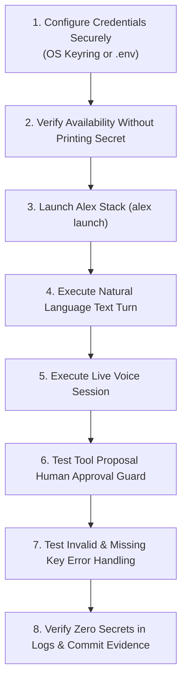

# Alex – Live Gemini End-to-End Acceptance Checklist

**Document:** `GEMINI_E2E_CHECKLIST.md`  
**Purpose:** Test instructions and auditable verification checklist for real, non-mocked Gemini AI integration (`TC-GEM-01` to `TC-GEM-06`).

---

## 1. Overview & Acceptance Mandate

Alex integrates Google Gemini models across two distinct interfaces:
1. **REST Chat Conversation:** Uses `google.genai` SDK with `gemini-2.5-flash` (and `gemini-2.5-flash-lite` fallback) for conversational turns, web search grounding, and tool execution proposals.
2. **Gemini Live Voice:** Bidirectional WebSocket audio/text streaming via `models/gemini-3.1-flash-live-preview` (and native audio fallback) with 24kHz PCM audio.

### Strict Governance Rules
* **No Mock Substitution:** Automated tests with mocks prove schema compatibility, but external acceptance requires a live API key and genuine turns communicating with Google Gemini.
* **Zero Credential Leakage:** API keys must never be committed to Git, printed in stdout/stderr, written to plaintext files, or displayed in UI input fields after submission.
* **Human-in-the-Loop Preserved:** If a Gemini response proposes computer control actions, the action must be staged as a proposal and require explicit manual human approval in the Controls drawer. Gemini is never permitted autonomous computer control execution.

---

## 2. Test Execution Workflow



---

## 3. Detailed Step-by-Step Protocols

### TC-GEM-01: Secure Credential Configuration & Verification
* **Objective:** Store Gemini API key securely in the OS credential manager and verify presence without exposing the plaintext key.
* **Configuration Methods:**
  * **Option A (GUI - Recommended):**
    1. Start Alex: `alex launch`.
    2. Click **Setup** drawer button in top right header.
    3. Paste Gemini API key from [Google AI Studio](https://aistudio.google.com/app/apikey) into the API Key input.
    4. Click **Save**. The key is committed directly to the Windows Credential Manager (`service: "Alex"`, `account: "gemini-api-key"`).
    5. The input clears and a green **"API Key Configured"** badge appears.
  * **Option B (Environment Variable):**
    Add `GEMINI_API_KEY=AIzaSy...` to your local [`.env`](file:///d:/Workspace/Jibi/Alex/.env) file (which is git-ignored).
* **Non-Leaking Credential Verification Command:**
  Run in terminal to confirm availability without printing the secret:
  ```cmd
  backend\.venv\Scripts\python.exe -c "from app.core.storage import JsonDocumentStore; from app.services.settings_service import SettingsService; s = SettingsService(JsonDocumentStore()); print('Credential Available:', s.api_key_configured())"
  ```
  **Expected Output:** `Credential Available: True`. No part of the key string is printed.

---

### TC-GEM-02: Live Conversational REST Turn
* **Objective:** Verify end-to-end text conversation with real Gemini model ladder.
* **Procedure:**
  1. In the Alex HUD chat input bar, type:  
     `"What are the three laws of robotics in 30 words?"`
  2. Press Enter or click the Send arrow.
* **Verification Checklist:**
  * [ ] Alex HUD displays user prompt immediately.
  * [ ] Typing/processing pulse indicator animates in HUD.
  * [ ] Model response streams or renders into the chat transcript within 10 seconds.
  * [ ] Response accurately states Asimov's Three Laws.
  * [ ] Backend log confirms request routed to `gemini-2.5-flash` (or fallback).
* **Evidence to Capture:**
  * Take a screenshot of the chat window with the response and save to [`evidence/gemini/rest_turn_chat.png`](./evidence/gemini/).
  * Copy the conversation transcript to [`evidence/gemini/rest_transcript.txt`](./evidence/gemini/) (masking any personal info).

---

### TC-GEM-03: Live Bidirectional Gemini Voice Session
* **Objective:** Verify WebSocket streaming audio connection to Gemini Live.
* **Procedure:**
  1. Ensure microphone is connected and operating system microphone permission is granted.
  2. Click the **Microphone** icon in the Alex HUD or press the Live Voice toggle.
  3. Observe status indicator change to **"Connected"** (or animated voice orb).
  4. Speak clearly into the microphone:  
     `"Alex, what is the distance from the Earth to the Moon?"`
* **Verification Checklist:**
  * [ ] Microphone audio PCM stream transmits to backend (`ws://127.0.0.1:8765/api/v1/conversation/live`).
  * [ ] Backend establishes Gemini Live session (`models/gemini-3.1-flash-live-preview`).
  * [ ] Gemini synthesizes speech: Assistant voice response is clearly audible through speakers.
  * [ ] Transcript appears in HUD voice log.
  * [ ] Click Stop Voice: Connection closes cleanly (WebSocket close code 1000).
* **Evidence to Capture:**
  * Save a screenshot of the active voice session to [`evidence/gemini/live_voice_session.png`](./evidence/gemini/).

---

### TC-GEM-04: Computer Control Tool Proposal Human Approval Guard
* **Objective:** Verify that when Gemini suggests a computer control action, human approval is strictly required.
* **Procedure:**
  1. In Alex chat, submit:  
     `"Please click the mouse at coordinate X=500, Y=300"`
  2. Observe Alex response.
* **Verification Checklist:**
  * [ ] Gemini does **NOT** autonomously move or click the mouse.
  * [ ] Gemini creates a structured `computer.request` proposal.
  * [ ] Alex UI opens or highlights the **Controls** drawer with the pending proposal:
    * Action Type: `mouse_click`
    * Parameters: `x: 500, y: 300`
    * Requires Human Approval: `YES`
  * [ ] Clicking **Reject** cancels the action cleanly.
  * [ ] No computer control action executes without clicking **Approve**.
* **Evidence to Capture:**
  * Capture screenshot of the pending proposal in the Controls drawer and save to [`evidence/gemini/tool_proposal_approval.png`](./evidence/gemini/).

---

### TC-GEM-05: Missing & Invalid Credential Fault Tolerance
* **Objective:** Verify that missing or corrupted API keys produce clean user-facing error banners and never crash the backend sidecar.
* **Procedure A (Missing Key):**
  1. Temporarily clear `GEMINI_API_KEY` from `.env` and remove key from keyring.
  2. Attempt a chat turn.
  * **Expected Result:** HUD displays a polite informational banner: `"Configure a Gemini API key in Settings to use chat."` Backend remains healthy (`/api/v1/health` returns 200).
* **Procedure B (Invalid Key):**
  1. Configure an invalid key: `AIzaSy_INVALID_KEY_FOR_TESTING_12345`.
  2. Attempt a chat turn.
  * **Expected Result:** HUD displays error banner: `"Gemini API authentication failed (400/403). Check your key."` Backend process does NOT crash or exit.
* **Evidence to Capture:**
  * Save screenshot of error banner to [`evidence/gemini/credential_error_banner.png`](./evidence/gemini/).

---

### TC-GEM-06: Zero Plaintext Secrets in Logs & Traces
* **Objective:** Audit all generated runtime logs and network captures for credential exposure.
* **Procedure:**
  1. Search all log files in `%APPDATA%\Alex\logs\` and console outputs in `evidence/`.
  2. Search for the string prefix `AIzaSy`.
* **Expected Result:**
  * Zero unmasked API keys exist in any log file.
  * All log occurrences are redacted as `AIzaSy...****` or masked.

---

## 4. Results Recording Sheet

| Test ID | Scenario | Date Tested | Actual Observation | Status |
|---|---|---|---|---|
| **TC-GEM-01** | Secure Credential Setup & Verification | *(Date)* | Stored in keyring; availability check returns `True` | `[  ] PASS  [  ] FAIL` |
| **TC-GEM-02** | Live REST Chat Turn (`gemini-2.5-flash`) | *(Date)* | Natural language response rendered in HUD | `[  ] PASS  [  ] FAIL` |
| **TC-GEM-03** | Gemini Live Voice Session & Audio Playback | *(Date)* | Voice session connected; audio stream audible | `[  ] PASS  [  ] FAIL` |
| **TC-GEM-04** | Tool Proposal Human Approval Guard | *(Date)* | Action staged as proposal; human click required | `[  ] PASS  [  ] FAIL` |
| **TC-GEM-05** | Missing/Invalid Key Error Handling | *(Date)* | Graceful UI banner; backend does not crash | `[  ] PASS  [  ] FAIL` |
| **TC-GEM-06** | Zero Plaintext Secrets in Logs | *(Date)* | Zero unmasked keys found in log audit | `[  ] PASS  [  ] FAIL` |

