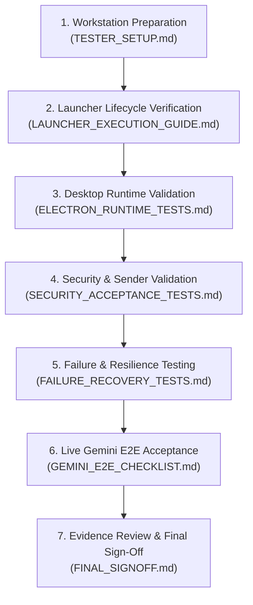

# Alex – Unified Startup & Electron Runtime Acceptance Repository

**Milestone:** Unified Launcher CLI & Electron Desktop Runtime Stabilization  
**Authoritative Specification:** [`Alex/docs/UNIFIED_STARTUP_RUNTIME_ACCEPTANCE.md`](../../UNIFIED_STARTUP_RUNTIME_ACCEPTANCE.md)  
**Main Reference Manual:** [`Alex/README.md`](../../../README.md)  
**Implementation State:** **FROZEN**  
**Current Milestone Acceptance Decision:** **`BLOCKED_BY_ENVIRONMENT`**  

---

## 1. Overview & Purpose

This repository package contains the complete handoff instructions, environment preparation guidelines, executable test protocols, and auditable evidence templates required to perform formal external runtime acceptance testing for the **Alex Unified Application Launcher** and **Electron Desktop Shell** on an authorized, unrestricted Windows 10/11 workstation.

On the development runner host, workstation Active Directory Software Restriction Policy (SRP / AppLocker) blocks `powershell.exe` execution in automated subshells. While all source inspection, build alignments, and automated test suites have been verified (`ACCEPTED`), physical hardware execution of the graphical desktop application must be validated and signed off by an authorized tester on an unrestricted workstation.

### Strict Audit Rules
* **No Mock Substitution:** Mocks and headless tests prove logic correctness, but cannot substitute for physical window rendering and real process supervision.
* **Preserve Implementation Freeze:** Do not modify the launcher, Electron lifecycle, or A02 Computer Control code. The reference project `Mark-LVI-main` must remain completely untouched.
* **Zero Credential Exposure:** Never record real Gemini API keys, bearer tokens, or personal identifiers in any evidence file, screenshot, or transcript.
* **Unambiguous Status:** Until physical desktop execution and process supervision are verified on an unrestricted machine, the decision must remain **`BLOCKED_BY_ENVIRONMENT`**.

---

## 2. Evidence Repository Structure

```text
Alex/docs/external-acceptance/unified-startup/
├── README.md                      # This handoff index and overview
├── TESTER_SETUP.md                # Tester workstation setup, dependencies, and environment files
├── LAUNCHER_EXECUTION_GUIDE.md    # Step-by-step execution for doctor, launch, status, restart, stop
├── ELECTRON_RUNTIME_TESTS.md      # Development and production desktop window validation protocols
├── SECURITY_ACCEPTANCE_TESTS.md   # Origin validation, canonical file path, and IPC sender tests
├── FAILURE_RECOVERY_TESTS.md      # 10 failure scenarios and automatic recovery tests
├── GEMINI_E2E_CHECKLIST.md        # Live Gemini AI text, voice, tool approval, and key tests
├── FINAL_SIGNOFF.md               # Formal acceptance certificate and sign-off criteria
└── evidence/
    ├── launcher/                  # Captured stdout/stderr logs for launcher commands
    ├── electron/                  # Window screenshots, HUD rendering, and DevTools logs
    ├── security/                  # Automated security test run outputs
    ├── failures/                  # Logs for port reassignment, health timeouts, and crash cleanup
    └── gemini/                    # Live Gemini transcripts, HUD response screenshots, audio traces
```

---

## 3. Recommended Execution Order

An authorized tester should execute the acceptance scenarios in the following structured sequence:



1. **Step 1: Workstation Setup & Pre-Flight:**  
   Complete [`TESTER_SETUP.md`](./TESTER_SETUP.md). Confirm Python 3.11+, Node 20+, and execute `alex doctor` to verify environment readiness.
2. **Step 2: Launcher Lifecycle Tests:**  
   Follow [`LAUNCHER_EXECUTION_GUIDE.md`](./LAUNCHER_EXECUTION_GUIDE.md). Run `alex launch`, `alex status`, `alex restart`, `alex stop`, and save console outputs to `evidence/launcher/`.
3. **Step 3: Electron Runtime Tests:**  
   Follow [`ELECTRON_RUNTIME_TESTS.md`](./ELECTRON_RUNTIME_TESTS.md). Verify development window loading (`http://127.0.0.1:5173/`), production bundle loading (`dist/index.html`), HUD effects, and IPC communication. Save screenshots to `evidence/electron/`.
4. **Step 4: Security Acceptance Tests:**  
   Follow [`SECURITY_ACCEPTANCE_TESTS.md`](./SECURITY_ACCEPTANCE_TESTS.md). Run the automated security test suite, verify origin validation, canonical production file checks, and token masking. Save test logs to `evidence/security/`.
5. **Step 5: Failure & Resilience Tests:**  
   Follow [`FAILURE_RECOVERY_TESTS.md`](./FAILURE_RECOVERY_TESTS.md). Test the 10 failure edge cases (port collisions, backend crash, health timeout, Ctrl+C). Save logs to `evidence/failures/`.
6. **Step 6: Live Gemini Integration Tests:**  
   Follow [`GEMINI_E2E_CHECKLIST.md`](./GEMINI_E2E_CHECKLIST.md). Execute real text conversation turns, Gemini Live voice sessions, tool approval guards, and credential masking. Save transcripts and screenshots to `evidence/gemini/`.
7. **Step 7: Final Sign-Off:**  
   When all 40 acceptance test cases pass and all required evidence is committed, complete the sign-off certificate in [`FINAL_SIGNOFF.md`](./FINAL_SIGNOFF.md) and transition milestone status from `BLOCKED_BY_ENVIRONMENT` to **`ACCEPTED`**.

