# Alex – Dependency Graph & Critical Path Analysis

**Document Version:** 1.0  
**Last Updated:** 2026-11-01  
**Authoritative References:** `Alex/docs/PROJECT_TASK_REGISTER.md`, `Alex/docs/PROJECT_EXECUTION_ROADMAP.md`, `Alex/docs/IMPLEMENTATION_ROADMAP.md`

---

## 1. Executive Summary

This document formalizes the complete technical dependency graph, critical paths, and execution sequencing rules for the Alex Desktop Assistant. It provides architectural governance to prevent race conditions, circular dependencies, premature feature starts, and unverified capability claims.

---

## 2. Global Dependency Architecture

```mermaid
flowchart TD
    subgraph CoreSecurity["Layer 0: Core Security & Loopback Auth"]
        BE001["ALEX-BE-001: Loopback FastAPI"]
        ELEC001["ALEX-ELEC-001: BrowserWindow & CSP"]
        ELEC002["ALEX-ELEC-002: Preload Facade"]
        ELEC003["ALEX-ELEC-003: Navigation Hardening"]
        BE002["ALEX-BE-002: Document Store"]
        BE003["ALEX-BE-003: Keyring Secrets"]
    end

    subgraph StorageData["Layer 1: Data, Memory & Filesystem"]
        BE004["ALEX-BE-004: Memory CRUD"]
        BE005["ALEX-BE-005: Memory Search"]
        BE006["ALEX-BE-006: Workspace Files"]
        BE007["ALEX-BE-007: Undo Journal"]
        BE009["ALEX-BE-009: Reminders"]
    end

    subgraph Presentation["Layer 2: Frontend HUD & Management Drawers"]
        FE001["ALEX-FE-001: HUD Avatar"]
        FE002["ALEX-FE-002: Telemetry HUD"]
        FE003["ALEX-FE-003: Conversation Page"]
        FE004["ALEX-FE-004: Memory Drawer"]
        FE005["ALEX-FE-005: Settings Page"]
        FE008["ALEX-FE-008: Reminders Drawer"]
    end

    subgraph AIAgent["Layer 3: AI & Voice Services"]
        AI001["ALEX-AI-001: Live Voice WS"]
        AI002["ALEX-AI-002: Text Turns"]
        AI003["ALEX-AI-003: Model Ladder"]
        AI004A["ALEX-AI-004A: Text Function Calls"]
        AI004B["ALEX-AI-004B: Live Function Calls"]
        AI005["ALEX-AI-005: Visual Finder"]
        FE006["ALEX-FE-006: Audio/PTT UI"]
        BE011["ALEX-BE-011: Grounded Search"]
        FE007["ALEX-FE-007: Search Page"]
    end

    subgraph LauncherLayer["Layer 4: Unified Launcher & Desktop Lifecycle"]
        LNCH001["ALEX-LNCH-001: CLI Dispatcher"]
        LNCH002["ALEX-LNCH-002: Port Allocator"]
        LNCH004["ALEX-LNCH-004: PID State Manager"]
        LNCH005["ALEX-LNCH-005: Sequential Orchestrator"]
        LNCH006["ALEX-LNCH-006: Coordinated Shutdown"]
        ELEC004["ALEX-ELEC-004: Sidecar Lifecycle"]
        ELEC005["ALEX-ELEC-005: External Sidecar Handoff"]
    end

    subgraph ComputerControl["Layer 5: Computer Control Subsystem (FROZEN)"]
        CTRL001["ALEX-CTRL-001: Permission & Proposals"]
        CTRL002["ALEX-CTRL-002: Stop Latch & Watchdog"]
        CTRL003["ALEX-CTRL-003: Display Bounds"]
        CTRL004["ALEX-CTRL-004: Win32 Focus"]
        CTRL005["ALEX-CTRL-005: Polite Close"]
        CTRL006["ALEX-CTRL-006: Synthetic & Profile Data"]
        FE010["ALEX-FE-010: Control UI Drawer"]
        CTRL007["ALEX-CTRL-007: Physical Desktop Verification"]
    end

    subgraph FuturePending["Layer 6: Advanced Future Capabilities"]
        BE014["ALEX-BE-014: OS Reminder Scheduler"]
        BE015["ALEX-BE-015: App Launcher"]
        BE016["ALEX-BE-016: Code Sandbox"]
        BE017["ALEX-BE-017: Dev Agent"]
        BE018["ALEX-BE-018: Topic Monitor"]
        FE011["ALEX-FE-011: Workspace UI"]
        AI006["ALEX-AI-006: Memory Proposal Flow"]
        AI007["ALEX-AI-007: Local LLM Adapter"]
        AI008["ALEX-AI-008: Wake Word Service"]
        TEST008["ALEX-TEST-008: External Workstation Run"]
    end

    %% Dependencies
    BE001 --> BE002
    BE002 --> BE003
    BE002 --> BE004
    BE004 --> BE005
    BE002 --> BE006
    BE006 --> BE007
    BE002 --> BE009
    
    ELEC001 --> ELEC002
    ELEC001 --> ELEC003
    ELEC001 --> ELEC004
    ELEC004 --> ELEC005
    BE001 --> ELEC004
    
    BE003 --> AI001
    BE001 --> AI001
    BE003 --> AI002
    BE004 --> AI002
    AI002 --> AI003
    AI002 --> AI004A
    AI001 --> AI004B
    AI002 --> AI005
    
    FE001 --> FE003
    BE004 --> FE004
    BE003 --> FE005
    FE005 --> FE006
    AI001 --> FE006
    BE003 --> FE006
    BE011 --> FE007
    ELEC002 --> FE007
    BE009 --> FE008
    
    LNCH001 --> LNCH002
    LNCH001 --> LNCH004
    LNCH001 --> LNCH005
    LNCH002 --> LNCH005
    BE001 --> LNCH005
    LNCH004 --> LNCH006
    
    BE001 --> CTRL001
    CTRL001 --> CTRL002
    CTRL001 --> CTRL003
    CTRL001 --> CTRL004
    CTRL004 --> CTRL005
    CTRL001 --> CTRL006
    BE004 --> CTRL006
    CTRL001 --> FE010
    ELEC002 --> FE010
    CTRL001 --> CTRL007
    CTRL007 --> TEST008
    
    BE009 --> BE014
    BE006 --> BE016
    BE016 --> BE017
    BE006 --> FE011
    BE007 --> FE011
    BE004 --> AI006
    AI004A --> AI006
    AI002 --> AI007
    AI001 --> AI008
```

---

## 3. Critical Path Analysis

The project contains **four distinct critical paths**, ordered by architectural priority:

### Critical Path 1: Core Security & Desktop Startup Acceptance
* **Chain:** `ALEX-BE-001` -> `ALEX-ELEC-001` -> `ALEX-ELEC-002` -> `ALEX-ELEC-003` -> `ALEX-LNCH-005` -> `ALEX-TEST-008`
* **Current Status:** Automated verification complete; blocked at `ALEX-TEST-008` by host AppLocker policy.
* **Impact:** Determines whether the application can legally and safely run on target user workstations.
* **Unblock Requirement:** Authorized tester execution of [`LAUNCHER_EXECUTION_GUIDE.md`](./external-acceptance/unified-startup/LAUNCHER_EXECUTION_GUIDE.md) on unrestricted Windows hardware.

### Critical Path 2: Computer Control Safety & External Sign-Off (Milestone A02)
* **Chain:** `ALEX-BE-001` -> `ALEX-CTRL-001` -> `ALEX-CTRL-002`..`006` -> `ALEX-FE-010` -> `ALEX-CTRL-007` -> `FINAL_SIGNOFF.md`
* **Current Status:** Implementation strictly **FROZEN**; automated tests pass (32 unit tests); status is **`NOT ACCEPTED`**.
* **Impact:** High-risk capability. Model autonomy must be governed by explicit one-shot human consent.
* **Unblock Requirement:** Execution of Tkinter smoke scripts ([`A02_EXTERNAL_ACCEPTANCE_GUIDE.md`](./A02_EXTERNAL_ACCEPTANCE_GUIDE.md)) on an unrestricted physical display.

### Critical Path 3: Real-Time Audio Pipeline & Live Tool Calling
* **Chain:** `ALEX-BE-003` -> `ALEX-AI-001` -> `ALEX-FE-006` -> `ALEX-AI-004B` -> Live Credential Smoke Run
* **Current Status:** Loopback WebSocket implementation verified; mock tests pass; physical hardware verification blocked.
* **Impact:** Primary user interaction mode.
* **Unblock Requirement:** Physical microphone audio stream and live Google Gemini API key validation ([`GEMINI_E2E_CHECKLIST.md`](./external-acceptance/unified-startup/GEMINI_E2E_CHECKLIST.md)).

### Critical Path 4: Scoped Filesystem, Code Execution & Agent Scaffolding
* **Chain:** `ALEX-BE-006` -> `ALEX-BE-007` -> `ALEX-BE-016` (Sandbox Engine) -> `ALEX-BE-017` (Dev Agent) -> `ALEX-FE-011` (Workspace UI)
* **Current Status:** `ALEX-BE-006` & `007` completed; `ALEX-BE-016` pending architectural review.
* **Impact:** Prevents arbitrary system file contamination during multi-file development and scripting.

---

## 4. Tasks That Must Not Be Started Yet (Sequencing Invariants)

In accordance with strict QA and architectural governance, the following tasks are explicitly locked from development until their prerequisite acceptance criteria are met:

1. **`ALEX-CTRL-xxx` Code Modifications (Mandatory Freeze):**
   - *Rule:* Do not modify any file under `backend/app/services/computer_control_service.py`, `backend/app/actions/builtins/computer_control.py`, or `frontend/src/pages/ComputerControlPage.tsx`.
   - *Reason:* Milestone A02 is frozen pending external runtime sign-off. Any code modification invalidates the 32 passing unit tests and audit baseline.
2. **`ALEX-BE-017` (Multi-File Dev Agent):**
   - *Rule:* Must NOT be started until `ALEX-BE-016` (Sandboxed Code Execution Engine) is fully implemented, isolated, and security-tested.
   - *Reason:* Autonomous multi-file writing or command execution outside a verified sandbox presents severe host data-loss and code injection risks.
3. **`ALEX-BE-016` (Sandboxed Code Execution Engine):**
   - *Rule:* Must NOT be started until an OS-specific sandboxing architecture review (Docker / Windows AppContainer / Linux cgroups) is accepted.
   - *Reason:* Direct subprocess execution without verified egress and disk boundaries violates core safety invariants.
4. **`ALEX-AI-006` (Natural Language Memory Proposals):**
   - *Rule:* Must NOT be started until Phase 2 capability reporting is verified and a dedicated prompt injection defense card is designed.
   - *Reason:* Assistant-triggered memory persistence without explicit human confirmation cards introduces indirect prompt injection vulnerabilities into system instructions.
5. **`ALEX-BE-015` (Allowlisted Application Launcher):**
   - *Rule:* Must NOT be started until a strict executable hash / path allowlist schema is approved.
   - *Reason:* Arbitrary application launching without executable validation could be leveraged for privilege escalation.

