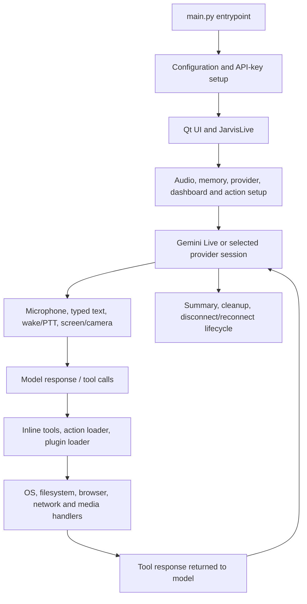
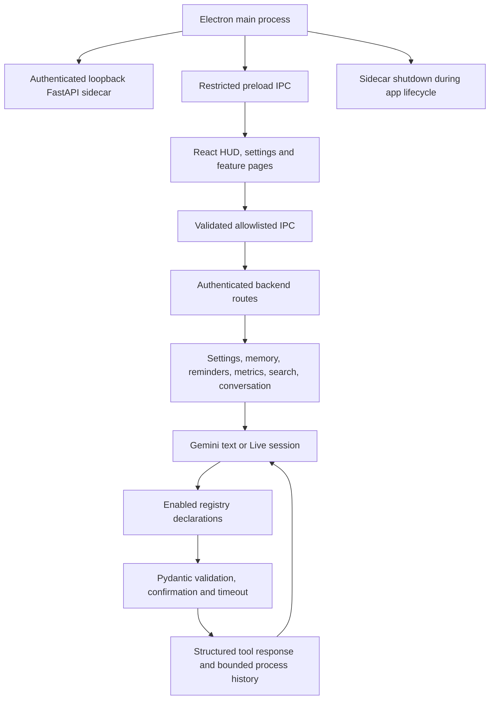

# Mark-LVI-main to Alex: Project Comparison Report

**Assessment date:** 2026-10-31  
**Mode:** read-only code comparison; no application code was changed for this assessment.  
**Scope:** project-owned source only; `.venv`, `node_modules`, caches, and generated artifacts are excluded.  
**Reference:** `../../Mark-LVI-main/` (source of truth).  
**Target:** Alex.

## Executive summary

Alex is an independent Electron/React desktop shell with a Python/FastAPI sidecar. It has functioning settings and credential storage, categorized memory CRUD, Gemini text and Live voice paths, grounded web search, reminders, telemetry/alerts, and a typed action registry with confirmation-aware execution. Recent changes also connect the same registry to Gemini text and Live function calling.

It is **not at feature parity**. Most Mark-LVI desktop-control, file, media, automation, provider, and remote-dashboard workflows are not migrated. The source checkout itself does not contain the many concrete plugins described in its README; it contains only a skipped plugin template. This report does not count those README-only claims as implemented source features.

### Overall feature comparison

The denominator is **34 distinct parity units**: 25 source callable tools (8 inline plus 17 action modules) and 9 separately tracked application subsystems. Action UI coverage and action execution remain distinct from model-callable access. Subsystem IDs cover broader lifecycle/UI/integration capabilities rather than repeating an individual action's purpose.

| Status | Count | Interpretation |
|---|---:|---|
| `FULLY_IMPLEMENTED` | 0 | No full source-to-Alex parity is established by behavior-comparison tests. |
| `PARTIALLY_IMPLEMENTED` | 16 | A meaningful subset exists, but behavior, safety, coverage, or platform parity is incomplete. |
| `MISSING` | 17 | No equivalent user-facing/source-backed behavior is present. |
| `BEHAVIOUR_MISMATCH` | 1 | The implementation exists but changes the source behavior materially. |
| `PLACEHOLDER_ONLY` | 0 | No exposed Alex placeholder is counted as a migrated feature. |
| **Total** | **34** | `25 action/tool units + 9 subsystem units`. |

`NEEDS_VERIFICATION` is a validation condition rather than a mutually-exclusive implementation status. At least **17 existing partial/mismatched units** need parity or platform verification. Missing units require implementation and tests before they can be verified.

**Migration score:** `(fully implemented + 0.5 × partially implemented) / 34 = (0 + 0.5 × 16) / 34 = 23.5%`. This is a conservative planning metric, not a claim that 23.5% of all source lines or user value has been migrated. `MISSING` and `BEHAVIOUR_MISMATCH` receive zero. Features are weighted equally because no defensible user-value weights exist.

### Priority definitions

| Priority | Meaning |
|---|---|
| P0 - Critical | Core workflow broken, or high-impact safety/security/data-loss gap. |
| P1 - High | Important user workflow or high-risk feature parity gap. |
| P2 - Medium | Supporting feature or provider/integration gap. |
| P3 - Low | Optional polish or low-impact parity improvement. |

## Evidence-based feature inventory

Detailed mappings and source references are in [ACTION_COMPARISON.md](./ACTION_COMPARISON.md), [MISSING_FEATURES.md](./MISSING_FEATURES.md), and [MISSING_FUNCTIONS.md](./MISSING_FUNCTIONS.md). IDs are stable across the reports.

### Action/tool units (A01-A25)

| ID | Source capability | Alex classification | Priority |
|---|---|---|---|
| A01 | Browser control | `MISSING` | P1 |
| A02 | Computer control | `MISSING` | P0 |
| A03 | OS computer settings | `MISSING` | P1 |
| A04 | Desktop control and organization | `MISSING` | P1 |
| A05 | General file controller | `PARTIALLY_IMPLEMENTED` | P0 |
| A06 | Document/media file processor | `PARTIALLY_IMPLEMENTED` | P1 |
| A07 | Code helper | `PARTIALLY_IMPLEMENTED` | P1 |
| A08 | Multi-file development agent | `MISSING` | P1 |
| A09 | Flight finder | `MISSING` | P2 |
| A10 | Game updater | `MISSING` | P2 |
| A11 | Open installed application | `MISSING` | P1 |
| A12 | Reminder | `PARTIALLY_IMPLEMENTED` | P1 |
| A13 | Weather report | `BEHAVIOUR_MISMATCH` | P2 |
| A14 | HUD video player | `MISSING` | P2 |
| A15 | YouTube search/play/transcript | `MISSING` | P2 |
| A16 | Web search | `PARTIALLY_IMPLEMENTED` | P1 |
| A17 | External messaging | `MISSING` | P1 |
| A18 | System status | `PARTIALLY_IMPLEMENTED` | P1 |
| A19 | Screen/webcam processing | `MISSING` | P0 |
| A20 | Close camera | `MISSING` | P1 |
| A21 | Manage background monitors | `MISSING` | P2 |
| A22 | Assistant shutdown and summary | `PARTIALLY_IMPLEMENTED` | P2 |
| A23 | Save memory via assistant tool | `PARTIALLY_IMPLEMENTED` | P1 |
| A24 | Recall memory via assistant tool | `PARTIALLY_IMPLEMENTED` | P1 |
| A25 | Undo | `MISSING` | P0 |

### Application subsystem units (S01-S09)

| ID | Subsystem | Alex classification | Priority |
|---|---|---|---|
| S01 | Startup, conversation orchestration, and shutdown | `PARTIALLY_IMPLEMENTED` | P1 |
| S02 | Live voice, audio-device controls, PTT, wake/sleep, and session recovery | `PARTIALLY_IMPLEMENTED` | P1 |
| S03 | Alternate LLM/STT/TTS provider pipelines | `MISSING` | P1 |
| S04 | Paired phone dashboard and remote command/audio/file workflows | `MISSING` | P2 |
| S05 | Third-party plugin discovery/configuration | `PARTIALLY_IMPLEMENTED` | P2 |
| S06 | HUD/avatar, expressions, face mesh, and synchronized lip-sync | `PARTIALLY_IMPLEMENTED` | P2 |
| S07 | Monitoring, proactive briefings, and scheduled topic checks | `PARTIALLY_IMPLEMENTED` | P2 |
| S08 | Persistent categorized memory and session summaries | `PARTIALLY_IMPLEMENTED` | P1 |
| S09 | Configuration, secrets, and optional capability setup | `PARTIALLY_IMPLEMENTED` | P1 |

## Architecture and execution flow

### Mark-LVI-main

Evidence: source `main.py` entry/startup and live loop, `core/action_loader.py`, `core/plugin_loader.py`, `core/confirm.py`, and `core/undo.py`. The action loader skips modules that fail import/schema checks; runtime-available tool count can therefore be below 25. The optional dashboard starts separately and may fail without preventing the main UI.

### Alex

Evidence: `Alex/backend/app/main.py`, `app/api/routes.py`, `app/actions/action_registry.py`, `app/actions/action_executor.py`, `app/services/conversation_service.py`, `app/services/live_voice_service.py`, `frontend/electron/main.ts`, and `frontend/electron/preload.ts`.

Alex startup is ordered: Electron allocates an available loopback port and per-run token, spawns the development Python process or packaged sidecar, polls authenticated health for up to 20 seconds, then registers IPC and creates the window. On quit, it stops Live voice, requests backend shutdown, and escalates process termination if needed. This lifecycle is better bounded than the source's daemon-thread/Qt arrangement, but clean-install and failure-injection parity remain unverified.

### Material architecture differences

- Mark-LVI is a Qt/Python application; Alex uses React in a sandboxed Electron renderer and a separate authenticated Python HTTP/WebSocket process.
- Mark-LVI registers inline and discovered tools, plus a separate plugin loader. Alex explicitly registers built-in actions; there are no migrated third-party plugin modules.
- Alex uses strict Pydantic schemas and independent confirmation requirements, whereas source handlers vary in validation and confirmation coverage.
- Alex exposes only enabled, available, non-confirmation actions to model tool calling. Current model-callable actions are `system.get_metrics` and `memory.recall`; `web.search` is explicitly confirmation-gated.
- Alex action history is bounded and process-memory-only. It is not a durable audit trail.

## Function-level and action-level gaps

There are **20 tracked function/service gap groups** (`G01-G20`); this is a report-level count of non-duplicated workflows, not a count of every helper method in both repositories. The 25 action entrypoints are separately counted as feature units and are not added again to this function-gap count. See [MISSING_FUNCTIONS.md](./MISSING_FUNCTIONS.md).

There are **25 source callable tools**. Of these, 10 have no equivalent, 14 have partial equivalents, one has a behavior mismatch, and none have verified full parity. Actions exposed in a UI but omitted from Gemini declarations are not called model-migrated.

## Dependencies, tests, and runtime verification

- The source `requirements.txt` describes a PyQt/audio/Gemini application with browser, media, dashboard, and optional provider dependencies; OS-specific and optional installs affect availability.
- Alex's backend manifest targets Python 3.11+ and declares FastAPI, Uvicorn, Pydantic/settings, keyring, Google GenAI, HTTPX, and psutil. The frontend is Electron + React/TypeScript with Vite/Vitest and Electron Builder scripts.
- Alex's backend automated tests last passed **58 tests** (three dependency/deprecation warnings). Previous frontend validation reported **19 tests passed**; TypeScript/Electron checks and Vite production build passed before the latest backend-only changes. These are Alex tests, not source-vs-target regression tests.
- The source app was **not run as part of this assessment**. External credentials, audio hardware, OS permissions, installed applications, native schedulers, and phone-dashboard network behavior are not verified here.
- Alex's historical documentation records a Windows Gemini Live/microphone smoke test and a packaged-sidecar unauthenticated-health check returning 401. It does not verify Gemini tool calling against live credentials, installation on a clean machine, signing, or macOS/Linux builds.
- Ruff was not installed in the Alex virtual environment when attempted; no lint success is claimed.

Full details: [DEPENDENCY_GAP_ANALYSIS.md](./DEPENDENCY_GAP_ANALYSIS.md), [TESTING_GAP_ANALYSIS.md](./TESTING_GAP_ANALYSIS.md), [AI_AGENT_GAP_ANALYSIS.md](./AI_AGENT_GAP_ANALYSIS.md), [FRONTEND_GAP_ANALYSIS.md](./FRONTEND_GAP_ANALYSIS.md), and [BACKEND_GAP_ANALYSIS.md](./BACKEND_GAP_ANALYSIS.md).

## Final counts and blockers

| Measure | Count |
|---|---:|
| Distinct tracked source feature units | 34 |
| Fully implemented with demonstrated parity | 0 |
| Partially implemented | 16 |
| Missing | 17 |
| Behavior mismatches | 1 |
| Placeholder-only Alex implementations | 0 |
| Function/service gap groups | 20 |
| Actions missing or incomplete/mismatched | 25 |
| External/platform integration groups not fully migrated | 11 |
| Partial/mismatched feature units needing parity/platform verification | 17 |
| Overall migration planning score | 23.5% |

The 11 integration groups tracked in the dependency report are not 11 entirely absent libraries: some have limited substitutes (notably attachment analysis, in-app reminders, and web search). Their original behavior is still missing or incomplete.

Critical blockers are: lack of a safe policy/undo boundary for OS, GUI and filesystem actions; no sandbox for generated code; missing source-backed provider/device/wake-word integrations; no parity regression suite; and missing platform/hardware/live-credential verification.

## Implementation roadmap

The detailed, traceable tasks and acceptance criteria are in [IMPLEMENTATION_ROADMAP.md](./IMPLEMENTATION_ROADMAP.md). Analysis comes first; implementation is not authorized by this report. Prioritize P0 safety and core gaps, then P1 workflow gaps, followed by P2 integrations and optional polish. Do not implement source actions that are unsafe as-is without designing safer equivalent behavior.
