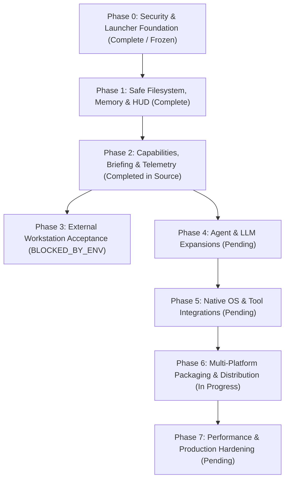

# Alex Project Execution Roadmap

**Document Version:** 1.0  
**Last Updated:** 2026-11-01  
**Project:** Alex Desktop Assistant  
**Authoritative Cross-Reference:** [`PROJECT_TASK_REGISTER.md`](./PROJECT_TASK_REGISTER.md), [`IMPLEMENTATION_ROADMAP.md`](./IMPLEMENTATION_ROADMAP.md)

---

## 1. Executive Summary & Sequencing Logic

The Alex project follows a strict, security-first phased roadmap. Development is gated by strict policy invariants:
1. **Security boundaries precede capabilities:** No model-callable action may execute without strict schema validation, loopback restriction, and explicit human confirmation for high-risk side effects.
2. **Implementation Freeze on Milestone A02:** Milestone A02 (Computer Control) is functionally frozen. Its automated test suites pass, but its authoritative acceptance status remains **`NOT ACCEPTED`** until physical verification on an unrestricted Windows workstation is completed.
3. **Unified Launcher Freeze:** The unified multi-process launcher (`alex launch`, `alex doctor`, `alex status`, `alex stop`) is stabilized and verified with unit tests; its runtime acceptance status remains **`BLOCKED_BY_ENVIRONMENT`** pending physical execution on an unrestricted host.
4. **Honest Environmental Status Reporting:** The agent must never claim physical hardware verification has passed when blocked by host security policies (such as Active Directory AppLocker / Software Restriction Policies).

---

## 2. Phased Execution Overview



---

## 3. Detailed Phase Breakdown

### Phase 0: Security & Launcher Foundation
* **Objective:** Establish unassailable security topology and reliable multi-process orchestration.
* **Core Tasks:**
  - `ALEX-BE-001`: Loopback authenticated FastAPI sidecar with ephemeral per-run bearer token.
  - `ALEX-ELEC-001`, `002`, `003`: Context isolation, strict CSP, typed contextBridge preload facade, and strict origin-based navigation hardening.
  - `ALEX-LNCH-001` through `007`: Unified CLI (`alex launch`, `alex doctor`, `alex status`, `alex stop`) with port conflict avoidance, health gating, PID state tracking, and token masking.
* **Status:** **COMPLETE (FROZEN)**.
* **Acceptance Gate:** Unit and API test suites pass. Desktop hardware verification blocked by host environment (`BLOCKED_BY_ENVIRONMENT`).

---

### Phase 1: Safe Storage, Filesystem & Provenance
* **Objective:** Deliver private workspace file operations, atomic document persistence, and user memory CRUD without host contamination.
* **Core Tasks:**
  - `ALEX-BE-002`, `ALEX-BE-003`: Local JSON document store and OS credential storage (`keyring`).
  - `ALEX-BE-004`, `ALEX-BE-005`: Categorized memory CRUD across 6 fixed categories and relevance-scored search.
  - `ALEX-BE-006`, `ALEX-BE-007`: Scoped workspace filesystem (`data_dir/workspace`) with traversal protection, symlink/hardlink rejection, and 10-entry persistent undo journal.
  - `ALEX-FE-001`, `ALEX-FE-003`, `ALEX-FE-004`, `ALEX-FE-005`: Reference cyan HUD shell, conversation page, memory manager, and settings page.
* **Status:** **COMPLETE**.
* **Acceptance Gate:** 100% passing automated unit tests in `test_api.py`, `test_file_workspace_service.py`, `test_memory_service.py`.

---

### Phase 2: Capabilities, Proactive Briefing & Telemetry
* **Objective:** Expose honest platform capability reporting, hardware telemetry threshold alerts, and structured proactive briefings.
* **Core Tasks:**
  - `ALEX-BE-008`: System telemetry snapshot service and CPU streak/alert cooldown monitor.
  - `ALEX-BE-009`: Timezone-aware desktop reminders with delivery acknowledgment.
  - `ALEX-BE-012`: Runtime platform capability reporting (`/api/v1/system/capabilities`).
  - `ALEX-BE-013`: Proactive startup briefing service (`/api/v1/system/briefing`).
  - `ALEX-FE-002`, `ALEX-FE-008`: Live telemetry HUD cards and reminders page.
* **Status:** **COMPLETE IN CODEBASE**.
* **Acceptance Gate:** Backend unit tests passing (`test_platform_capability_service.py`, `test_briefing_service.py`, `test_api.py`).

---

### Phase 3: External Workstation Acceptance (Hardware Gated)
* **Objective:** Execute formal physical desktop verification of A02 Computer Control and Unified Launcher on an unrestricted Windows 10/11 workstation.
* **Core Tasks:**
  - `ALEX-CTRL-007`: Complete physical verification using `Alex/docs/A02_EXTERNAL_ACCEPTANCE_GUIDE.md`.
  - `ALEX-TEST-008`: Complete launcher lifecycle verification using `Alex/docs/external-acceptance/unified-startup/`.
* **Blockers:** Host Active Directory Software Restriction Policy / AppLocker blocking `powershell.exe` execution; test runner lacks physical display, mouse, and audio peripherals.
* **Status:** **BLOCKED_BY_ENVIRONMENT**. Implementation frozen; handoff package ready for authorized human tester.

---

### Phase 4: Agent & LLM Expansions (Upcoming)
* **Objective:** Broaden tool calling, enable model-proposed memory modifications with human consent, and introduce local offline model fallbacks.
* **Core Tasks:**
  - `ALEX-AI-004`: Expand dynamic function calling bridge to support additional safe read-only actions.
  - `ALEX-AI-006`: Assistant natural-language memory proposal with explicit user confirmation card.
  - `ALEX-AI-007`: Alternate LLM provider adapter (Ollama / vLLM local OpenAI-compatible endpoint).
  - `ALEX-AI-008`: Local wake word detection ("Hey Alex") via Porcupine or OpenWakeWord.
* **Status:** **PENDING**. Ready for implementation once Phase 2 is validated.

---

### Phase 5: Native OS & Tool Integrations (Upcoming)
* **Objective:** Add controlled local application launching, sandboxed code execution, and background topic monitoring.
* **Core Tasks:**
  - `ALEX-BE-014`: OS task scheduler adapter for reminders when Alex is closed.
  - `ALEX-BE-015`: Allowlisted local application launcher with executable verification.
  - `ALEX-BE-016`: Sandboxed code execution engine with strict resource and network isolation.
  - `ALEX-BE-017`: Multi-file development agent scaffolding with undo support.
  - `ALEX-BE-018`: Background topic and news monitor with quiet hours.
* **Status:** **PENDING**. Requires sandboxing architecture review prior to code implementation.

---

### Phase 6: Multi-Platform Packaging & Distribution
* **Objective:** Deliver verified production installers across Windows, macOS, and Linux.
* **Core Tasks:**
  - `ALEX-ELEC-009`: Electron Builder NSIS installer (Windows), DMG (macOS), AppImage (Linux).
  - Code signing certificate pipeline integration.
  - Packaged sidecar Python runtime verification on clean operating systems.
* **Status:** **IN PROGRESS**. Windows NSIS configuration generated; full matrix validation pending unrestricted build runner.

---

### Phase 7: Performance, Accessibility & Production Hardening
* **Objective:** Optimize memory usage, profile live audio latency, and verify accessibility compliance.
* **Core Tasks:**
  - Reduced motion mode and keyboard navigation accessibility audits.
  - Audio stream buffer optimization (16 kHz mic / 24 kHz playback).
  - Long-running memory leak inspection for Electron and FastAPI processes.
* **Status:** **PENDING**.

---

## 4. Critical Path & Dependency Tree

```
[Phase 0: Core Security & Launcher] (DONE)
   │
   ├─► [Phase 1: Storage, Filesystem & Provenance] (DONE)
   │      │
   │      └─► [Phase 2: Capabilities, Briefing & Reminders] (DONE)
   │             │
   │             ├─► [Phase 3: External Acceptance on Workstation] (BLOCKED BY ENV)
   │             │
   │             ├─► [Phase 4: Agent Expansions & Memory Proposals] (ACTIONABLE)
   │             │      │
   │             │      └─► [Phase 5: Sandbox & App Launcher] (ACTIONABLE SCATTER)
   │             │
   │             └─► [Phase 6: Multi-Platform Packaging] (IN PROGRESS)
   │                    │
   │                    └─► [Phase 7: Production Hardening] (PLANNED)
```

---

## 5. Actionable vs. Blocked Tasks Matrix

| Category | Tasks Included | Current Environment Actionability | Strategy |
|---|---|---|---|
| **Actionable Now** | Phase 2 enhancements (`ALEX-BE-012`, `ALEX-BE-013`, `ALEX-BE-005`), Phase 4 scaffolding (`ALEX-AI-006`, `ALEX-AI-007`), UI diagnostics (`ALEX-FE-012`), Documentation (`ALEX-DOC-001` to `008`). | **100% Executable.** Can be developed, refactored, and verified with unit and mock test suites. | Implement directly using file tools; add automated unit test suites. |
| **Blocked by Environment** | Desktop runtime verification (`ALEX-TEST-008`, `ALEX-CTRL-007`, `ALEX-LNCH-005`), physical audio/speech turns (`ALEX-AI-001` live hardware), AppLocker-restricted shell execution. | **0% Executable on current runner.** Host Software Restriction Policy strictly blocks PowerShell and interactive shell invocations. | Prepare complete, audited handoff documentation kits for external authorized testers. Do not bypass policy. |

