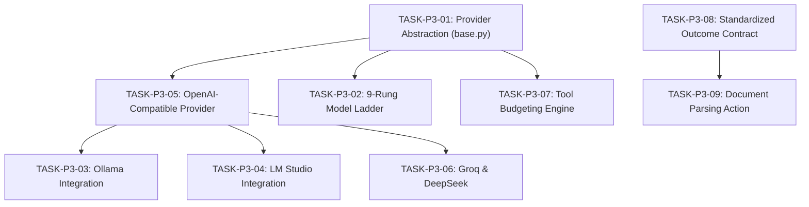

# Phase 3 Implementation Breakdown: Core AI Providers & Operational Actions

**Document Version:** 2.1 (Phase 3 Owner-Authorized & Active)  
**Inspection Date:** 2026-11-03  
**Status:** `IN_PROGRESS`  
**Execution Gate:** Authorized by Project Owner on 2026-11-03 (`OWNER_AUTHORIZED`; see [`docs/architecture/ARCHITECTURE_GOVERNANCE.md`](../architecture/ARCHITECTURE_GOVERNANCE.md))  
**Target Project:** `ALEX-AI-main`  
**Reference Codebase:** `Mark-LVI-main`  

---

## 1. Phase Overview & Implementation Strategy

Phase 3 transitions Alex AI Desktop Assistant from a single-provider, cloud-only architecture into a resilient, multi-provider, multi-model AI system with local offline capabilities, quota resilience, and deep document processing.

### Key Objectives
1. Implement a pluggable `LLMProvider` abstraction layer covering streaming, discovery, health checks, and cancellation.
2. Port Mark-LVI's 9-rung Model Fallback Ladder to eliminate 429 quota failures, with full observability and user feedback.
3. Integrate local AI engines (Ollama, LM Studio) and cloud endpoints (Groq, DeepSeek, OpenAI).
4. Implement dynamic tool budgeting to prevent 8B local models from choking on tool schemas.
5. Standardize all action outcomes on Mark-LVI's 5-word contract (`done`, `unverified`, `failed`, `ask`, `started`).
6. Port multi-format document parsing (PDF, DOCX, XLSX, PPTX).

### Architectural Rules & Invariants
- **Preserve Freezes:** Do NOT modify `computer_control_service.py` (A02), `launcher/cli.py`, or `main.ts`. Phase 3 implementation touches only `backend/app/providers/`, `backend/app/actions/builtins/documents.py`, and `backend/app/services/`.
- **Zero Plaintext Secrets:** All provider API keys must be retrieved via `keyring_vault.py`.
- **Sandboxed File Operations:** Document parsing must strictly respect workspace boundaries in `file_workspace_service.py`.
- **Pydantic Validation:** All new providers, options, and actions must use typed Pydantic v2 schemas.
- **Flagged Model Identifiers & Provider Assumptions:** All model IDs (e.g., `gemini-3.1-flash-live-preview`, `gemini-2.5-flash-native-audio-preview-12-2025`, `groq:llama-3.3-70b-versatile`, `deepseek:deepseek-chat`, `ollama:llama3.2:3b`) are flagged runtime assumptions subject to dynamic capability probing and live handshake verification. They must NOT be silently replaced or deleted.
- **Private Reasoning Data Policy:** Raw internal reasoning (`<think>` tokens) must **NEVER** be exposed in the React HUD, sent to TTS or audio output, or included in primary conversation history. No raw chain-of-thought persistence mechanism (such as `thought_log`) may be introduced. Only structured operational audit metadata (`provider`, `model`, `latency_ms`, token usage, `fallback_reason`, `tool_invocation`, `tool_outcome`, `error_category`) may be retained.

---

## 2. Detailed Technical Specifications for the 9 Scopes

---

### Scope 1: AI Provider Abstraction Layer (`TASK-P3-01`)

- **Task ID:** `TASK-P3-01`
- **Current Implementation:** `ALEX-AI-main` communicates solely with Google Gemini via `google-genai` SDK in `backend/app/services/live_voice_service.py` and `conversation_service.py`. There is no common provider interface.
- **Reference Implementation:** `Mark-LVI-main/providers/base.py` defines `BaseProvider`, `LLMProvider`, and `providers/registry.py` defines provider metadata, models, and UI form schemas.
- **Files Expected to Change / Create:**
  - `backend/app/providers/base.py` (New: Abstract `LLMProvider`, `ProviderCapabilities`, `StreamingChunk`, `UsageMetadata`, `NormalizedProviderError`)
  - `backend/app/providers/registry.py` (New: Provider registration, model discovery, configuration schemas)
  - `backend/app/providers/__init__.py` (New)
- **Dependencies:** `pydantic>=2.7.0`, `abc`, `typing`, `asyncio`.
- **Interface Technical Contract:**
  ```python
  class ProviderCapabilities(BaseModel):
      vision: bool = False
      function_calling: bool = True
      streaming: bool = True
      native_audio: bool = False
      live_bidirectional: bool = False
      max_context_tokens: int = 8192
      supports_system_prompt: bool = True

  class UsageMetadata(BaseModel):
      provider_id: str = ""
      model_id: str = ""
      prompt_tokens: int = 0
      completion_tokens: int = 0
      total_tokens: int = 0
      latency_ms: float = 0.0
      fallback_reason: Optional[str] = None
      tool_invocation: Optional[str] = None
      tool_outcome: Optional[str] = None
      error_category: Optional[str] = None

  class StreamingChunk(BaseModel):
      text: str = ""
      function_calls: Optional[List[Dict[str, Any]]] = None
      is_final: bool = False
      usage: Optional[UsageMetadata] = None

  class LLMProvider(ABC):
      @property
      @abstractmethod
      def provider_id(self) -> str: pass

      @property
      @abstractmethod
      def capabilities(self) -> ProviderCapabilities: pass

      @abstractmethod
      async def list_models(self) -> List[ModelDescriptor]: pass

      @abstractmethod
      async def health_check(self) -> bool: pass

      @abstractmethod
      async def generate(self, messages, tools=None, timeout_ms=30000, cancellation_token=None) -> StreamingChunk: pass

      @abstractmethod
      async def stream(self, messages, tools=None, timeout_ms=30000, cancellation_token=None) -> AsyncIterator[StreamingChunk]: pass
  ```
- **Security Requirements:**
  - Provider configurations must never accept plaintext secrets in persistent serialization; credentials resolved at runtime via `keyring_vault.py`.
  - Must validate base URL endpoints to prevent SSRF against internal network IPs.
- **Test Cases:**
  - `test_provider_registry_registers_and_retrieves_providers`
  - `test_provider_base_validates_abstract_methods`
  - `test_provider_rejects_malformed_base_urls`
  - `test_provider_cancels_stream_on_cancellation_token`
- **Acceptance Criteria:** Abstract base class `LLMProvider` defines `generate()`, `stream()`, and `list_models()`. Providers register cleanly in `ProviderRegistry`.
- **Estimated Complexity:** LOW
- **Migration Risks:** None. Additive architecture that does not modify existing endpoints.

---

### Scope 2: Nine-Rung Model Fallback Ladder & Quota Resilience (`TASK-P3-02`)

- **Task ID:** `TASK-P3-02`
- **Current Implementation:** `backend/app/services/live_voice_service.py` hardcodes two models in `_LIVE_MODELS`. If the active session encounters HTTP 429 Resource Exhausted, the WebSocket drops with error code 1011. `conversation_service.py` implements a 2-model ladder with `model_cooldowns.py`.
- **Reference Implementation:** `Mark-LVI-main/core/gemini.py` defines `_LADDERS` with 3 task-specific ladders (`FAST`, `SMART`, `SEARCH`) covering 9 models. Catches 429/503 errors and steps down to the next rung without dropping the user turn.
- **Files Expected to Change / Create:**
  - `backend/app/services/model_ladder_service.py` (New: Unified ladder state machine, task-specific ladders, cooldown tracker, fallback observability)
  - `backend/app/services/live_voice_service.py` (Update: Wire session establishment through `ModelLadderService`)
- **Dependencies:** `google-genai`, `asyncio`, `tenacity`.
- **Exact Priority Hierarchy:**
  1. Rung 1: `models/gemini-3.1-flash-live-preview` (Primary Multimodal Live WSS — Requires Live Audio & Vision)
  2. Rung 2: `models/gemini-2.5-flash-native-audio-preview-12-2025` (Secondary Native Audio Live WSS — Requires Live Audio)
  3. Rung 3: `gemini-2.5-flash` (Primary Fast REST Reasoning & Tool Calling)
  4. Rung 4: `gemini-2.5-flash-lite` (Ultra-Fast REST Fallback)
  5. Rung 5: `groq:llama-3.3-70b-versatile` (Cloud High-Speed Backup — Requires Valid Key & Outbound Network)
  6. Rung 6: `deepseek:deepseek-chat` (Deep Reasoning Backup — Requires Valid Key & Outbound Network)
  7. Rung 7: `ollama:llama3.2:3b` (Local Offline Primary — Requires Local Server & >=3GB RAM)
  8. Rung 8: `lm_studio:local-model` (Local Offline Secondary — Requires Local Server & >=3GB RAM)
  9. Rung 9: `gemini-1.5-flash` (Emergency Cloud Survival Rung)

> [!IMPORTANT]
> **Explicit Policy: No Unsubstantiated Quota-Pool Independence Claims:**  
> Do not claim model availability or quota-pool independence without empirical evidence. Models within the same Google Gemini provider (e.g. `gemini-3.1-flash-live-preview`, `gemini-2.5-flash`, `gemini-2.5-flash-lite`, `gemini-1.5-flash`) share API project quota, billing tier limits, and organizational rate limits (RPM/TPM/RPD) unless proven isolated via multi-tenant runtime telemetry. If project-wide quota depletion occurs, falling back to other models under the same provider key will fail with repeated 429 errors; the ladder must detect provider-level quota exhaustion and prioritize cross-provider cloud (Groq/DeepSeek) or local offline inference (Ollama/LM Studio).

> [!IMPORTANT]
> **Flagged Runtime Model Assumptions (Do Not Silently Replace):**
> - `models/gemini-3.1-flash-live-preview`: Preview model tag from Mark-LVI reference prototype. **FLAGGED:** Must be dynamically probed via live WebSocket handshake at runtime; if unverified or unavailable, the ladder must advance cleanly to verified tiers without breaking session establishment. Do not silently delete or replace.
> - `models/gemini-2.5-flash-native-audio-preview-12-2025`: Date-versioned snapshot (`preview-12-2025`). **FLAGGED:** Subject to vendor deprecation and retirement. Provider registry must probe model availability before hardcoding.
> - `groq:llama-3.3-70b-versatile` & `deepseek:deepseek-chat`: Cloud provider endpoint IDs. **FLAGGED:** Rely on external provider service availability, valid user API keys retrieved strictly from OS Keyring (`keyring_vault.py`), and unblocked outbound network egress.
> - `ollama:llama3.2:3b` & `lm_studio:local-model`: Local daemon endpoints (`127.0.0.1:11434` and `127.0.0.1:1234`). **FLAGGED:** Assumes user has installed and launched the local engine and pre-pulled weights; host machine must satisfy the $\ge$ 3 GB RAM availability requirement to avoid out-of-memory thrashing.

- **Capability-Aware Fallback Engine:**
  Fallback candidate selection must dynamically match the *Capability Profile* required by the active turn:
  1. `requires_live_audio: bool`: If the active session is a full-duplex live audio stream (`/api/v1/voice/live`), fallback is restricted to models declaring `live_bidirectional` or native audio. If live audio models are exhausted, the system cannot drop into a text-only REST model on the live WebSocket without an explicit modality shift: it must trigger the Speech Adapter Handshake, spinning up local STT (Faster-Whisper) and TTS (Piper) to preserve spoken conversation before dispatching prompt text to the text-only model.
  2. `requires_tools: bool`: If the turn requires tool calling (e.g., computer control, file read, search), candidate models must declare verified function calling support (`capabilities.function_calling is True`). Models lacking function-calling capabilities or unable to parse budgeted schemas must be excluded from candidate filtering.
  3. `requires_streaming: bool`: Chunks must stream incrementally; models lacking streaming support cannot serve interactive voice or streaming HUD turns.
  4. `requires_vision: bool`: Turns containing image or screen frames require `capabilities.vision is True`.

- **Explicit Runtime Validation Requirements:**
  1. **Model Availability:** Probed at startup via `list_models()` / `/v1/models` (cached 6 hours). If a model endpoint returns 404, it is immediately marked unavailable and quarantined on a 6-hour cooldown.
  2. **Provider Authentication:** Probed via lightweight credential ping using OS Keyring credentials. If HTTP 401/403 is received, the provider is marked `AUTHENTICATION_FAILED`. This is fatal for all models under that credential; the ladder bypasses all rungs under that provider without attempting subsequent models with the same broken key.
  3. **Streaming Support:** Validated during session handshake. If initial chunk is not yielded within 1,500ms, candidate is marked non-streaming and aborted.
  4. **Tool-Calling Compatibility:** Verified against declared tool schema dialects (Gemini vs. OpenAI) and schema budget constraints (`TASK-P3-07`).
  5. **Multimodal / Audio Capabilities:** Verified against declared provider capabilities.
  6. **Quota & Rate-Limit Behavior:** Inspect HTTP 429 response headers (`Retry-After`, `x-ratelimit-reset`). Detect project-wide vs. model-specific limits. If header indicates project quota exhaustion, quarantine the entire provider temporarily.
  7. **Provider-Specific Cooldowns:** Dynamic tracker maintaining state per (provider, model):
     - 429: Provider-specified `Retry-After` if present, else default 300s.
     - 404: 21,600s (6h).
     - 500/502/503/504: 1,800s (30m) with 1 immediate backoff retry (1.0s).
     - 401/403: Quarantined indefinitely until user updates API keys in settings.
  8. **Conversation Continuity During Fallback:**
     - Seamless state transfer: normalized conversation history (user messages, system prompt, tool definitions, tool results) is maintained in provider-neutral Pydantic representations in `ConversationService`.
     - When fallback triggers, the target provider adapter serializes the normalized context into its specific dialect (e.g. converting between Gemini `Content` and OpenAI `messages`).
     - In-flight partial output from failed model is cleanly discarded to prevent incomplete sentences.
     - Maximum 3 hops per turn. If all candidates fail, raise `ServiceUnavailableError`.
     - Non-disruptive telemetry emitted to frontend: WebSocket event `model_fallback`, HUD model badge update, soft reconnect chime.
- **Cooldown & Fallback Rules:**
  - **HTTP 429 (Quota Exhausted):** Cooldown = 300s (5m); advance immediately to next available rung.
  - **HTTP 404 (Missing / Deprecated):** Cooldown = 21,600s (6h); omit from candidate rotation.
  - **HTTP 500/502/503/504 (Outage / Gateway Timeout):** Cooldown = 1,800s (30m); retry once with 1.0s backoff, then advance.
  - **HTTP 401/403 (Authentication Failure):** Fatal error. Do NOT step down; raise `AuthenticationError` immediately.
  - **Network Disconnect:** 3 retries (1s, 2s, 4s) before stepping down to local models.
  - **Maximum Ladder Hops:** 3 model hops per turn maximum.
- **Fallback Observability & User-Visible Signals:**
  - Emits WebSocket event `{"type": "model_fallback", "from_model": ..., "to_model": ..., "reason": ...}` to frontend.
  - React HUD displays model badge update with active fallback indicator.
  - Optional soft chime audio feedback to notify user without interrupting conversation.
- **Test Cases:**
  - `test_ladder_advances_on_429_quota_exhausted`
  - `test_ladder_skips_cooling_models`
  - `test_ladder_returns_to_primary_tier_after_cooldown_expires`
  - `test_ladder_aborts_immediately_on_401_authentication_error`
  - `test_ladder_clamps_to_max_3_hops`
- **Acceptance Criteria:** When simulated 429 is injected into Gemini Live stream, the service transparently switches to the next available tier within 2.0s without crashing the WebSocket session.
- **Estimated Complexity:** MEDIUM
- **Migration Risks:** Potential audio stream hiccup during rung switchover; handled by sending synthetic reconnect chime to UI.

---

### Scope 3: Ollama Local LLM Integration (`TASK-P3-03`)

- **Task ID:** `TASK-P3-03`
- **Current Implementation:** Zero local model integration in Alex.
- **Reference Implementation:** `Mark-LVI-main/providers/llm_openai.py` connects to Ollama's local OpenAI-compatible endpoint at `http://127.0.0.1:11434/v1`.
- **Files Expected to Change / Create:**
  - `backend/app/providers/ollama_provider.py` (New: Subclasses `OpenAICompatibleProvider`)
  - `backend/app/api/v1/endpoints/system.py` (Expose local engine status in doctor/diagnostics)
- **Dependencies:** `httpx>=0.27.0`.
- **Security Requirements:**
  - Strict loopback binding: Refuse connections to non-loopback IP addresses (`127.0.0.1`, `localhost`) unless user explicitly configures trusted remote host.
- **Test Cases:**
  - `test_ollama_detects_running_service_on_11434`
  - `test_ollama_lists_installed_models`
  - `test_ollama_executes_chat_completion_mock`
- **Acceptance Criteria:** If Ollama is running locally, Alex discovers available models (e.g. `llama3.2:3b`, `qwen2.5:7b`) and can complete conversational turns offline.
- **Estimated Complexity:** LOW
- **Migration Risks:** High latency if user runs oversized model on CPU; doctor must warn if model parameter size exceeds host RAM.

---

### Scope 4: LM Studio Local LLM Integration (`TASK-P3-04`)

- **Task ID:** `TASK-P3-04`
- **Current Implementation:** Zero LM Studio integration in Alex.
- **Reference Implementation:** `Mark-LVI-main/providers/llm_openai.py` connects to LM Studio's local OpenAI-compatible endpoint at `http://127.0.0.1:1234/v1`.
- **Files Expected to Change / Create:**
  - `backend/app/providers/lm_studio_provider.py` (New: Subclasses `OpenAICompatibleProvider`)
- **Dependencies:** `httpx>=0.27.0`.
- **Security Requirements:**
  - Restrict default connection to `http://127.0.0.1:1234/v1`.
- **Test Cases:**
  - `test_lm_studio_detects_active_server`
  - `test_lm_studio_executes_streaming_chat`
- **Acceptance Criteria:** Alex connects to LM Studio on port 1234 and streams tokens with <50ms first-chunk latency when server is pre-warmed.
- **Estimated Complexity:** LOW
- **Migration Risks:** None.

---

### Scope 5: OpenAI-Compatible API Provider (`TASK-P3-05`)

- **Task ID:** `TASK-P3-05`
- **Status:** `COMPLETED` (Verified 2026-11-04)
- **Current Implementation:** Universal OpenAI `/v1/chat/completions` REST and SSE streaming provider with `ReasoningFilter`, `AntiRepetitionGuard`, tool call reassembly & deduplication, and `NormalizedProviderError` mapping.
- **Reference Implementation:** `Mark-LVI-main/providers/llm_openai.py` handles the universal OpenAI `/v1/chat/completions` REST and SSE streaming protocol. Includes `<think>` reasoning filter and anti-repetition detection.
- **Files Expected to Change / Create:**
  - `backend/app/providers/openai_provider.py` (New: Universal `/v1/chat/completions` client)
  - `backend/app/providers/reasoning_filter.py` (New: Streaming `<think>` tag extractor)
- **Dependencies:** `httpx>=0.27.0`, `re`.
- **Security & Privacy Requirements (Private Reasoning Data Policy):**
  - **Strict Suppression Invariants:**
    - **No HUD Exposure:** Raw internal reasoning (`<think>...</think>` tokens) must **NEVER** be exposed in the React HUD (neither in the chat transcript nor in collapsible disclosure widgets).
    - **No Audio/TTS Output:** Raw internal reasoning must **NEVER** be sent to speech synthesis, Piper TTS, or audio output pipelines. `reasoning_filter.py` intercepts chunks across token boundaries (e.g. `"<thi"` and `"nk>"`) and strips reasoning blocks completely before queuing for audio synthesis.
    - **No History Inclusion:** Raw internal reasoning must **NOT** be included in primary conversation history (`ConversationMessage.content`).
    - **Prohibition of Raw Chain-of-Thought Persistence:** Do **NOT** introduce a raw chain-of-thought persistence mechanism such as `thought_log`. Storing internal model reasoning blocks is strictly prohibited.
    - **Operational Audit Metadata Only:** The system retains **ONLY** structured operational audit metadata:
      - `provider_id`: Identifying string (e.g., `groq`, `deepseek`, `ollama`)
      - `model_id`: Active model name/tag
      - `latency_ms`: Time to first token and total response duration
      - `token_usage`: Prompt tokens, completion tokens, total tokens
      - `fallback_reason`: Error code / exception if a fallback occurred
      - `tool_invocation`: Function name and parameter schema invoked
      - `tool_outcome`: Verified outcome status (`done`, `unverified`, `failed`, `ask`, `started`)
      - `error_category`: Normalized error code if a failure occurred
- **Test Cases:**
  - `test_openai_provider_formats_tools_and_messages`
  - `test_reasoning_filter_suppresses_think_tokens_from_stream`
  - `test_reasoning_filter_preserves_final_response`
- **Acceptance Criteria:** Provider successfully talks to standard OpenAI endpoints and parses function/tool calling JSON schemas accurately.
- **Estimated Complexity:** MEDIUM
- **Migration Risks:** Schema divergence in tool definitions across small local models; mitigated by Scope 7 tool budgeting.

---

### Scope 6: Cloud Providers Integration (Groq & DeepSeek) (`TASK-P3-06`)

- **Task ID:** `TASK-P3-06`
- **Status:** `COMPLETED` (Verified 2026-11-04)
- **Current Implementation:** `GroqProvider` configured for ultra-low latency LPU streaming with OS Keyring resolution, and `DeepSeekProvider` with deepseek-reasoner chain-of-thought isolation adhering strictly to the Private Reasoning Data Policy.
- **Reference Implementation:** `Mark-LVI-main/providers/llm_openai.py` connects to Groq (`api.groq.com/openai/v1`) and DeepSeek (`api.deepseek.com/v1`).
- **Files Expected to Change / Create:**
  - `backend/app/providers/groq_provider.py` (New: Configured for Groq ultra-low latency inference)
  - `backend/app/providers/deepseek_provider.py` (New: Configured for DeepSeek reasoning models `deepseek-reasoner`)
- **Dependencies:** `httpx>=0.27.0`, `keyring`.
- **Security Requirements:**
  - API keys stored strictly in OS Keyring under `groq-api-key` and `deepseek-api-key`.
- **Test Cases:**
  - `test_groq_provider_initialization_with_keyring_secret`
  - `test_deepseek_reasoner_extracts_reasoning_content`
- **Acceptance Criteria:** User can select Groq or DeepSeek in settings; credentials validate and conversation runs with full streaming responses.
- **Estimated Complexity:** LOW
- **Migration Risks:** Rate limits on free tiers; mitigated by Model Ladder fallback.

---

### Scope 7: Dynamic Tool Budgeting Engine (`TASK-P3-07`)

- **Task ID:** `TASK-P3-07`
- **Status:** `COMPLETED` (Verified 2026-11-04)
- **Current Implementation:** `schema_budget.py` implements dynamic query-relevant tool ranking, usage prioritization, count budget clamping (max 12 tools for 8B, max 8 for 3B), character payload limit enforcement (<9,000 chars for 8B), and full pass-through for flagship cloud models, exposed via `ActionRegistry.get_budgeted_declarations` and `get_budgeted_tools`.
- **Reference Implementation:** `Mark-LVI-main/providers/schema.py` implements tool budgeting (count budget: max 8-14 tools; size budget: max 9,000 characters) to prevent smaller 8B models from crashing or hallucinating.
- **Files Expected to Change / Create:**
  - `backend/app/providers/schema_budget.py` (New: Dynamic tool ranking, budget pruning, character limit enforcement)
  - `backend/app/actions/registry.py` (Update: Expose `get_budgeted_tools(model_capacity: str)`)
- **Dependencies:** `pydantic>=2.7.0`, `json`.
- **Security Requirements:**
  - High-risk safety-critical actions (`computer_control`) must preserve confirmation gates regardless of budgeting pruning.
- **Test Cases:**
  - `test_tool_budget_restricts_tool_count_for_8b_models`
  - `test_tool_budget_prioritizes_frequently_used_tools`
  - `test_tool_budget_enforces_character_limit`
- **Acceptance Criteria:** For local 8B models, total tool schema length is clamped under 9,000 characters and 12 tools; full schema delivered to cloud Gemini/GPT-4o.
- **Estimated Complexity:** MEDIUM
- **Migration Risks:** Pruned tools unavailable unless summoned by query relevance; solved by dynamic keyword ranking.

---

### Scope 8: Standardized Five-Word Outcome Contract (`TASK-P3-08`)

- **Task ID:** `TASK-P3-08`
- **Status:** `COMPLETED` (Verified 2026-11-04)
- **Current Implementation:** `backend/app/actions/base.py` defines `ToolOutcome` enum (`done`, `unverified`, `failed`, `ask`, `started`) and Pydantic v2 `ActionOutcomeResponse`. Handlers across `files.py`, `search.py`, `memory.py`, and `system.py` strictly adhere to the contract.
- **Reference Implementation:** `Mark-LVI-main/core/outcome.py` enforces five-word outcome contract: `done`, `unverified`, `failed`, `ask`, `started`.
- **Files Expected to Change / Create:**
  - `backend/app/actions/base.py` (Update: Add `ToolOutcome` enum and `ActionOutcomeResponse`)
  - `backend/app/actions/builtins/files.py` (Update: Return `ToolOutcome.DONE` or `FAILED`)
  - `backend/app/actions/builtins/search.py` (Update: Return `ToolOutcome.DONE`)
  - `backend/app/actions/builtins/memory.py` (Update: Return `ToolOutcome.DONE`)
  - `backend/app/actions/builtins/system.py` (Update: Return `ToolOutcome.DONE`)
- **Dependencies:** `pydantic>=2.7.0`, `enum`.
- **Interface Technical Contract:**
  ```python
  class ToolOutcome(str, Enum):
      DONE = "done"             # Action verified to have completed successfully
      UNVERIFIED = "unverified" # Request initiated, but state could not be verified
      FAILED = "failed"         # Action could not be completed
      ASK = "ask"               # Requires user clarification or approval
      STARTED = "started"       # Asynchronous process initiated cleanly; still running

  class ActionOutcomeResponse(BaseModel):
      status: ToolOutcome
      action: str
      message: str
      data: Dict[str, Any] = Field(default_factory=dict)
      error: Optional[str] = None

      @property
      def success(self) -> bool:
          """Backward-compatibility property: True ONLY when operation has completed successfully.
          NEVER returns True for STARTED, UNVERIFIED, FAILED, or ASK.
          """
          return self.status == ToolOutcome.DONE

      @property
      def is_done(self) -> bool:
          """True only when the operation has reached verified completion."""
          return self.status == ToolOutcome.DONE

      @property
      def is_started(self) -> bool:
          """True when operation was initiated asynchronously and is still running."""
          return self.status == ToolOutcome.STARTED

      @property
      def is_pending(self) -> bool:
          """True when operation is non-terminal (either still running or unverified)."""
          return self.status in (ToolOutcome.STARTED, ToolOutcome.UNVERIFIED)

      @property
      def requires_clarification(self) -> bool:
          """True when user confirmation or input is required."""
          return self.status == ToolOutcome.ASK

      @property
      def is_failed(self) -> bool:
          """True when operation encountered an execution failure."""
          return self.status == ToolOutcome.FAILED
  ```
- **How Existing Callers Distinguish Completed vs. Running Operations:**
  1. **Synchronous Callers & Tests:** Checking `response.success` evaluates to `True` strictly when the operation reached verified completion (`status == ToolOutcome.DONE`). For operations that merely started in the background, `response.success` is `False`, ensuring callers never interpret `STARTED` as completed success.
  2. **Asynchronous Callers & Background Supervisors:** Callers that support background jobs inspect `response.status == ToolOutcome.STARTED` (or `response.is_started`). The payload in `data` contains tracking metadata (`job_id`, `pid`, or `task_token`). Callers subscribe to asynchronous completion events via WebSocket (`/api/v1/jobs/{job_id}/events`) or poll status until terminal state (`DONE` or `FAILED`) is reached.
  3. **LLM Prompt System Instructions:** The prompt contract strictly commands:
     - `DONE`: Narrate verified completion to the user.
     - `STARTED`: Inform the user that the process has been initiated and is running in the background; strictly forbid claiming that the task is finished.
     - `UNVERIFIED`: Report uncertainty; do not assert success.
     - `FAILED`: Report execution error.
     - `ASK`: Prompt user for confirmation.
- **Security & Safety Invariants:**
  - Preserves all existing safety bounds, coordinate clamping, emergency stop latches, and confirmation tokens.
  - `STARTED` is strictly prohibited from bypassing completion verification.
- **Test Cases:**
  - `test_action_base_returns_tool_outcome_enum`
  - `test_success_property_returns_true_only_for_done`
  - `test_success_property_returns_false_for_started`
  - `test_is_started_property_identifies_running_jobs`
  - `test_file_action_returns_unverified_if_write_not_flushed`
  - `test_all_builtin_actions_conform_to_outcome_contract`
- **Acceptance Criteria:** Every built-in action returns validated `ActionOutcomeResponse` with `status: ToolOutcome`. Prompt system instructions enforce that neither `STARTED` nor `UNVERIFIED` can be reported as completed success.
- **Estimated Complexity:** LOW
- **Migration Risks:** None; preserving `success: bool == (status == ToolOutcome.DONE)` maintains strict backward compatibility for completion assertions while preventing false success on background tasks.

---

### Scope 9: Deep Document Parsing Action (`TASK-P3-09`)

- **Task ID:** `TASK-P3-09`
- **Status:** `COMPLETED` (Verified 2026-11-04)
- **Current Implementation:** Full multi-format extraction for PDF (`pypdf`), DOCX (`python-docx`), XLSX (`openpyxl`), and PPTX (`python-pptx`) registered under `documents.parse` with 25 MB safety limit and 100 page/slide clamp.
- **Reference Implementation:** `Mark-LVI-main/actions/file_processor.py` parses PDF, Word (DOCX), Excel (XLSX), and PowerPoint (PPTX).
- **Files Created / Updated:**
  - `backend/app/actions/builtins/documents.py` (Document parsing action handler)
  - `backend/app/services/document_parser_service.py` (Multi-format document text/table extractor)
  - `backend/tests/test_document_parser.py` (12 automated unit tests)
  - `backend/pyproject.toml` (Added pure Python dependencies: `pypdf`, `python-docx`, `openpyxl`, `python-pptx`)
- **Dependencies:** `pypdf`, `python-docx`, `openpyxl`, `python-pptx`.
- **Security Requirements:**
  - Sandboxed parsing: Enforced file size limit (max 25 MB) and page count limit (max 100 pages/slides) to prevent Denial of Service / ZIP bombs.
  - Files must reside within validated workspace path or explicitly mounted folder.
- **Test Cases:**
  - `test_pdf_parser_extracts_clean_text`
  - `test_docx_parser_extracts_paragraphs_and_tables`
  - `test_xlsx_parser_extracts_sheets_and_tables`
  - `test_pptx_parser_extracts_slides_and_shapes`
  - `test_document_parser_rejects_oversized_files`
  - `test_documents_action_handler_returns_done`
  - `test_documents_action_handler_workspace_boundary_protection`
- **Acceptance Criteria:** User can ask questions about PDF manuals, Word documents, PowerPoint presentations, or Excel spreadsheets; service extracts clean text and returns `ToolOutcome.DONE` with document summary. Verified 100% passing (12/12 tests).
- **Estimated Complexity:** MEDIUM
- **Migration Risks:** Additional Python dependencies (~12 MB); isolated to pure Python parsing wheels without C-extension dependencies.

---

## 3. Implementation Sequence & Dependency Graph



---

## 4. Phase 3 Verification & Exit Gate

Upon completion of Phase 3 implementation:
1. **Automated Test Gate:** All new test suites for providers, model ladder, tool budgeting, outcome contract, and document parsing pass with 100% success rate.
2. **Regression Gate:** All existing 109 backend tests, 32 A02 tests, and launcher tests pass with zero regressions.
3. **No Frozen Modifications:** `computer_control_service.py`, `launcher/cli.py`, `main.ts`, and `Mark-LVI-main` remain 100% untouched.
4. **Offline Verification:** Disconnecting network allows text conversation turn via Ollama/LM Studio with local document parsing.
