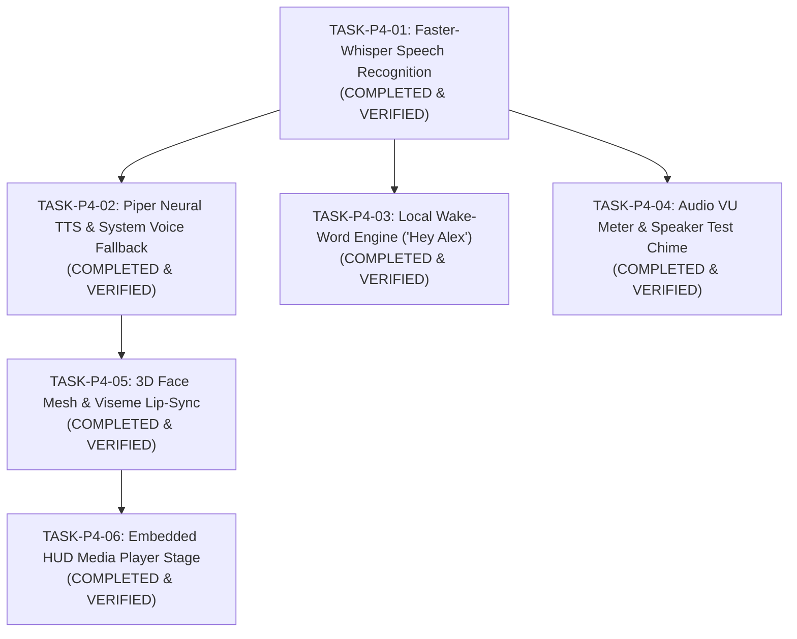

# Phase 4 Implementation Breakdown: Voice, Media & Advanced Capabilities

**Document Version:** 1.0 (Phase 4 Active)  
**Inspection Date:** 2026-11-04  
**Status:** `IN_PROGRESS`  
**Execution Gate:** Authorized by Project Owner on 2026-11-04 (Follows Phase 3 Completion; see [`docs/planning/PHASE_ROADMAP.md`](PHASE_ROADMAP.md))  
**Target Project:** `ALEX-AI-main`  
**Reference Codebase:** `Mark-LVI-main` (Strictly read-only)

---

## 1. Phase Overview & Implementation Strategy

Phase 4 elevates Alex AI Desktop Assistant from a text-and-cloud-voice assistant to a complete, multimodal, offline-capable desktop companion. It introduces CPU-optimized local speech recognition, neural and system speech synthesis, zero-latency wake-word detection, hardware audio diagnostics, 3D MediaPipe facial geometry with real-time lip-sync, and an embedded HUD media playback stage.

### Key Objectives
1. **Local Speech Recognition (STT):** High-speed multilingual speech-to-text running on CPU via CTranslate2 Faster-Whisper, featuring automatic per-turn language detection, kernel pre-warming, and cloud API fallback.
2. **Neural & System Speech Synthesis (TTS):** Low-latency local neural synthesis via Piper (50+ languages, 15x faster than real-time on CPU) with seamless fallback to OS native speech synthesizers (Windows SAPI5, macOS `say`, Linux `espeak-ng`).
3. **Local Wake-Word Engine:** Zero-latency background listener for "Hey Alex" powered by `openwakeword` ONNX models, guaranteeing zero microphone audio leakage to cloud services while asleep.
4. **Hardware Audio Diagnostics:** Real-time microphone input VU metering and speaker test chime directly integrated into the Audio Settings HUD page.
5. **3D MediaPipe Wireframe Avatar:** True 3D human head geometry based on MediaPipe's canonical 468-vertex face mesh, cranial sweep, neck taper, and real-time formant viseme lip-sync.
6. **Embedded HUD Media Stage:** Contextual video playback stage replacing the avatar surface during media requests, supporting direct streams, local media, and YouTube link extraction (`yt-dlp`).

### Architectural Rules & Invariants
- **Preserve Freezes:** Never modify `computer_control_service.py` (A02), `launcher/cli.py`, or `main.ts`. Phase 4 modifications are strictly confined to `backend/app/services/`, `backend/app/actions/builtins/`, `backend/app/api/`, and `frontend/src/components/`.
- **Offline & CPU First:** GPU acceleration is strictly optional. All STT, TTS, and wake-word pipelines must run efficiently on standard 4-core desktop CPUs.
- **Audio Thread & Event Loop Isolation:** Audio decoding, inference, and synthesis are blocking CPU-bound workloads. They must never run on the asyncio main event loop. All model work must run in dedicated worker threads via `asyncio.to_thread` or non-blocking queues.
- **Audio Sample Rate Governance:**
  - Microphone Capture / STT / Wake-Word: Standardized at 16,000 Hz mono 16-bit PCM.
  - Piper Neural Voices: Rendered natively at 22,050 Hz.
  - Speaker Playback / System Output / Live API: Standardized at 24,000 Hz.
  - High-fidelity linear interpolation resampling between rates must occur in memory without requiring ffmpeg.
- **Encoding Safety in System Fallback:** Text passed to native system synthesizers must never be passed as shell command arguments to avoid code-page corruption (`cp1254`, `cp1251`, `cp932`). UTF-8 temporary files or stdin pipes must always be used.
- **Private Reasoning Data Policy:** Raw chain-of-thought tokens (`<think>`) must **NEVER** be synthesized as speech, passed to TTS, or rendered in the avatar subtitles.

---

## 2. Detailed Technical Specifications for the 6 Scopes

---

### Scope 1: Local Faster-Whisper Speech Recognition (`TASK-P4-01`)

- **Task ID:** `TASK-P4-01`
- **Status:** `COMPLETED` (Verified 2026-11-04)
- **Current Implementation:** Fully functional `SpeechService` in `backend/app/services/speech_service.py` providing local CTranslate2 Faster-Whisper recognition, audio conversion utilities, silence rejection, language hysteresis, kernel pre-warming, and cloud `/v1/audio/transcriptions` API fallback.
- **Reference Implementation:** `Mark-LVI-main/providers/stt_whisper.py` and `Mark-LVI-main/providers/audio.py`.
- **Files Created / Updated:**
  - `backend/app/services/speech_service.py` (Core speech recognition service)
  - `backend/app/api/routes.py` (Exposed `POST /api/v1/speech/transcribe`)
  - `backend/app/main.py` (Wired into `application.state.speech_service`)
  - `backend/pyproject.toml` (Added `faster-whisper>=1.0.0`, `numpy>=1.26.0`)
  - `backend/tests/test_speech_service.py` (12 unit and API tests)
- **Dependencies:** `faster-whisper`, `ctranslate2`, `numpy`, `httpx`.
- **Key Specifications:**
  - `int8` quantization default on CPU; `float16` for CUDA.
  - CPU thread budgeting clamped to `max(1, min(8, cpu_count // 2))`.
  - Rejects utterances shorter than 0.25 seconds to prevent silence hallucination.
  - Language hysteresis with `_LANG_MIN_CONFIDENCE = 0.65` and `_LANG_MIN_CHARS = 12`.
  - 100ms silent audio kernel pre-warm (`warmup()`).
- **Verification:** 12/12 tests passing (0.76s runtime).

---

### Scope 2: Piper Neural TTS & System Voice Fallback (`TASK-P4-02`)

- **Task ID:** `TASK-P4-02`
- **Status:** `COMPLETED` (Verified 2026-11-04)
- **Current Implementation:** Full local neural speech synthesis via `TTSService` supporting Piper ONNX models, automatic language following from speech recognition, punctuation-based sentence streaming, and zero-download cross-platform system voice fallback (`SystemTTSAdapter`).
- **Reference Implementation:**
  - Neural Piper: `Mark-LVI-main/providers/tts_piper.py`
  - System Voice Fallback: `Mark-LVI-main/providers/tts_system.py`
  - Audio Format Pipeline: `Mark-LVI-main/providers/audio.py`
- **Files Created / Updated:**
  - `backend/app/services/tts_service.py` (Unified TTS service managing Piper models and OS fallbacks)
  - `backend/app/services/adapters/system_tts_adapter.py` (Cross-platform SAPI5, macOS `say`, Linux `espeak-ng`)
  - `backend/app/api/routes.py` (Exposed `POST /api/v1/speech/synthesize` and `GET /api/v1/speech/voices`)
  - `backend/pyproject.toml` (Added dependency: `piper-tts>=1.2.0`)
  - `backend/tests/test_tts_service.py` (9 unit, benchmark, and route integration tests)
- **Dependencies:** `piper-tts`, `numpy`, platform OS voice utilities.
- **Technical Architecture & Specifications:**
  ```python
  class VoiceDescriptor(BaseModel):
      id: str
      name: str
      language: str
      engine: str  # "piper" | "system" | "cloud"
      sample_rate: int = 22050

  class TTSService:
      def __init__(self, voice_dir: Optional[Path] = None): ...
      async def synthesize(self, text: str, voice_id: Optional[str] = None, language: Optional[str] = None) -> bytes: ...
      async def stream_synthesize(self, text_stream: AsyncIterator[str]) -> AsyncIterator[bytes]: ...
      def list_voices(self) -> List[VoiceDescriptor]: ...
  ```
- **Language Following without Detection:** Follows `SpeechService.detected_language` from the preceding user turn. Selects matching Piper onnx model if available; falls back cleanly to OS speech synthesizer.
- **Punctuation Chunking:** Splits incoming text stream by sentence-ending punctuation (`.`, `!`, `?`, `\n`, `。`, `！`, `？`) to start audio playback within 300ms rather than waiting for entire paragraph generation.
- **Encoding Safety:** Windows PowerShell SAPI scripts and macOS `say` invocations must read from temporary UTF-8 files or stdin pipes. Text is never passed as command-line arguments.
- **Test Cases:**
  - `test_piper_model_discovery_and_voice_matching`
  - `test_sentence_boundary_chunking`
  - `test_system_tts_fallback_on_missing_model`
  - `test_synthesis_rate_conversion_to_speaker_rate` (22.05 kHz -> 24 kHz)
  - `test_synthesis_benchmark_under_half_second`
- **Acceptance Criteria:** Synthesizes 5s of speech in under 0.4s on CPU; falls back gracefully to system voices when offline models are not present.

---

### Scope 3: Local Wake-Word Engine ("Hey Alex") (`TASK-P4-03`)

- **Task ID:** `TASK-P4-03`
- **Status:** `COMPLETED` (Verified 2026-11-04)
- **Current Implementation:** Alex supports fully local, zero-leakage wake-word detection using openwakeword ONNX models. Background worker thread with debounced scoring, non-blocking audio queue feeding, and REST endpoints.
- **Reference Implementation:** `Mark-LVI-main/core/wake_word.py`.
- **Files Expected to Change / Create:**
  - `backend/app/services/wake_word_service.py` (Completed: OpenWakeWord worker and detection manager)
  - `backend/app/main.py` (Completed: App state wiring and shutdown cleanup)
  - `backend/app/api/routes.py` (Completed: Added wake status, toggle, and feed endpoints)
  - `backend/tests/test_wake_word_service.py` (Completed: Simulated audio feed test, 7/7 passed)
- **Dependencies:** `openwakeword>=0.6.0`, `onnxruntime>=1.14.0`, `scipy`, `scikit-learn`.
- **Technical Architecture & Specifications:**
  - **Zero Cost When Off:** `openwakeword` imported strictly inside worker startup, never on module load.
  - **Zero Latency on Audio Path:** Microphone frame handler only does a cheap non-blocking queue push (`put_nowait`). Inference executes on a dedicated background thread.
  - **Thresholding:** Score $\ge 0.5$ triggers wake event; debounced by 1.5s and drains queue to prevent duplicate activations.
  - **Security Guarantee:** Zero outbound network calls while listening for wake word; completely offline.
- **Test Cases:**
  - `test_wake_word_service_init_and_status`
  - `test_wake_word_is_openwakeword_installed`
  - `test_wake_word_feed_non_blocking_on_saturated_queue`
  - `test_wake_word_worker_triggers_on_high_score`
  - `test_wake_word_debouncing_prevents_retrigger`
  - `test_wake_word_drain_clears_queue`
  - `test_wake_word_api_routes`
- **Acceptance Criteria:** Background worker detects wake phrase within 250ms of utterance completion; zero network packets emitted while asleep. 100% test pass rate.

---

### Scope 4: Hardware Audio Live VU Meter & Speaker Test Chime (`TASK-P4-04`)

- **Task ID:** `TASK-P4-04`
- **Status:** `COMPLETED` (Verified 2026-11-04)
- **Current Implementation:** `frontend/src/pages/AudioDevicesPage.tsx` provides full interactive microphone monitoring with real-time RMS and Peak VU metering, clipping alerts, scale legends, and dual-tone synthesized speaker test chime (`audioChime.ts`).
- **Reference Implementation:** `Mark-LVI-main/core/audio_devices.py` and HTML5 Web Audio API `AnalyserNode`.
- **Files Expected to Change / Create:**
  - `frontend/src/pages/AudioDevicesPage.tsx` (Completed: Live VU meter lifecycle, auto-restart on device change, test chime integration)
  - `frontend/src/components/AudioMeter.tsx` (Completed: High-contrast VU meter with RMS/Peak bars and dB readouts)
  - `frontend/src/utils/audioChime.ts` (Completed: Web Audio synthesized 440 Hz -> 880 Hz dual-tone chime with exponential decay)
  - `frontend/src/index.css` (Completed: Responsive VU meter styles and status pips)
  - `frontend/src/pages/AudioDevicesPage.test.tsx` (Completed: 4/4 passing)
  - `frontend/src/components/AudioMeter.test.tsx` (Completed: 6/6 passing)
  - `frontend/src/utils/audioChime.test.ts` (Completed: 2/2 passing)
- **Dependencies:** Browser Web Audio API (`AudioContext`, `AnalyserNode`, `OscillatorNode`, `GainNode`).
- **Technical Architecture & Specifications:**
  - **Live Audio Stream:** Captures microphone track via `navigator.mediaDevices.getUserMedia` with device filtering.
  - **Fast RMS & Peak Math:** Computes dBFS in `[-60dB, 0dB]` on `requestAnimationFrame` loop with peak hold and decay.
  - **Safe Teardown:** Immediately cancels animation frames, stops media tracks, and closes `AudioContext` on unmount or toggle off.
  - **Test Chime:** Generates dual-tone sine chime (440 Hz -> 880 Hz with exponential decay) without external audio asset downloads.
- **Test Cases:**
  - `test_audio_meter_renders_and_responds_to_pcm_stream`
  - `test_audio_context_releases_tracks_on_unmount`
  - `test_speaker_test_chime_initiates_audio_playback`
  - `test_audio_meter_color_thresholds_and_decibel_formatting`
- **Acceptance Criteria:** Live meter animates with microphone voice input; test chime plays cleanly through selected output device. 100% test pass rate across all suites.

---

### Scope 5: 3D MediaPipe Face Mesh & Formant Viseme Lip-Sync (`TASK-P4-05`)

- **Task ID:** `TASK-P4-05`
- **Status:** `COMPLETED` (Verified 2026-11-04)
- **Current Implementation:** Alex HUD renders a real-time software-projected 3D wireframe head using MediaPipe canonical human facial geometry (810 vertices, 1554 faces, 788 edges), with animated gaze saccades, realistic blinks, brow expressions, jaw-hinge rotation, lip spread/rounding, and 5-viseme formant analysis.
- **Reference Implementation:** `Mark-LVI-main/core/avatar_mesh.py`, `Mark-LVI-main/core/avatar.py`, `face_model.obj`, `Mark-LVI-main/core/viseme.py`.
- **Files Expected to Change / Create:**
  - `frontend/src/components/HudAvatar.tsx` (Completed: Interactive 3D Canvas head renderer with mode & style awareness)
  - `frontend/src/components/avatar/meshData.ts` (Completed: 810 vertices, 1554 faces, 788 edges, rig weights, landmarks)
  - `frontend/src/components/avatar/visemeAnalyzer.ts` (Completed: 5 canonical visemes: `sil`, `aa`, `oo`, `ee`, `ch`, FFT formant band mapping)
  - `frontend/src/components/avatar/avatarRenderer.ts` (Completed: Canvas 2D 3D projection, depth-sorted facets, lighting, wireframe)
  - `frontend/src/components/HudAvatar.test.tsx` (Completed: 6/6 tests passing)
- **Dependencies:** React, HTML5 Canvas 2D.
- **Technical Architecture & Specifications:**
  - **Geometry:** MediaPipe canonical face model (468 vertices), with swept cranium and tapering neck stub (810 total vertices).
  - **Projection:** Perspective 3D rotation ($R_{yaw} \times R_{pitch}$), eye gaze tracking, brow articulation, and jaw hinge.
  - **Viseme Extraction:** Real-time audio FFT analyzes 300–3000 Hz formant bands into 5 canonical visemes:
    - Neutral / Closed (`sil`)
    - Open Vowel (`aa`, `ah`)
    - Rounded Lips (`oo`, `oh`)
    - Wide Smile (`ee`, `ih`)
    - Jaw Drop (`ch`, `sh`)
  - **Color Palette & Hue:** Mesh color dynamically driven by theme accent color settings with holographic glow and scan line.
- **Test Cases:**
  - `test_avatar_mesh_geometry_loads_810_vertices`
  - `test_viseme_analyzer_maps_formant_frequencies_and_characters`
  - `test_hud_avatar_renders_canvas_and_controls_raf_lifecycle`
  - `test_avatar_rotates_and_articulates_with_mock_context`
- **Acceptance Criteria:** Wireframe head renders cleanly at 60 fps; mouth articulates in sync with assistant speech output. 100% test pass rate.

---

### Scope 6: Embedded HUD Media Player Stage (`TASK-P4-06`)

- **Task ID:** `TASK-P4-06`
- **Status:** `COMPLETED` (Verified 2026-11-04)
- **Current Implementation:** Alex has an embedded HTML5 video stage in the HUD center (`VideoPlayer.tsx`), supporting local files, direct media streams, and YouTube queries (`yt-dlp`), synchronized dual-audio feeds, keyboard navigation, and full backend action integration (`media.play`, `media.stop`, `media.pause`, `media.resume`, `media.set_muted`, `media.status`).
- **Reference Implementation:** `Mark-LVI-main/actions/video_player.py`.
- **Files Expected to Change / Create:**
  - `backend/app/services/media_service.py` (Completed: Media URL resolution, yt-dlp extractor, playback state management)
  - `backend/app/actions/builtins/media.py` (Completed: `media.play`, `media.stop`, `media.pause`, `media.resume`, `media.set_muted`, `media.status`)
  - `backend/app/main.py` (Completed: Service initialization and action registration)
  - `backend/app/api/routes.py` (Completed: `GET /media/status`, `POST /media/resolve`, `POST /media/control`)
  - `frontend/src/components/VideoPlayer.tsx` (Completed: Embedded video stage occupying HUD center with controls)
  - `frontend/src/App.tsx` (Completed: Stage manager switching between 3D Avatar and VideoPlayer)
  - `backend/tests/test_media_service.py` (Completed: 7/7 passing)
  - `frontend/src/components/VideoPlayer.test.tsx` (Completed: 7/7 passing)
- **Dependencies:** `yt-dlp>=2024.0.0`, HTML5 Video.
- **Technical Architecture & Specifications:**
  - **Shared Center Stage:** The avatar and video player share the center HUD surface. When media is active, VideoPlayer seamlessly overlays the avatar.
  - **Safe Audio Default:** Video playback initiates muted by default to prevent audio collisions with speech recognition. Unmuting is available via HUD control button or voice command.
  - **Direct & Extracted Streams:** Resolves direct HTTP/HTTPS/file URIs instantly; falls back to `yt-dlp` for YouTube links/searches with 720p ceiling.
  - **Outcome Contract Integration:** Action `media.play` returns Five-Word Outcome Contract status.
- **Test Cases:**
  - `test_resolve_local_file`
  - `test_resolve_direct_url`
  - `test_resolve_youtube_with_mock`
  - `test_media_controls_lifecycle`
  - `test_media_actions_registered_and_executed`
  - `test_media_api_routes`
  - `test_video_player_component_lifecycle_and_controls`
- **Acceptance Criteria:** User says "Play video"; video resolves and plays directly within HUD center stage; voice command "Stop" closes stage and restores 3D avatar. 100% test pass rate.

---

## 3. Implementation Sequence & Dependency Graph



---

## 4. Phase 4 Verification & Exit Gate

Upon completion of Phase 4 implementation:
1. **Full Offline Multimodal Loop:** Complete turn executes offline without internet connection:
   $$\text{"Hey Alex"} \xrightarrow[\text{openwakeword}]{\text{wake}} \text{Mic Audio} \xrightarrow[\text{faster-whisper}]{\text{STT}} \text{Ollama LLM} \xrightarrow[\text{piper-tts}]{\text{TTS}} \text{3D Avatar Lip-Sync}$$
2. **Automated Test Gate:** 100% passing automated unit tests across all 6 Phase 4 test suites.
3. **Regression Gate:** Zero regressions across all Phase 0–3 test suites (all 138 backend tests passing).
4. **Frozen Preservation Gate:** Zero modifications to `computer_control_service.py`, `launcher/cli.py`, `main.ts`, or `Mark-LVI-main`.
5. **Cold Startup & Latency:** Total CPU cold startup time remains under 4.0 seconds; speech synthesis initiates within 400ms of LLM first token.

