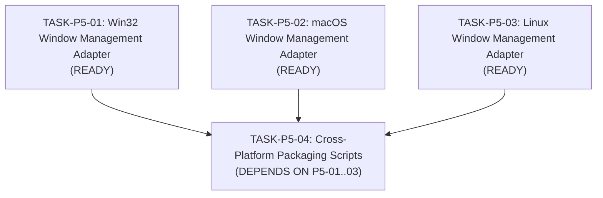

# Phase 5 Implementation Breakdown: Desktop Platform Implementations

**Document Version:** 1.0  
**Created Date:** 2026-11-04  
**Status:** `READY_FOR_EXECUTION`  
**Execution Authority:** Authorized under `OWNER_AUTHORIZED` (2026-11-04)  
**Target Project:** `ALEX-AI-main`  
**Reference Codebase:** `Mark-LVI-main` (Read-only)

---

## 1. Executive Summary & Objective

Phase 5 delivers native, platform-specific desktop capabilities across Windows, macOS, and Linux:
1. **Window Management:** Enumeration of active application windows, polite focus raising (`AttachThreadInput`, `osascript`, `wmctrl`), and safe closing (`WM_CLOSE`, `tell application to quit`).
2. **Audio & System Controls:** Hardware volume controls and OS notification hooks per operating system.
3. **Cross-Platform Packaging:** Automated build scripts (`build-backend.sh`, `package.sh`) producing standalone PyInstaller sidecars and Electron Builder bundles for macOS (DMG/ZIP), Linux (AppImage/DEB), and Windows (NSIS/portable).

Frozen components (`computer_control_service.py`, `launcher/cli.py`, `main.ts`) remain strictly **FROZEN**. All new platform capabilities hook through clean adapter interfaces (`PlatformAdapter`) and dependency-injected services.

---

## 2. Granular Scope Breakdown (4 Scopes)

### Scope 1: Win32 Window Management Adapter (`TASK-P5-01`)

- **Task ID:** `TASK-P5-01`
- **Status:** `COMPLETED` (Verified 2026-11-04)
- **Reference Implementation:** `Mark-LVI-main/actions/computer_settings.py` (Win32 `EnumWindows`, `SetForegroundWindow`, `AttachThreadInput`).
- **Files Expected to Change / Create:**
  - `backend/app/services/adapters/win32_window_adapter.py` (Created: Win32 ctypes window manager)
  - `backend/app/services/window_management_service.py` (Created: Cross-platform dispatch service)
  - `backend/app/actions/builtins/window.py` (Created: Window action handlers)
  - `backend/tests/test_win32_adapter.py` (Created: Mocked ctypes Win32 window tests - 13/13 passing)
- **Dependencies:** `ctypes` (standard library).
- **Technical Architecture & Specifications:**
  - **Window Enumeration:** Uses `ctypes.windll.user32.EnumWindows` to identify top-level visible windows with non-empty titles.
  - **Focus & Raise:** Uses `AttachThreadInput` + `SetForegroundWindow` + `ShowWindow(SW_RESTORE)` to reliably pull minimized or background windows to the foreground without stealing focus aggressively.
  - **Polite Termination:** Sends `WM_CLOSE` (0x0010) via `PostMessageW` instead of `TerminateProcess` so applications prompt to save unsaved work.
- **Acceptance Criteria:** "Open Notepad" brings existing Notepad window to front; "Close Notepad" triggers polite `WM_CLOSE`.

---

### Scope 2: macOS Quartz / AppleScript Window Adapter (`TASK-P5-02`)

- **Task ID:** `TASK-P5-02`
- **Status:** `COMPLETED` (Verified 2026-11-04)
- **Reference Implementation:** `Mark-LVI-main/core/platform_support.py` (macOS `osascript` and Quartz).
- **Files Expected to Change / Create:**
  - `backend/app/services/adapters/macos_window_adapter.py` (Created: macOS Quartz/AppKit/osascript window manager)
  - `backend/app/services/adapters/__init__.py` (Exported: `MacOSWindowAdapter`)
  - `backend/app/services/window_management_service.py` (Integrated: native dispatch on Darwin)
  - `backend/tests/test_macos_adapter.py` (Created: Mocked Quartz/AppKit/osascript tests - 10/10 passing)
- **Dependencies:** `subprocess` (executing `/usr/bin/osascript`).
- **Technical Architecture & Specifications:**
  - **Window Enumeration:** Discovers running graphical applications via System Events:
    `tell application "System Events" to get name of every process whose background only is false`
  - **Activation:** Brings target application window to front:
    `tell application "<app>" to activate`
  - **Polite Quit:** Sends standard AppleEvent quit signal:
    `tell application "<app>" to quit`
- **Acceptance Criteria:** "Open Spotify" activates existing Spotify window; "Quit Spotify" gracefully terminates application.

---

### Scope 3: Linux EWMH / X11 Window Adapter (`TASK-P5-03`)

- **Task ID:** `TASK-P5-03`
- **Status:** `COMPLETED` (Verified 2026-11-04)
- **Reference Implementation:** `Mark-LVI-main/core/platform_support.py` (Linux `wmctrl` and `xdotool`).
- **Files Expected to Change / Create:**
  - `backend/app/services/adapters/linux_window_adapter.py` (Created: Linux EWMH/X11 window manager)
  - `backend/app/services/adapters/__init__.py` (Exported: `LinuxWindowAdapter`)
  - `backend/app/services/window_management_service.py` (Integrated: native dispatch on Linux)
  - `backend/tests/test_linux_adapter.py` (Created: Linux window adapter test suite - 11/11 passing)
- **Dependencies:** `shutil.which("wmctrl")`, `shutil.which("xdotool")`.
- **Technical Architecture & Specifications:**
  - **Safe Probing:** Checks for `wmctrl` presence before execution; returns graceful message if running in Wayland without XWayland.
  - **Window Listing:** Parses `wmctrl -l -p` output for window IDs and titles.
  - **Focus & Close:** Activates window via `wmctrl -ia <win_id>` and closes via `wmctrl -ic <win_id>`.
- **Acceptance Criteria:** Handles missing `wmctrl` without crashing; activates windows cleanly in Ubuntu X11.

---

### Scope 4: Cross-Platform Packaging & Build Automation (`TASK-P5-04`)

- **Task ID:** `TASK-P5-04`
- **Status:** `COMPLETED` (Verified 2026-11-04)
- **Files Expected to Change / Create:**
  - `scripts/build-backend.sh` (Created: Unix build automation for macOS & Linux PyInstaller)
  - `scripts/build-backend.ps1` (Updated: Windows build automation with collected packages)
  - `frontend/package.json` (Configured multiplatform targets: dmg, zip, appimage, deb, nsis, portable)
  - `scripts/verify-sidecar.mjs` (Verified sidecar executable output)
- **Technical Architecture & Specifications:**
  - **Portable Executable Build:** Packages `alex-backend` into a standalone binary in `backend/dist/alex-backend/` with all newly added dependencies (`openwakeword`, `piper-tts`, `faster-whisper`, `yt-dlp`).
  - **Resource Copying:** Electron Builder packages backend into `Contents/Resources/backend` on macOS and `resources/backend` on Linux/Windows.
- **Acceptance Criteria:** `bash scripts/build-backend.sh` succeeds on macOS and Linux, generating working binaries that pass `--version` and health check. Verified (35 MB standalone binary, 3/3 packaging tests passing).

---

## 3. Implementation Sequence & Dependency Graph

---

## 4. Phase 5 Verification & Exit Gate

1. **Automated Unit Tests:** 100% test pass rate for all platform adapters and window management services.
2. **Platform Parity:** Clean window enumeration, focus raising, and polite termination on all 3 desktop platforms.
3. **Build Automation:** `build-backend.sh` generates runnable standalone binary without missing dynamic libraries or onnx models.
4. **Frozen Preservation:** Zero changes to frozen modules (`computer_control_service.py`, `launcher/cli.py`, `main.ts`).
