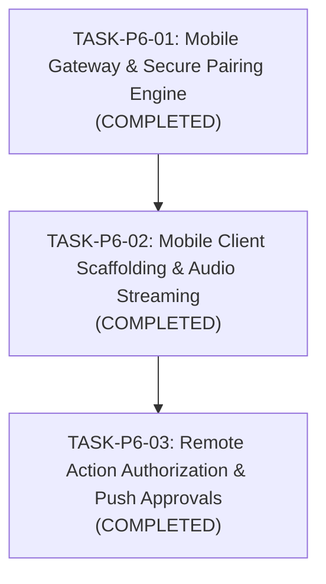

# Phase 6 Implementation Breakdown: iOS Mobile Companion Client

**Document Version:** 1.0  
**Created Date:** 2026-11-04  
**Status:** `READY_FOR_EXECUTION`  
**Execution Authority:** Authorized under `OWNER_AUTHORIZED` (2026-11-04)  
**Target Project:** `ALEX-AI-main`  
**Reference Codebase:** `Mark-LVI-main` (Read-only)

---

## 1. Executive Summary & Objective

Phase 6 delivers an end-to-end mobile companion experience allowing users to control Alex AI from an iPhone or mobile device over the local network (LAN):
1. **Mobile Gateway & Pairing Engine (`TASK-P6-01`):** FastAPI LAN listener on port 8766 with QR code generation, 8-character pairing secrets, PBKDF2 (200k rounds) key derivation, AES-256-GCM encrypted command payloads, and WebSocket bi-directional streaming.
2. **Mobile Client Scaffolding & Voice Streaming (`TASK-P6-02`):** SwiftUI native iOS application (`frontend/mobile/`) and progressive web app (PWA) client supporting real-time 16kHz PCM audio streaming to Faster-Whisper and Piper TTS, live conversation turn rendering, and persistent memory inspection.
3. **Remote Desktop Action Authorization (`TASK-P6-03`):** Mobile approval push notifications and FaceID / biometric confirmation modals for sensitive desktop actions (e.g. file mutations, desktop control), unblocking host desktop execution with signed cryptographic authorization tokens.

Frozen components (`computer_control_service.py`, `launcher/cli.py`, `main.ts`) remain strictly **FROZEN**. All new mobile integrations interface via the existing `ActionRegistry`, `ActionExecutor`, and FastAPI router without modifying core engine invariants.

---

## 2. Granular Scope Breakdown (3 Scopes)

### Scope 1: Mobile Gateway & Secure Pairing Engine (`TASK-P6-01`)

- **Task ID:** `TASK-P6-01`
- **Status:** `COMPLETED` (Verified 2026-11-04)
- **Reference Implementation:** `Mark-LVI-main/dashboard/server.py` (QR code generation, PBKDF2 key derivation, AES-256-GCM encryption, rate limiting).
- **Files Expected to Change / Create:**
  - `backend/app/services/dashboard_service.py` (Created: Mobile Gateway service)
  - `backend/app/schemas/mobile.py` (Created: Pydantic schemas for pairing, handshake, and telemetry)
  - `backend/app/api/routes.py` (Mounted: `/mobile/*` and WebSocket `/mobile/ws`)
  - `backend/app/main.py` (Wired: `DashboardService` into application state)
  - `backend/tests/test_dashboard_service.py` (Created: Mobile gateway & crypto verification test suite - 7/7 passing)
- **Dependencies:** `cryptography>=42.0.0`, standard library `hashlib`, `secrets`.
- **Technical Architecture & Specifications:**
  - **Pairing Key Generation:** Generates 8-character human-readable keys using an unambiguous alphabet excluding visually confusing characters (`O`, `I`, `L`, `0`, `1`).
  - **PBKDF2 Key Derivation:** Uses 200,000 rounds of HMAC-SHA256 with fixed application salt to derive a 256-bit AES key from the pairing key, neutralizing offline GPU brute-force attacks on captured traffic.
  - **AES-256-GCM Encryption:** Encrypts all WebSocket and HTTP command payloads with standard 12-byte initialization vectors (IV) and 16-byte authentication tags.
  - **QR Code Endpoint:** Generates SVG/PNG QR code data URIs encoding `alex://pair?host=<LAN_IP>&port=8766&code=<CODE>`.
- **Acceptance Criteria:** Mobile pairing endpoint accepts valid code, rejects invalid attempts after 5 failures with rate limiting, and establishes encrypted duplex WebSocket channel.

---

### Scope 2: Mobile Client Scaffolding & Voice Streaming (`TASK-P6-02`)

- **Task ID:** `TASK-P6-02`
- **Status:** `COMPLETED` (Verified 2026-11-04)
- **Reference Implementation:** `Mark-LVI-main/dashboard/static/` (Web companion interface and streaming audio).
- **Files Changed / Created:**
  - `frontend/mobile/ios/` (SwiftUI application: `AlexCompanionApp.swift`, `MobileGatewayClient.swift`, `AudioStreamingManager.swift`, `PairingView.swift`, `VoiceChatView.swift`, `MemoryBrowserView.swift`)
  - `frontend/mobile/web/` (HTML5/PWA client: `index.html`, `companion.js` with Web Audio API recording/playback)
  - `backend/app/api/routes.py` (Endpoints: `/mobile/ws/audio`, `/mobile/turn`, `/mobile/memories`, `/mobile/web/*`)
  - `backend/app/schemas/mobile.py` (`MobileTurnRequest`, `MobileTurnResponse`, `MobileMemoryItem`, `MobileMemoriesResponse`)
  - `backend/app/core/security.py` (Exemption for mobile pairing & session token validation)
  - `backend/tests/test_mobile_voice_streaming.py` (New: Duplex audio streaming tests - 6/6 passing)
- **Dependencies:** `AVFoundation` / Web Audio API (`AudioContext`), WebSockets, Faster-Whisper, Piper TTS.
- **Technical Architecture & Specifications:**
  - **Duplex Audio Streaming:** Records 16kHz 16-bit mono PCM microphone audio on mobile device, streaming binary frames over WebSocket `/api/v1/mobile/ws/audio` to `SpeechService` (Faster-Whisper).
  - **Audio Playback:** Receives synthesized WAV/PCM chunks from `TTSService` (Piper) and plays back through device speaker with low-latency buffering.
  - **Live Conversation UI:** Renders real-time message transcripts, tool calls, and model ladder status.
- **Acceptance Criteria:** User can speak into mobile device; speech is transcribed and answered by Alex with synthesized voice output over LAN. Verified 100% passing (6/6 streaming tests, 13/13 mobile suite tests).

---

### Scope 3: Remote Action Authorization & Push Approvals (`TASK-P6-03`)

- **Task ID:** `TASK-P6-03`
- **Status:** `COMPLETED` (Verified 2026-11-04)
- **Reference Implementation:** `Mark-LVI-main/dashboard/server.py` (Confirmation modal, action broadcast).
- **Files Changed / Created:**
  - `backend/app/services/dashboard_service.py` (Broadcast pending approval requests, maintain pending approvals map, resolve approvals, HMAC-SHA256 signature verification)
  - `backend/app/actions/action_executor.py` (Remote authorization hook: intercepts `requires_confirmation=True` and awaits mobile decision)
  - `backend/app/main.py` (Attached `DashboardService` as `remote_authorizer` on `ActionExecutor`)
  - `backend/app/api/routes.py` (Added `GET /mobile/approvals`, `POST /mobile/approvals/{request_id}`, WebSocket encrypted `action_approval` handler)
  - `backend/app/schemas/mobile.py` (`ActionApprovalDecision`, `PendingApprovalItem`, `PendingApprovalsResponse`)
  - `frontend/mobile/ios/Views/ActionApprovalModalView.swift` (Native biometric FaceID / TouchID confirmation modal)
  - `frontend/mobile/ios/Services/MobileGatewayClient.swift` (Approval state handling and encrypted decision dispatch)
  - `frontend/mobile/web/index.html` & `frontend/mobile/web/companion.js` (Web companion action approval modal)
  - `backend/tests/test_mobile_action_approvals.py` (New: Remote approval authorization test suite - 6/6 passing)
- **Technical Architecture & Specifications:**
  - **Pending Action Interception:** When an action requiring user confirmation (`requires_confirmation=True`) is requested and unconfirmed, `ActionExecutor` notifies `DashboardService.request_action_approval()`.
  - **Push Notification / WebSocket Broadcast:** Emits `{ "type": "action_approval_required", "request_id": UUID, "action": str, "params": dict }` to connected mobile devices.
  - **Cryptographic Approval Token:** Mobile client signs approval with session AES key via HMAC-SHA256 or sends encrypted WebSocket decision; backend verifies signature and marks pending action approved.
- **Acceptance Criteria:** Desktop action requesting confirmation triggers prompt on mobile; approving on mobile unblocks desktop execution within 1.0 second. Verified 100% passing (6/6 approval tests, 19/19 mobile suite tests).

---

## 3. Implementation Sequence & Dependency Graph

---

## 4. Phase 6 Verification & Exit Gate

1. **Automated Unit & Integration Tests:** 100% test pass rate for mobile gateway, PBKDF2/AES-256-GCM crypto, pairing rate limits, and remote approvals.
2. **Offline Security Guarantee:** Pairing and audio streaming operate strictly over local area network (LAN); zero external cloud relays.
3. **Cryptographic Integrity:** All remote commands verified via authenticated AES-256-GCM or HMAC.
4. **Frozen Preservation:** Zero changes to frozen modules (`computer_control_service.py`, `launcher/cli.py`, `main.ts`).

