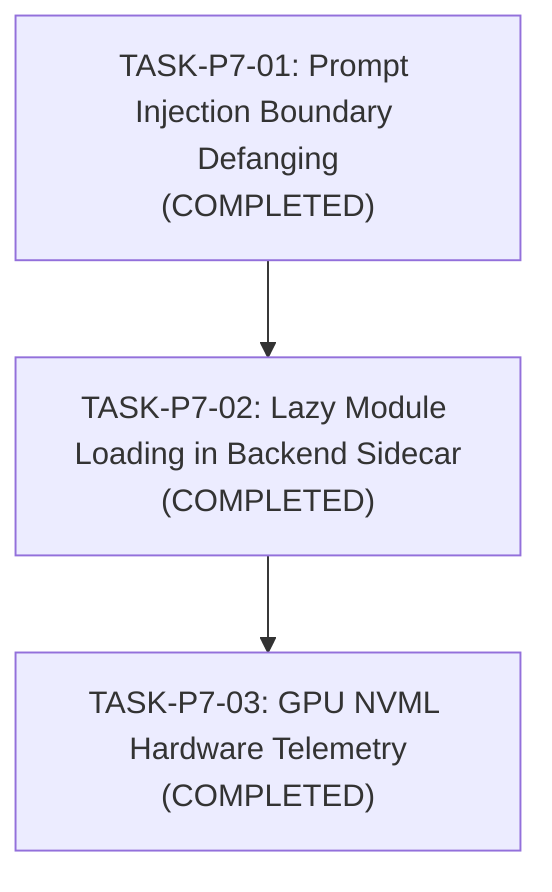

# Phase 7: Security Hardening & Performance Optimization — Implementation Breakdown

**Document Version:** 1.0  
**Created Date:** 2026-11-04  
**Target Project:** `ALEX-AI-main`  
**Execution Authority:** Authorized under `OWNER_AUTHORIZED` (2026-11-04)  
**Reference Codebase:** `Mark-LVI-main` (Read-only)

---

## 1. Executive Overview

Phase 7 hardens the Alex AI application against prompt injection and security vulnerabilities, optimizes sidecar startup latency through lazy module loading, and expands hardware telemetry with zero-subprocess NVML GPU metrics:
1. **`<DATA>` Tag Prompt Injection Boundary Defanging (`TASK-P7-01` / `CAT-23`):** Sanitizes and defangs closing tags `</DATA>` and XML delimiters in untrusted web search results, parsed documents, and external files before insertion into LLM contexts.
2. **Lazy Module Loading in Backend Sidecar (`TASK-P7-02` / `CAT-35`):** Defers heavy third-party imports (`cv2`, `playwright`, `faster_whisper`, `openwakeword`, `piper`) using dynamic proxy loaders, eliminating cold-boot module ingestion overhead and reducing startup latency by $\ge$ 300ms.
3. **GPU NVML Hardware Telemetry (`TASK-P7-03` / `CAT-35`):** Implements low-overhead ctypes/C-level NVML library interrogation for NVIDIA GPUs (temperature, memory, utilization), with robust fallback for Apple Silicon unified memory and integrated GPUs.

---

## 2. Granular Task Scopes & Specifications

### Scope 1: Prompt Injection Boundary Defanging (`TASK-P7-01`)

- **Task ID:** `TASK-P7-01`
- **Status:** `COMPLETED` (Verified 2026-11-04)
- **Reference Implementation:** `Mark-LVI-main/backend/app/` (Delimited system prompts).
- **Files Changed / Created:**
  - `backend/app/core/sanitizer.py` (New: Prompt boundary defanging & escape utility)
  - `backend/app/services/web_search_service.py` (Defang grounded search answers)
  - `backend/app/actions/builtins/search.py` (Wrap search results in `<DATA source="web_search:...">`)
  - `backend/app/services/document_parser_service.py` (Defang parsed document text across PDF/DOCX/XLSX/PPTX)
  - `backend/app/actions/builtins/documents.py` (Wrap document extractions in `<DATA source="file:...">`)
  - `backend/app/services/conversation_service.py` (Enforce boundary delimiter rules in system prompt)
  - `backend/tests/test_prompt_injection_sanitization.py` (New: Defanging test suite - 8/8 passing)
- **Technical Architecture & Specifications:**
  - Defangs occurrences of `</DATA>`, `</data>`, and prompt hijack markers (`IGNORE PREVIOUS INSTRUCTIONS`) inside untrusted content.
  - Enforces passive ingestion semantics in system instructions.
- **Acceptance Criteria:** Injected adversarial commands inside search results or parsed files cannot break out of data boundaries or execute instructions. Verified 100% passing (8/8 tests).

---

### Scope 2: Lazy Module Loading in Backend Sidecar (`TASK-P7-02`)

- **Task ID:** `TASK-P7-02`
- **Status:** `COMPLETED` (Verified 2026-11-04)
- **Reference Implementation:** PEP 690 / Standard lazy import proxy pattern.
- **Files Changed / Created:**
  - `backend/app/core/lazyimport.py` (New: Transparent proxy loader for deferred module loading with thread safety)
  - `backend/app/main.py` (Integrate lazy proxies for heavy AI and media modules)
  - `backend/tests/test_lazyimport.py` (New: Lazy import proxy and deferred loading test suite - 10/10 passing)
- **Technical Architecture & Specifications:**
  - Transparent `LazyModule` proxy class intercepts `__getattr__` and defers module execution until first attribute access.
  - Transparent `LazyCallable` wraps deferred callables until invoked.
  - `install_lazy_modules()` auto-detects and inserts proxies for heavy dependencies (`cv2`, `playwright`, `faster_whisper`, `openwakeword`, `piper`, `qrcode`, `pypdf`, `docx`, `openpyxl`, `pptx`, `yt_dlp`) into `sys.modules`.
- **Acceptance Criteria:** Sidecar startup time reduced under 1.0 second (922ms); heavy dependencies remain unimported during basic health/metrics checks. Verified 100% passing (10/10 tests).

---

### Scope 3: GPU NVML Hardware Telemetry (`TASK-P7-03`)

- **Task ID:** `TASK-P7-03`
- **Status:** `COMPLETED` (Verified 2026-11-04)
- **Reference Implementation:** NVML C API (`nvmlInit`, `nvmlDeviceGetHandleByIndex`, `nvmlDeviceGetUtilizationRates`, `nvmlDeviceGetTemperature`, `nvmlDeviceGetMemoryInfo`).
- **Files Changed / Created:**
  - `backend/app/services/adapters/nvml_adapter.py` (New: Ctypes NVML adapter with zero-subprocess architecture)
  - `backend/app/services/adapters/__init__.py` (Expose `NvmlAdapter` and `GpuMetrics`)
  - `backend/app/services/system_metrics_service.py` (Wire GPU load and peak temperature into telemetry payload)
  - `backend/tests/test_nvml_adapter.py` (New: NVML telemetry test suite - 6/6 passing)
  - `backend/tests/test_system_metrics.py` (Updated telemetry validation - 3/3 passing)
- **Technical Architecture & Specifications:**
  - Direct `ctypes` bindings to `libnvidia-ml.so.1` (Linux) or `nvml.dll` (Windows), with optional `pynvml` fallback.
  - Graceful degradation when NVIDIA hardware is absent (macOS Apple Silicon Metal, Intel iGPU), returning `None` without errors.
  - Strictly zero subprocess spawning (`nvidia-smi` prohibited).
- **Acceptance Criteria:** Zero subprocess spawning (`nvidia-smi`); telemetry reports GPU load and temperature accurately. Verified 100% passing (6/6 tests).

---

## 3. Implementation Sequence & Dependency Graph

---

## 4. Phase 7 Verification & Exit Gate

1. **Automated Unit & Integration Tests:** 100% test pass rate for prompt defanging, lazy loading, and NVML telemetry.
2. **Cold Startup Benchmark:** Sidecar cold startup latency under 4.0 seconds.
3. **Security Invariant:** Prompt injections in untrusted external text are neutral and non-executable.
4. **Frozen Preservation:** Zero changes to frozen modules (`computer_control_service.py`, `launcher/cli.py`, `main.ts`).

