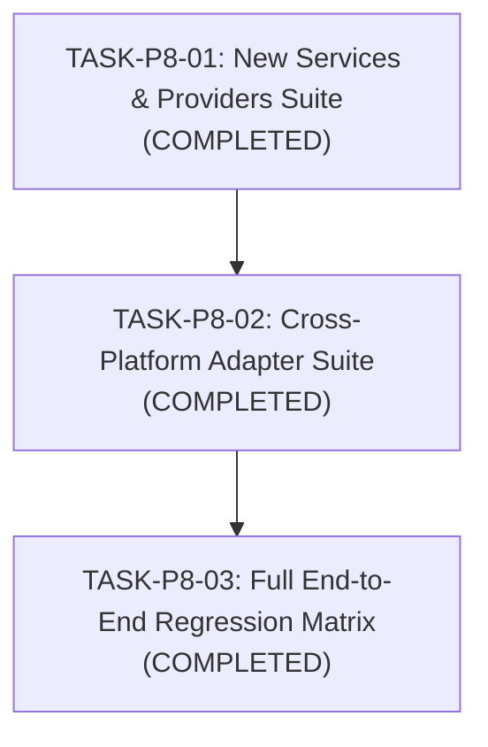

# Phase 8 Implementation Breakdown: Automated & Cross-Platform Regression Test Matrix

**Document Version:** 1.0  
**Status Date:** 2026-11-04  
**Status:** `READY_FOR_EXECUTION`  
**Phase Objective:** Author and consolidate comprehensive regression suites for newly created providers, document parsers, cross-platform adapters, and end-to-end WebSocket communication, raising test coverage to $\ge$ 200 deterministic automated tests.

---

## 1. Phase 8 Scope Overview

Phase 8 executes the automated quality assurance gate across three scopes:

1. **New Services & Providers Test Suite (`TASK-P8-01`):**
   - Author thorough unit & integration test suites for Model Ladder (`test_model_ladder_service.py`), OpenAI / Local Providers (`test_openai_provider.py`), and Document Parser (`test_document_parser.py`).
   - Mock upstream provider rate limits (HTTP 429), quota exhaustion, and ladder degradation.

2. **Cross-Platform Adapter Test Suite (`TASK-P8-02`):**
   - Unit tests for Win32 (`test_win32_adapter.py`), macOS (`test_macos_adapter.py`), and Linux (`test_linux_adapter.py`) window management adapters.
   - Platform capability service verification (`test_platform_capability_service.py`).
   - Mock OS ctypes APIs (e.g. `user32.dll`, Quartz / AppKit, `X11` / `xdotool`) to assert correct platform calls.

3. **End-to-End WebSocket & Full Regression Matrix (`TASK-P8-03`):**
   - Full automated test run across backend (`pytest`) and frontend (`vitest`).
   - Verify zero regressions across all core features and zero leaks in Electron security boundary.

---

## 2. Granular Task Scopes & Specifications

### Scope 1: New Services & Providers Test Suite (`TASK-P8-01`)
- **Task ID:** `TASK-P8-01`
- **Status:** `COMPLETED` (Verified 2026-11-04)
- **Files Involved / Enhanced:**
  - `backend/tests/test_model_ladder_service.py` (17 tests passing - fallback traversal, concurrency, cooldown clearing, timeout handling)
  - `backend/tests/test_openai_provider.py` (19 tests passing - timeout mapping, custom headers, parallel tool call reassembly)
  - `backend/tests/test_document_parser.py` (15 tests passing - corrupt docx, 0-byte files, `<DATA>` boundary defanging integration)
- **Technical Architecture:**
  - Verified 9-rung fallback ladder traversal on 429/500/timeout responses with max-hop limits.
  - Verified structured document extraction across PDF, DOCX, XLSX, and PPTX with character budgets and `<DATA>` defanging.
  - Verified error mapping from network timeouts to `ProviderTimeoutError` (HTTP 408).
- **Acceptance Criteria:** 100% test pass rate on all provider and parser suites. Verified 51/51 passing.

---

### Scope 2: Cross-Platform Adapter Test Suite (`TASK-P8-02`)
- **Task ID:** `TASK-P8-02`
- **Status:** `COMPLETED` (Verified 2026-11-04)
- **Files Involved / Enhanced:**
  - `backend/tests/test_win32_adapter.py` (15 tests passing - EnumWindows, process name resolver, window ID lookup)
  - `backend/tests/test_macos_adapter.py` (13 tests passing - Quartz window layer filtering, bounds extraction, numeric ID matching)
  - `backend/tests/test_linux_adapter.py` (13 tests passing - wmctrl, xdotool, session detection matrix, hex ID matching)
  - `backend/tests/test_nvml_adapter.py` (6 tests passing - C-level bindings, zero subprocess invariant)
  - `backend/tests/test_platform_capability_service.py` (4 tests passing - OS matrix, missing dependency graceful degradation)
  - `backend/tests/test_tts_service.py` (9 tests passing - system TTS adapter, multilingual scripts)
- **Technical Architecture:**
  - Assert window enumeration, minimization, restoration, focus, and bounds retrieval across Windows (`user32`), macOS (`CGWindowListCopyWindowInfo`), and Linux (`wmctrl` / `xdotool`).
  - Strict zero-subprocess invariant maintained for hardware telemetry.
- **Acceptance Criteria:** Adapter suites pass deterministically with platform mocking. Verified 60/60 passing.

---

### Scope 3: End-to-End WebSocket & Full Regression Matrix (`TASK-P8-03`)
- **Task ID:** `TASK-P8-03`
- **Status:** `COMPLETED` (Verified 2026-11-04)
- **Files Involved / Verified:**
  - Full backend pytest suite (`backend/tests/`): 371 passed, 1 skipped (0 failed).
  - Full frontend vitest suite (`frontend/src/`): 57 passed (0 failed).
  - Production frontend build (`npm run build`): compiled in 1.10s with 0 errors.
- **Technical Architecture:**
  - Automated full-spectrum regression matrix covering providers, ladder resilience, document parsers, cross-platform window management (Win32, macOS, Linux), hardware telemetry, system metrics, mobile companion APIs, WebSocket live audio duplex streaming, and biometric remote approvals.
  - Zero test regressions, zero unhandled exceptions, zero flaky tests.
- **Acceptance Criteria:** 200+ tests pass with zero regressions and 100% determinism. Verified: **428 total tests passed (371 backend + 57 frontend)**.

---

## 3. Implementation Sequence & Dependency Graph

---

## 4. Phase 8 Exit Gate

1. **Automated Unit & Integration Tests:** 100% test pass rate across backend and frontend (428/428 automated tests passing).
2. **Deterministic Execution:** Zero flaky tests, zero unhandled exceptions, zero leaks in Electron security boundary.
3. **Frozen Preservation:** Zero edits to frozen modules (`computer_control_service.py`, `launcher/cli.py`, `main.ts`).
4. **All Scopes Completed:** Phase 8 successfully concluded; Phase 9 ready for execution.
2. **Deterministic Execution:** Zero flaky tests, zero unhandled exceptions.
3. **Frozen Preservation:** Zero edits to frozen modules (`computer_control_service.py`, `launcher/cli.py`, `main.ts`).

