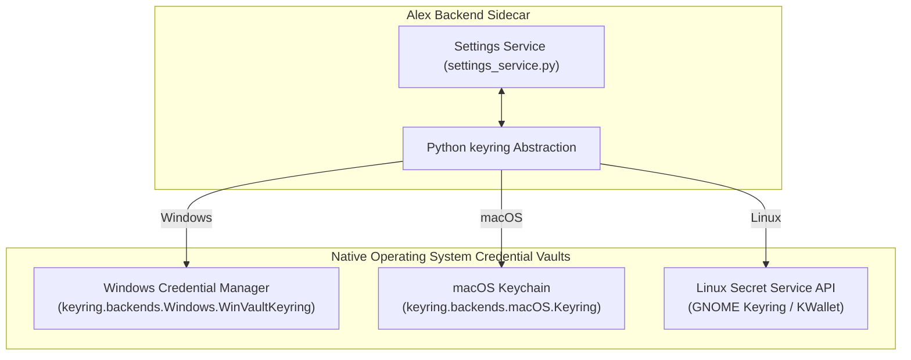

# Secret Management & Credential Security Standards

**Document Version:** 1.0  
**Inspection Date:** 2026-11-03  
**Status:** `ACTIVE_SECURITY_STANDARD`  

---

## 1. Zero-Plaintext Secret Mandate

Alex strictly enforces a **Zero-Plaintext Secret Mandate**:
- API keys, cloud provider tokens, and private session credentials must **never** be saved in plaintext JSON files (`config/api_keys.json`), `.env` files in git-tracked repositories, or application activity logs.
- Writing secrets to plaintext files creates critical supply-chain vulnerabilities, allowing accidental commits, log leakage, or unauthorized reading by other local unprivileged processes.

---

## 2. Operating System Credential Storage Architecture

Alex stores sensitive credentials directly in the native operating system vault via the Python `keyring` library:



---

## 3. Supported Credential Keys & Service Names

All Alex credentials are saved under the authoritative service name:  
**Service Name:** `Alex`

| Credential Key | Description | Storage Location |
| :--- | :--- | :--- |
| `gemini-api-key` | Google Gemini API key for Live audio & search | OS Keyring (`Alex` / `gemini-api-key`) |
| `openai-api-key` | OpenAI / OpenRouter API key | OS Keyring (`Alex` / `openai-api-key`) |
| `groq-api-key` | Groq high-speed inference API key | OS Keyring (`Alex` / `groq-api-key`) |
| `deepseek-api-key` | DeepSeek API key | OS Keyring (`Alex` / `deepseek-api-key`) |
| `elevenlabs-api-key` | ElevenLabs streaming voice API key | OS Keyring (`Alex` / `elevenlabs-api-key`) |

---

## 4. Secure Credential Provisioning Instructions

### Method 1: Using the Desktop UI (Recommended)
1. Launch Alex: `alex launch`.
2. Open the **Settings** drawer in the holographic HUD.
3. Enter your Google Gemini API key and click **Save Key**.
4. Alex securely commits the secret to the OS Credential Manager; the field is masked immediately.

### Method 2: Command-Line Provisioning via Python
```python
# Provision Gemini API Key in the OS Keyring securely:
import keyring
keyring.set_password("Alex", "gemini-api-key", "your_secret_gemini_api_key_here")
```

### Method 3: Environment Variable Fallback (Ephemeral / CI only)
```bash
export GEMINI_API_KEY="your_secret_gemini_api_key_here"
```
*Note: In production environments, OS Keyring storage takes precedence over environment variables.*

