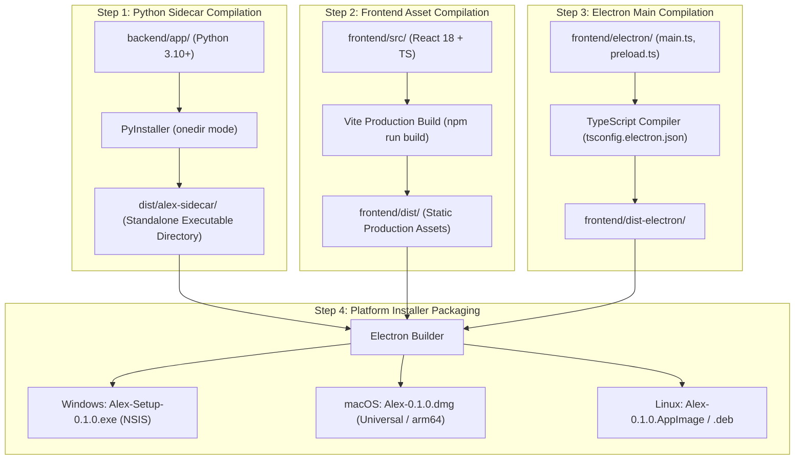

# Build and Packaging Guide: Multi-Platform Standalone Distribution

**Document Version:** 1.0  
**Inspection Date:** 2026-11-03  
**Status:** `ACTIVE_BUILD_SPECIFICATION`  
**Target Distributions:** Windows NSIS Installer (.exe), macOS DMG (.dmg), Linux AppImage / DEB  

---

## 1. Production Build Pipeline Architecture

The Alex production build pipeline bundles the application into a standalone installer that requires **no pre-installed Python, Node.js, or virtual environment** on the target user's computer:



---

## 2. Platform Build Instructions

### 2.1 Building on Windows (PowerShell)
```powershell
# 1. Compile Python backend sidecar
.\scripts\build-backend.ps1

# 2. Package Electron desktop installer
cd frontend
npm run build
npx electron-builder --win --x64
```
*Output: `frontend/release/Alex-Setup-0.1.0.exe`*

### 2.2 Building on macOS (Terminal)
```bash
# 1. Compile Python backend sidecar
./scripts/build-backend.sh

# 2. Package Electron desktop DMG
cd frontend
npm run build
npx electron-builder --mac --arm64 --x64
```
*Output: `frontend/release/Alex-0.1.0.dmg`*

### 2.3 Building on Ubuntu Linux (Terminal)
```bash
# 1. Compile Python backend sidecar
./scripts/build-backend.sh

# 2. Package AppImage and DEB
cd frontend
npm run build
npx electron-builder --linux AppImage deb
```
*Output: `frontend/release/Alex-0.1.0.AppImage` and `frontend/release/alex_0.1.0_amd64.deb`*

---

## 3. Code Signing & Notarization Guidelines

- **Windows:** Code sign with an Authenticode certificate (`signtool.exe sign /fd SHA256 /tr ...`) to prevent Windows SmartScreen untrusted warnings.
- **macOS:** Sign with Apple Developer ID Application certificate and notarize via `xcrun notarytool submit` to pass Apple Gatekeeper checks.

