# Source Code Inventory: Mark-LVI-main vs. ALEX-AI-main

**Document Version:** 1.0  
**Inspection Date:** 2026-11-03  
**Reference Project:** `Mark-LVI-main` (Commit / Release: MARK LVI / 56)  
**Target Project:** `ALEX-AI-main` (Version: `0.1.0`, Baseline Snapshot: `SNAPSHOT_v0.1.0-20261102`)  
**Status:** `VERIFIED_FACTUAL`  

---

## 1. Executive Summary & Inventory Overview

This document provides a complete, line-by-line and file-by-file inspection of both repositories to establish the architectural baseline for achieving full functional parity.

```
========================================================================================
                          REPOSITORY COMPARISON SUMMARY TABLE
========================================================================================
  Metric                                Mark-LVI-main              ALEX-AI-main
----------------------------------------------------------------------------------------
  Primary Architectural Pattern         Python Monolith + PyQt6    3-Tier Decoupled
                                        (Single-process multi-th)  (Electron + React + FastAPI)
  Frontend Technology                   PyQt6 (QPainter 3D HUD)    React 18 + Vite + Tailwind
  Desktop Shell Technology              PyQt6 / QMainWindow        Electron 33 + ContextBridge
  Backend / Sidecar Technology          In-process Python threads  FastAPI + Uvicorn (Loopback)
  Process Orchestration                 Direct Python launch       Unified CLI Launcher (Python/Node)
  Total Tracked Source Files            ~85 files                  ~45 code files + docs
  Python Codebase Size                  ~1.1 MB (Monolithic files) ~180 KB (Modular services)
  TypeScript/TSX Codebase Size          0 KB (Pure Python UI)      ~140 KB (Type-safe UI & IPC)
  Total Python Dependencies (req.txt)   36 declared packages       10 declared packages
  AI Providers Supported                Gemini Live + 10 providers Gemini Live + Gemini REST only
  Speech Recognition (STT)              Faster-Whisper (Local CPU) Web Audio API (Browser only)
  Speech Synthesis (TTS)                Piper (Local) + ElevenLabs Web Audio playback (Live API)
                                        + System Voices
  Action Modules Available              21 action modules          5 builtin action modules
  Remote Mobile Client                  FastAPI Web (HTTP/WS)      None (Planned iOS / PWA)
  Window Management Support             Windows + Linux (X11)      Windows only (Win32 API)
  Platform Permissions Awareness        Wayland & macOS TCC aware  Partial (checks Windows ctypes)
========================================================================================
```

---

## 2. Reference Project Inventory: `Mark-LVI-main`

### 2.1 Root Entry Points & Monolithic Modules
- **`main.py` (134,090 bytes):**
  - **Role:** Main application lifecycle orchestrator and event loop.
  - **Subsystems:** Subprocess patch (`CREATE_NO_WINDOW`), UTF-8 console streams, sounddevice audio stream callback, Gemini Live WebSocket client (`JarvisLive`), prompt generation with dynamic system self-knowledge, tool execution dispatcher, context sliding-window compression, session log summarization, wake-word event handling, and remote dashboard initialization.
  - **Dependencies:** `PyQt6`, `sounddevice`, `numpy`, `google.genai`, `httpx`, `psutil`.
- **`ui.py` (316,912 bytes):**
  - **Role:** Monolithic desktop user interface built with PyQt6.
  - **Subsystems:** Frameless HUD window with acrylic blur, custom QPainter 3D wireframe avatar with MediaPipe canonical mesh, real-time waveform aura, dynamic content display drawer, settings drawer (HueWheel accent picker, audio device selectors, engine & providers form, model ladder configuration), video player integration (QtMultimedia + yt-dlp), system tray icon, and activity log.
- **`setup.py` (6,055 bytes):** Installation script handling cross-platform dependency checks and one-click setup.
- **`requirements.txt` (8,735 bytes):** Detailed Python dependency manifest with environment markers for Windows, macOS, and Linux.

### 2.2 Core Subsystem (`core/`) — 22 Files
- **`core/action_loader.py`:** Dynamic action discovery scanner. Scans `actions/*.py`, introspects `TOOL` dictionaries, validates signatures, detects collisions, strips metadata (`tier`, `brief`) before API transmission, and handles argument injection.
- **`core/plugin_loader.py`:** User plugin discovery scanner for `plugins/*.py`. Supports runtime toggling without process restarts.
- **`core/avatar.py` & `core/avatar_mesh.py` & `core/face_model.obj`:** Software-rendered 3D holographic human head. Poses MediaPipe canonical face mesh vertices using NumPy and renders via QPainter without GPU/OpenGL dependencies.
- **`core/viseme.py`:** Formant analysis and transcript-based viseme synthesizer (~50 mouth shapes/sec) with language-independent Unicode reduction.
- **`core/wake_word.py`:** Local offline wake-word detection ("Hey Jarvis") utilizing `openwakeword` ONNX models running on CPU.
- **`core/hotkey.py`:** Push-to-talk hotkey manager (Ctrl+Space global hook on Windows via Win32, window-scoped on macOS/Linux).
- **`core/audio_devices.py`:** Operating system audio endpoint discovery and testing. Features live dB peak metering for microphones, test tone generation for speakers, and pycaw/CoreAudio volume control.
- **`core/platform_support.py`:** Operating system capability detector. Formally identifies Wayland limitations (Ubuntu 22.04+), macOS TCC (Accessibility and Screen Recording) permissions, and passes constraints to the model prompt.
- **`core/appidentity.py`:** Runtime self-knowledge generator providing the assistant's name, host OS, available tools, and active limits.
- **`core/undo.py`:** Multi-level undo stack for reversing destructive file modifications, renames, and system setting changes.
- **`core/confirm.py`:** Safety confirmation gate for irreversible operations (system shutdown, restart, WiFi disconnection).
- **`core/gemini.py`:** Gemini Live API connection manager handling WebSocket streaming, token authentication, and reconnection backoff.
- **`core/llm_client.py`:** Multi-model ladder and fallback client for routing side calls (document analysis, screen reasoning) to local LLMs (Ollama, LM Studio) or cloud endpoints (OpenAI, Groq).
- **`core/echo.py`:** Real-time self-echo acoustic guard preventing the assistant from recognizing its own synthesized voice.
- **`core/lazyimport.py`:** Deferred module import manager reducing startup latency from 462 ms to 216 ms.
- **`core/installer.py`:** In-app installer for heavy optional dependencies (`faster-whisper`, `piper-tts`).
- **`core/outcome.py`:** Standardized five-word outcome contract (`done`, `unverified`, `failed`, `ask`, `started`).
- **`core/stt.py` & `core/tts.py`:** Speech-to-text and text-to-speech abstraction layers.
- **`core/prompt.txt`:** Authoritative base prompt carrying safety rules, external data boundary tags, and tool dispatch guidelines.

### 2.3 Provider Subsystem (`providers/`) — 11 Files
- **`providers/engine_pipeline.py`:** Pipeline orchestrating local Hearing (STT) $\rightarrow$ Thinking (LLM) $\rightarrow$ Speaking (TTS).
- **`providers/llm_openai.py`:** Unified client for OpenAI-compatible `/v1/chat/completions` servers (Ollama, LM Studio, Groq, DeepSeek, Mistral, xAI, OpenRouter, Together). Features streaming `<think>` reasoning filter and anti-repetition loops.
- **`providers/stt_whisper.py`:** Local STT using `faster-whisper` on CPU with automatic language detection and acoustic pre-warming.
- **`providers/tts_piper.py`:** Neural local TTS using Piper (~176 voices across 52 languages, 15x real-time on CPU).
- **`providers/tts_elevenlabs.py`:** Cloud streaming TTS via ElevenLabs API.
- **`providers/tts_system.py`:** Zero-dependency system TTS using Windows SAPI, macOS `say`, and Linux `espeak-ng`.
- **`providers/schema.py`:** Dual tool budgeting engine (count budget and size budget) preventing smaller 8B models from choking on 45 tools.
- **`providers/audio.py`:** Dynamic energy-based Voice Activity Detection (VAD) with continuous noise-floor tracking.
- **`providers/registry.py`:** Provider declaration registry and UI form schema generator.
- **`providers/base.py` & `providers/_tests.py`:** Base classes and diagnostic test suite.

### 2.4 Actions Subsystem (`actions/`) — 21 Action Modules
1. `actions/open_app.py`: Process-table verified application launching, window raising, and polite closing via WM_CLOSE.
2. `actions/computer_control.py`: Mouse and keyboard automation with safety bounds.
3. `actions/computer_settings.py`: Volume, screen brightness, battery, WiFi, wallpaper, and display settings.
4. `actions/browser_control.py`: Browser navigation, tab management, element interaction via Playwright / BeautifulSoup.
5. `actions/web_search.py`: Multi-mode web search (`news`, `research`, `price`, `compare`, `search`) via Gemini Grounding and DDGS.
6. `actions/file_controller.py`: File browsing, copying, moving, renaming, and safe deletion via `send2trash`.
7. `actions/file_processor.py`: Deep document analysis for PDF, DOCX, PPTX, XLSX, TXT, and source code.
8. `actions/screen_processor.py`: Screen capture (`mss`) and webcam frame extraction (`OpenCV`) for multimodal visual reasoning.
9. `actions/video_player.py`: Embedded HUD video playback using QtMultimedia.
10. `actions/youtube_video.py`: YouTube search, streaming extraction (`yt-dlp`), and transcript analysis.
11. `actions/send_message.py`: Messaging integration for WhatsApp Desktop and Telegram.
12. `actions/desktop.py`: Desktop-level window management, taskbar control, minimize all, and tiling.
13. `actions/reminder.py`: OS-native scheduled notifications via Windows Task Scheduler (`schtasks`), macOS `launchd`, and Linux `systemd`.
14. `actions/system_monitor.py`: Zero-subprocess hardware telemetry (CPU, RAM, GPU via NVML, battery).
15. `actions/background_monitor.py`: User-configured topic monitoring with automated daily news alerts.
16. `actions/proactive.py`: Proactive 2.0 context-aware, time-aware check-in engine.
17. `actions/weather_report.py`: Weather report generation personalized from user location memory.
18. `actions/dev_agent.py`: Autonomous coding agent capable of multi-step code generation and debugging.
19. `actions/code_helper.py`: Code syntax checking, formatting, and explanation.
20. `actions/flight_finder.py`: Flight lookup and travel status search.
21. `actions/game_updater.py`: Game installation detection and Steam/Epic Games update monitoring.

### 2.5 Dashboard Subsystem (`dashboard/`) — 5 Files
- `dashboard/server.py`: FastAPI server providing remote smartphone control over LAN with QR-code pairing, AES-256-GCM command encryption, and rate-limited endpoints.
- `dashboard/static/`: Mobile web application (`login.html`, `app.html`, `crypto-js.min.js`).

### 2.6 Memory & Configuration Subsystem (`memory/`, `config/`) — 7 Files
- `memory/memory_manager.py`: File-backed key-value memory, semantic prompt formatting, and conversation session summarization.
- `memory/config_manager.py`: Configuration persistence in `config/api_keys.json` with in-memory caching against file mtime.
- `config/jarvis.ico`: Application icon.

---

## 3. Target Project Inventory: `ALEX-AI-main`

### 3.1 Unified CLI Launcher (`launcher/`) — 16 Files
- **`launcher/cli.py` (21,330 bytes):** Multi-command CLI (`launch`, `stop`, `restart`, `status`, `doctor`). Frozen implementation.
- **`launcher/process_manager.py`:** Process tree supervisor with pidfile tracking.
- **`launcher/dependencies.py` & `launcher/doctor.py`:** System prerequisite diagnostics (Python 3.10+, Node 18+, port checks).
- **`launcher/backend_manager.py`, `launcher/frontend_manager.py`, `launcher/electron_manager.py`:** Subsystem lifecycle managers.
- **`launcher/shutdown_manager.py`:** Graceful process tree termination.

### 3.2 Backend Service Sidecar (`backend/app/`) — 28 Files
- **`backend/app/main.py`:** FastAPI application bound to loopback `127.0.0.1:8765`, enforcing bearer token authentication.
- **`backend/app/core/`:**
  - `config.py`: Pydantic settings loading `ALEX_` prefixed environment variables.
  - `security.py`: Dynamic bearer token validation and timing-attack resistant authentication.
  - `storage.py`: Thread-safe JSON document storage with atomic file writing.
  - `logging_config.py`: Structured application logging.
- **`backend/app/services/`:**
  - `live_voice_service.py`: WebSocket server bridging Web Audio PCM to Google Gemini Live API.
  - `conversation_service.py`: REST-based chat using Gemini REST models (`gemini-2.0-flash`).
  - `computer_control_service.py` (Frozen): Coordinate validation, failsafes, emergency aborts, and Win32 window management.
  - `settings_service.py`: Application settings persistence with OS keyring integration for API keys.
  - `memory_service.py`: Local key-value fact storage.
  - `reminder_service.py`: In-memory reminder storage.
  - `system_metrics_service.py`: Host CPU, memory, and disk telemetry via `psutil`.
  - `platform_capability_service.py`: OS capability reporting.
  - `file_workspace_service.py`: Sandboxed file operations.
  - `web_search_service.py`: Gemini Grounded search with DuckDuckGo fallback.
  - `briefing_service.py`: Greeting and telemetry summary.
- **`backend/app/actions/`:**
  - `action_registry.py` & `action_executor.py`: In-memory action registry and execution coordinator.
  - `builtins/`: 5 builtin actions (`computer_control.py`, `files.py`, `memory.py`, `search.py`, `system.py`).

### 3.3 Electron Desktop Shell (`frontend/electron/`) — 4 Files
- **`frontend/electron/main.ts` (38,297 bytes):** Electron main process. Configures BrowserWindow with strict context isolation (`contextIsolation: true`, `nodeIntegration: false`), loopback HTTP client, and window geometry.
- **`frontend/electron/preload.ts`:** Preload bridge exposing typed `window.alex` methods to the renderer.
- **`frontend/electron/screenCapture.ts`:** Native screen capture via `desktopCapturer`.

### 3.4 React Frontend HUD (`frontend/src/`) — 24 Files
- **`frontend/src/App.tsx`:** Root component managing state, navigation drawer, active pages, and hotkeys.
- **`frontend/src/components/`:**
  - `HudAvatar.tsx`: 2D SVG holographic avatar with CSS animations and dynamic positioning.
  - `Notice.tsx`: Alert dialog.
- **`frontend/src/pages/`:**
  - `ConversationPage.tsx`: Text and voice chat history.
  - `ComputerControlPage.tsx`: Approval queue and manual controls.
  - `AudioDevicesPage.tsx`: Audio device selection via Web Audio API.
  - `SettingsPage.tsx`: Settings configuration and API key setup.
  - `MemoryPage.tsx`: Fact viewing and deletion.
  - `RemindersPage.tsx`: Reminder list.
  - `WebSearchPage.tsx`: Grounded search UI.
  - `ActionsPage.tsx`: Action trigger UI.
- **`frontend/src/hooks/useLiveVoice.ts`:** Web Audio API PCM capture (16kHz), WebSocket streaming, and PCM playback.

---

## 4. Architectural Comparison: Monolith vs. Three-Tier Sidecar

```mermaid
graph TD
    subgraph "Mark-LVI (Monolithic Single-Process)"
        M_UI["PyQt6 GUI Main Thread<br>(ui.py - 316 KB)"]
        M_CORE["Background Asyncio Thread<br>(main.py - 134 KB)"]
        M_ACT["Actions & Providers Subsystems<br>(actions/*.py, providers/*.py)"]
        M_UI <-->|Qt Signals / Direct Calls| M_CORE
        M_CORE <-->|Dynamic Import / TOOL Dict| M_ACT
    end

    subgraph "Alex (Decoupled Three-Tier Architecture)"
        A_UI["React 18 / TypeScript Renderer<br>(Sandboxed, No Node.js)"]
        A_EL["Electron Main Process<br>(main.ts - ContextBridge)"]
        A_BE["FastAPI Backend Sidecar<br>(127.0.0.1:8765 + Bearer Token)"]
        A_UI <-->|Typed IPC window.alex| A_EL
        A_EL <-->|Loopback HTTP / WS| A_BE
    end
```



### Architectural Tradeoff Assessment
1. **Security & Isolation:** Alex's decoupled three-tier architecture is significantly superior from a security perspective. Electron `contextIsolation` prevents renderer compromise from executing arbitrary host commands. In Mark-LVI, any script injection inside PyQt6 has immediate, unrestricted access to the Python host and system shell.
2. **Crash Resilience:** In Mark-LVI, an unhandled exception or native crash in Qt, PyAudio, or an action takes down the entire assistant. In Alex, if the renderer crashes, the sidecar and background tasks survive; if the sidecar restarts, the UI reconnects seamlessly.
3. **Cross-Platform Adaptability:** PyQt6 requires native C++ Qt binaries that differ vastly across Windows, Linux, and macOS. Alex's Electron frontend runs cross-platform on Chromium, while the backend sidecar can be shared with an iOS client.
4. **Functional Breadth:** Mark-LVI currently implements an immense array of local AI providers, multimodal computer control, media tools, and background engines that Alex has not yet migrated.

---

## 5. Summary of Codebase Artifacts & Status

- **`Mark-LVI-main` Status:** Verified complete, functional reference codebase. Kept strictly read-only.
- **`ALEX-AI-main` Status:** Solid, secure architectural skeleton with production launcher, authenticated IPC, and core services, but suffering from substantial functional gaps in local models, TTS/STT pipelines, action coverage, and cross-platform window management.

