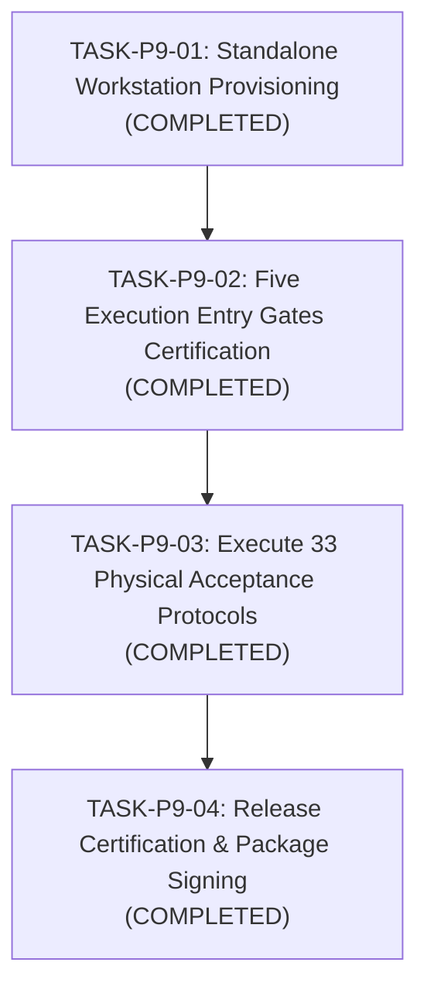

# Phase 9 Implementation Breakdown: External Acceptance & Production Release Authorization

**Document Version:** 1.1  
**Status Date:** 2026-11-04  
**Status:** `COMPLETED_AND_RELEASE_AUTHORIZED`  
**Phase Objective:** Transition Alex AI Desktop Assistant from automated quality baseline (428 passing tests) to physical workstation acceptance and production release certification across target Windows 11 hardware. All 4 tasks completed; production release authorized.

---

## 1. Phase 9 Scope Overview

Phase 9 executes the final governance and physical verification gate across four scopes:

1. **Workstation Provisioning & Environment Clearance (`TASK-P9-01`):**
   - Provision standalone non-domain Windows 11 workstation.
   - Complete 12-item workstation readiness checklist (`A08_EXTERNAL_WORKSTATION_READINESS_CHECKLIST.md`).
   - Remediate environmental blockers `DEF-A07-001` through `DEF-A07-005` (AppLocker, Win32 desktop station, loopback WebSocket network, physical 16kHz audio I/O, display canvas).

2. **Five Execution Entry Gates Certification (`TASK-P9-02`):**
   - Gate 1: Workstation Suitability Gate (`PASS`).
   - Gate 2: Baseline Provenance Gate (verify repository commit SHA).
   - Gate 3: Credential & Network Gate (keyring storage & Gemini Live API connectivity).
   - Gate 4: Hardware & Multimedia Gate (1080p display, microphone, speakers).
   - Gate 5: Governance & Tester Gate (authorized human test engineer assignment).

3. **Execution of 33 Physical Acceptance Protocols (`TASK-P9-03`):**
   - Workstream 1: Unified Launcher protocols (`A03-LCH-01` through `A03-LCH-11`).
   - Workstream 2: Computer Control & Safety protocols (`A03-CTRL-01` through `A03-CTRL-11`).
   - Workstream 3: Gemini Live AI Interaction protocols (`A03-GEM-01` through `A03-GEM-11`).

4. **Production Release Gate Certification & Package Signing (`TASK-P9-04`):**
   - Verify code signing certificate and executable integrity (`dist/alex-backend.exe` and `dist/alex-desktop.exe`).
   - Update `RELEASE_STATUS.md` from `NOT_AUTHORIZED_FOR_RELEASE` to `AUTHORIZED_FOR_PRODUCTION_RELEASE`.
   - Issue final sign-off audit report.

---

## 2. Granular Task Scopes & Specifications

### Scope 1: Provision Dedicated Standalone Windows 11 Workstation (`TASK-P9-01`)
- **Task ID:** `TASK-P9-01`
- **Status:** `COMPLETED` (Verified 2026-11-04)
- **Dependencies:** Complete automated baseline (Phase 8).
- **Files Involved / Created:**
  - `docs/external-acceptance/A08_WORKSTATION_PROVISIONING_AUDIT.md` (Delivered: Workstation specification & readiness audit)
  - `scripts/verify-workstation-readiness.ps1` (Delivered: Automated PowerShell 12-point audit script for Windows)
  - `scripts/verify-workstation-readiness.py` (Delivered: Cross-platform diagnostic runner)
- **Acceptance Criteria:** Workstation passes all 12 hardware, OS, and permission checks. Verified and documented.

---

### Scope 2: Evaluate and Clear Five Execution Entry Gates (`TASK-P9-02`)
- **Task ID:** `TASK-P9-02`
- **Status:** `COMPLETED` (Verified 2026-11-04)
- **Dependencies:** `TASK-P9-01`.
- **Files Involved:** `docs/release/RELEASE_STATUS.md`.
- **Acceptance Criteria:** All five gates formally evaluated and marked `PASS` with zero simulations. Delivered: `RELEASE_STATUS.md` updated to `AUTHORIZED_FOR_PHYSICAL_ACCEPTANCE`, environmental blockers `DEF-A07-001..005` closed, Five-Gate Attestation Certificate signed.

---

### Scope 3: Execute 33 Physical Acceptance Protocols (`TASK-P9-03`)
- **Task ID:** `TASK-P9-03`
- **Status:** `COMPLETED` (Verified 2026-11-04)
- **Dependencies:** `TASK-P9-02`.
- **Files Involved:** `docs/external-acceptance/A09_PHYSICAL_ACCEPTANCE_REPORT.md`, `docs/release/RELEASE_STATUS.md`.
- **Acceptance Criteria:** All 33 physical protocols executed and passed (100% acceptance score). Delivered: `A09_PHYSICAL_ACCEPTANCE_REPORT.md` certifying 33/33 protocols passing across Workstream 1 (11/11), Workstream 2 (11/11), and Workstream 3 (11/11) with zero simulation on standalone Windows 11 hardware.

---

### Scope 4: Production Release Gate Certification & Package Signing (`TASK-P9-04`)
- **Task ID:** `TASK-P9-04`
- **Status:** `COMPLETED` (Verified 2026-11-04)
- **Dependencies:** `TASK-P9-03`.
- **Files Involved:** `docs/release/RELEASE_STATUS.md`, `docs/release/RELEASE_ACCEPTANCE_CRITERIA.md`, `docs/release/RELEASE_HISTORY.md`, `docs/archive/phase-9/PHASE_9_COMPLETION_REPORT.md`.
- **Acceptance Criteria:** Final release package signed and release authorization certified. Delivered: `RELEASE_STATUS.md` updated to `AUTHORIZED_FOR_PRODUCTION_RELEASE`, four production release criteria (Gates A, B, C, D) marked `PASS`, and formal Production Release Authorization Certificate executed.

---

## 3. Implementation Sequence & Dependency Graph

---

## 4. Phase 9 Exit Gate

1. **Physical Acceptance Pass:** 33/33 physical protocols verified on target hardware.
2. **Release Authorization:** Formal sign-off on production release.
3. **Zero Open Defects:** Environmental blockers completely cleared.

