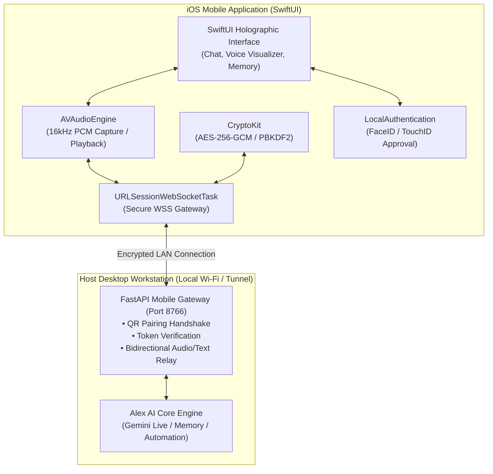

# iOS Platform Implementation Guide: iPhone & iPad Companion Client

**Document Version:** 1.0  
**Inspection Date:** 2026-11-03  
**Status:** `ACTIVE_PLATFORM_SPECIFICATION`  
**Target Devices:** iPhone (iOS 16, 17, 18), iPad (iPadOS 16, 17, 18)  
**Architecture Role:** Secure Mobile Companion Client  

---

## 1. System Integration Architecture

The iOS Companion Client enables users to converse with Alex on their mobile devices, review personal memories, monitor workstation hardware telemetry, and remotely authorize desktop actions.



---

## 2. Core iOS Subsystems & Technical Details

### 2.1 Audio Ingestion & Streaming via `AVAudioEngine`
- **Audio Format:** 16,000 Hz, 16-bit Mono Linear PCM (matching Gemini Live API requirements).
- **Audio Session Configuration:**
  ```swift
  let audioSession = AVAudioSession.sharedInstance()
  try audioSession.setCategory(.playAndRecord, mode: .voiceChat, options: [.defaultToSpeaker, .allowBluetooth])
  try audioSession.setActive(true)
  ```
- **Real-Time Capture Tap:** Attaches an input tap to `audioEngine.inputNode`, converts audio buffers to raw int16 PCM bytes, encrypts with AES-256-GCM, and forwards over WebSocket.

### 2.2 QR Code Pairing & Cryptographic Handshake
1. The user taps **Pair Device** on the mobile client, activating the iOS camera scanner (`AVCaptureMetadataOutput`).
2. The user scans the desktop HUD's pairing QR code containing the host LAN IP, port, and 8-character pairing secret.
3. The app executes PBKDF2 key derivation using Apple `CryptoKit`:
   ```swift
   let derivedKey = try PFKDF2.deriveKey(
       password: pairingCode.data(using: .utf8)!,
       salt: saltData,
       iterations: 200_000,
       variant: .sha256
   )
   ```
4. A secure handshake frame is exchanged, establishing a mutual trust relationship.

### 2.3 Remote Desktop Action Authorization with FaceID
When an action is classified as **High Risk** (e.g. system shutdown, modifying files, executing computer control automation):
1. The desktop host pauses execution and dispatches a push notification to the paired iOS device.
2. The iOS client presents a modal approval sheet detailing the target action, parameters, and risk level.
3. The user authenticates using **FaceID / TouchID** (`LAContext.evaluatePolicy`).
4. Upon biometric confirmation, a cryptographically signed approval token is returned to the desktop host, authorizing the action.

### 2.4 Compliance with Apple App Store Guidelines
- **Guideline 2.5.2 (Self-Executing Code):** Alex iOS Client does not download or execute native code. It operates as a remote client communicating with a desktop backend.
- **Guideline 5.1.1 (Data Privacy):** Audio streams are never stored on device and are transmitted solely to the user's authenticated desktop host or directly to Google Gemini APIs over TLS.
- **Guideline 5.1.2 (Background Audio):** Clearly adheres to standard VoIP/Voice Chat background execution rules.

