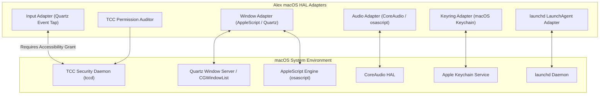

# macOS Platform Implementation Guide: Sonoma & Sequoia

**Document Version:** 1.0  
**Inspection Date:** 2026-11-03  
**Status:** `ACTIVE_PLATFORM_SPECIFICATION`  
**Target Architectures:** Apple Silicon (arm64: M1/M2/M3/M4), Intel (x86_64)  
**Target OS Versions:** macOS 14 Sonoma, macOS 15 Sequoia  

---

## 1. System Integration Architecture

macOS delivers high performance and battery efficiency, particularly on Apple Silicon. However, macOS enforces stringent security controls via **Transparency, Consent, and Control (TCC)** and gatekeeper policies.



---

## 2. macOS Core Subsystems & Technical Details

### 2.1 Transparency, Consent, and Control (TCC) Permissions
Before Alex can drive mouse/keyboard inputs or capture displays on macOS, the user must explicitly grant permissions in **System Settings**:
1. **Accessibility (`System Settings > Privacy & Security > Accessibility`):**
   - Required for synthetic typing (`pyautogui.write`), clicking, and hotkeys.
   - Without this grant, synthetic event taps fail silently without raising exceptions.
2. **Screen Recording (`System Settings > Privacy & Security > Screen Recording`):**
   - Required for `mss` display capture and visual AI understanding.
   - Without this grant, display capture returns an empty or desktop wallpaper canvas.
3. **Microphone (`System Settings > Privacy & Security > Microphone`):**
   - Required for voice audio streaming. Prompted natively by Electron/macOS on first capture.
4. **Camera (`System Settings > Privacy & Security > Camera`):**
   - Required for OpenCV (`cv2.VideoCapture`) webcam frame capture via AVFoundation. Prompted natively on first camera access.

### 2.2 Window Management via AppleScript & Quartz
- **Window Enumeration:** Uses Quartz Window Services (`CGWindowListCopyWindowInfo`) to enumerate on-screen windows.
- **Window Activation:** Uses AppleScript via `osascript` to bring target applications to the foreground:
  ```bash
  osascript -e 'tell application "Spotify" to activate'
  ```
- **Polite App Quit:** Asks the application politely to quit:
  ```bash
  osascript -e 'tell application "Spotify" to quit'
  ```

### 2.3 Audio Endpoints & Volume
- Output volume is adjusted via AppleScript:
  ```bash
  osascript -e 'set volume output volume 60'
  ```
- Hardware devices are enumerated via Electron / Web Audio API.

### 2.4 Credential Storage (Apple Keychain)
- All secrets and API tokens are persisted in the macOS Keychain under service name `Alex` via Python `keyring` (`keyring.backends.macOS.Keyring`).

### 2.5 Scheduled Reminders via `launchd`
- Scheduled tasks are written to user LaunchAgents at `~/Library/LaunchAgents/com.alex.reminder.<id>.plist` and loaded via `launchctl load`.
- Triggers native macOS notification banners at the scheduled calendar interval.

### 2.6 Packaging & Code Signing
- **Universal Binary:** PyInstaller packages a universal or arm64 native binary for Python.
- **DMG Package:** Electron Builder outputs a drag-and-drop `.dmg` installer with custom background and application symlink.
- **Notarization:** Production distribution requires signing with an Apple Developer ID Application certificate and notarization via `xcrun notarytool`.

