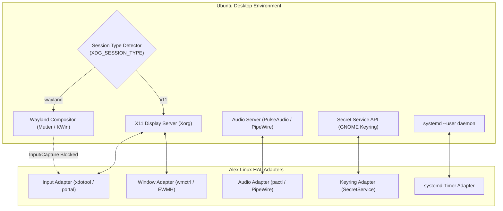

# Ubuntu Linux Platform Implementation Guide: 22.04 & 24.04 LTS

**Document Version:** 1.0  
**Inspection Date:** 2026-11-03  
**Status:** `ACTIVE_PLATFORM_SPECIFICATION`  
**Target Distributions:** Ubuntu 22.04 LTS, Ubuntu 24.04 LTS, Debian 12+ (64-bit x86_64 and ARM64)  

---

## 1. System Integration Architecture

Ubuntu Linux is a premier target operating system for developers and power users. Supporting Ubuntu requires handling the critical architectural difference between legacy **X11** sessions and modern **Wayland** compositors.



---

## 2. Core Linux Subsystems & Technical Details

### 2.1 The Wayland Security Model & Honest Limitation Reporting
- **The Wayland Constraint:** Wayland was designed to eliminate the security vulnerability where any client can snoop keystrokes or synthesize clicks into other application windows. Consequently, traditional automation libraries (`pyautogui`, `xdotool`, `mss`) fail silently under Wayland: they return success codes without moving the cursor or clicking.
- **Runtime Detection:** At startup, `core/platform_support.py` inspects `XDG_SESSION_TYPE`, `WAYLAND_DISPLAY`, and `DISPLAY`.
- **Honest Model Reporting:** If `session_type == "wayland"`, the limits are injected directly into the LLM prompt:
  ```text
  - You CANNOT type, click, press keys or move the mouse in this session: 
    this operating system uses Wayland, which does not permit one program to drive another.
  - Say plainly that this machine does not allow synthetic desktop control.
  ```
- **X11 Restoration:** To enable full desktop computer control on Ubuntu, the user can log out, click the gear icon on the GDM login screen, and select **"Ubuntu on Xorg"**.

### 2.2 Window Management under X11
- **Listing & Raising Windows:** Under X11, Alex calls `wmctrl -l` to enumerate windows and `wmctrl -ia <window_id>` or `xdotool windowactivate <window_id>` to bring an existing instance to the front without launching a duplicate process.
- **Polite App Quit:** Sends `SIGTERM` to the process or `wmctrl -c <window_id>` to prompt for unsaved changes.

### 2.3 Audio Integration via PipeWire / PulseAudio
- **Volume & Endpoints:** Interacts with the modern Linux audio subsystem using `pactl`:
  - Enumerate sinks: `pactl list sinks short`
  - Get volume: `pactl get-sink-volume @DEFAULT_SINK@`
  - Set volume: `pactl set-sink-volume @DEFAULT_SINK@ 50%`

### 2.4 Credential Storage (Secret Service API)
- Secrets are stored securely in GNOME Keyring or KWallet via the Python `keyring` library (`keyring.backends.SecretService.Keyring`).

### 2.5 Scheduled Reminders via `systemd --user`
- Reminders are registered as transient user systemd timers:
  `systemd-run --user --on-calendar="2026-11-03 16:00:00" notify-send "Reminder" "Meeting starting"`
- Survives application exit and triggers native desktop alerts at the exact scheduled time.

### 2.6 Packaging & Distribution
- **AppImage:** Single self-contained executable bundling Electron, React UI, Python runtime, and dependencies.
- **DEB Package:** Native Debian/Ubuntu package installing to `/opt/Alex` with desktop shortcut and `.desktop` entry.

