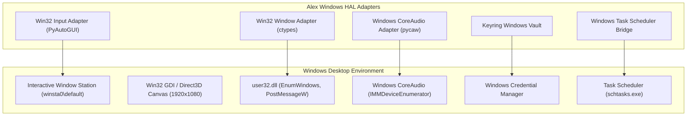

# Windows Platform Implementation Guide: Windows 10 & 11 (64-bit)

**Document Version:** 1.0  
**Inspection Date:** 2026-11-03  
**Status:** `ACTIVE_PLATFORM_SPECIFICATION`  
**Target OS:** Windows 10 (64-bit Build 19045+), Windows 11 (64-bit Build 22H2, 23H2, 24H2)  

---

## 1. System Integration Architecture

Windows is the primary desktop platform for Alex AI Desktop Assistant and the target operating system for physical release acceptance testing (33 Acceptance Protocols).

---

## 2. Windows Core Subsystems & Technical Details

### 2.1 Window Management & Process Protection
- **Window Enumeration:** Uses `ctypes.windll.user32.EnumWindows` and `GetWindowTextW`.
- **Window Activation (Focus):** Windows blocks background applications from stealing focus. Alex attaches the thread input queue via `user32.AttachThreadInput` before invoking `SetForegroundWindow` and `BringWindowToTop`.
- **Polite Termination:** Sends `WM_CLOSE` (via `user32.PostMessageW`) to top-level window handles instead of terminating processes violently with `taskkill /F`. This ensures that unsaved documents prompt standard save dialogs.
- **Process Immunity:** Refuses to send `WM_CLOSE` to the active Python sidecar, Electron shell, or launcher processes.

### 2.2 Audio Endpoints & Volume Control
- **CoreAudio Enumeration:** Queries physical audio endpoints via `IMMDeviceEnumerator`.
- **Device Filtering:** Windows retains disconnected devices with identical friendly names; Alex filters out `DEVICE_STATE_NOTPRESENT` and `DEVICE_STATE_UNPLUGGED`.
- **Volume Adjustment:** Uses `IAudioEndpointVolume` via `pycaw`. Changes are logged to the undo stack.

### 2.3 Credential Storage (Windows Credential Manager)
- Secrets (`gemini_api_key`, provider credentials) are stored in the Windows Credential Manager under the target name `Alex` via the `keyring` library (`keyring.backends.Windows.WinVaultKeyring`).
- API keys are never written to plaintext `.env` files or registry keys.

### 2.4 Enterprise AppLocker & GPO Considerations (`DEF-A07-001`)
- On domain-joined enterprise workstations, Active Directory Group Policy Objects (GPOs) may enforce AppLocker executable path rules that block child shell execution (`powershell.exe`).
- **Remediation:** Physical QA acceptance testing must run on a standalone, non-domain-joined Windows 11 machine outside enterprise GPO policies.

### 2.5 Packaging & Distribution
- **Sidecar Compilation:** PyInstaller compiles `backend/app/main.py` into a single standalone directory (`dist/alex-sidecar/`).
- **Installer Generation:** Electron Builder generates a signed NSIS installer executable (`Alex-Setup-0.1.0.exe`) with auto-updater manifest.

